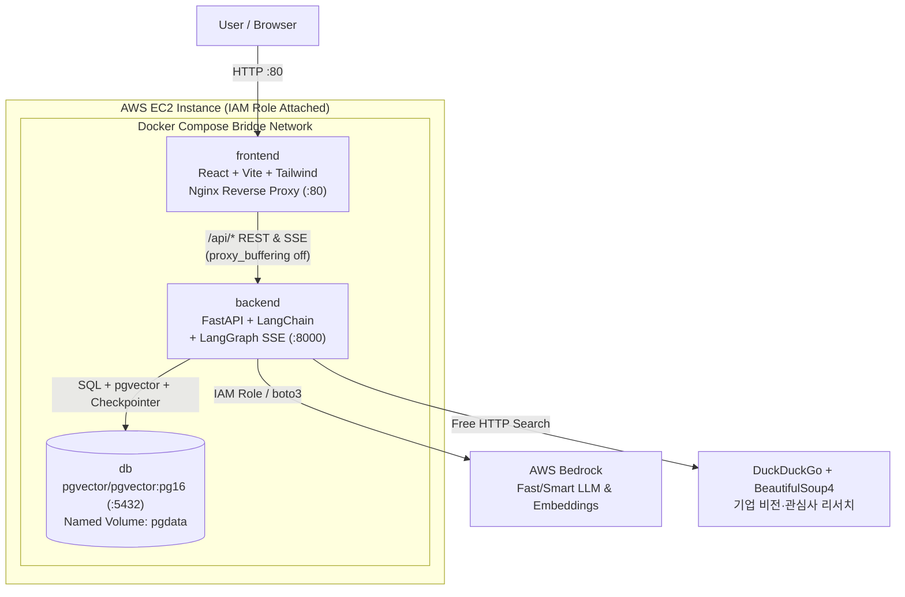
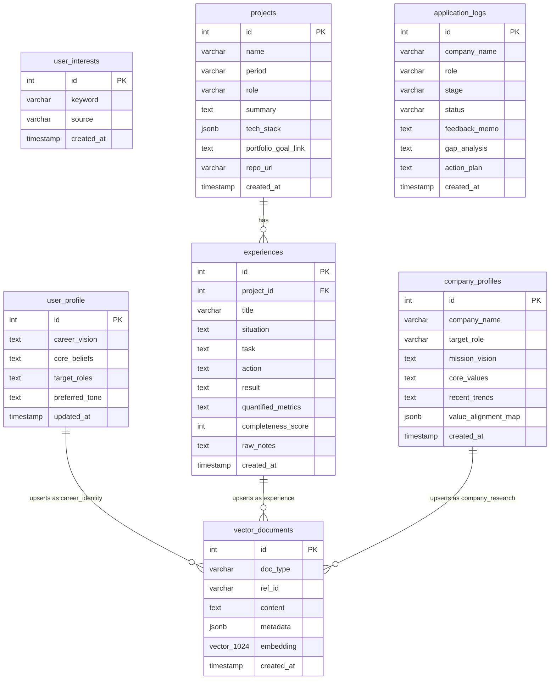
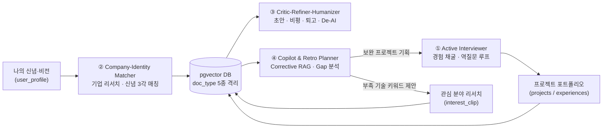
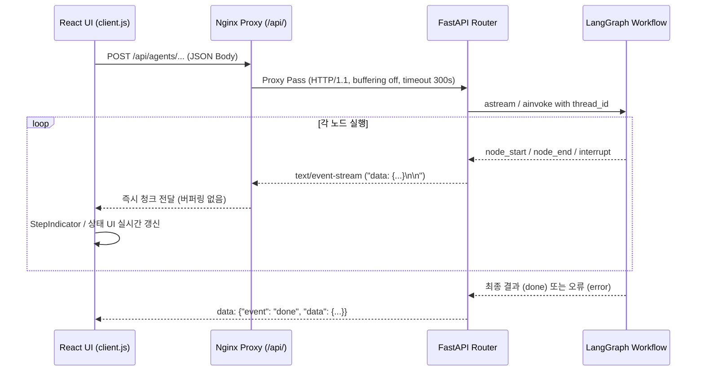

# ARCHITECTURE.md — 시스템 아키텍처 설계서

이 문서는 **개인화 커리어·포트폴리오 AI 에이전트 (`write-on-vibe-lab`)**의 인프라, 데이터, AI 에이전트(LangGraph), API/SSE 통신, 프론트엔드 및 보안 경계 아키텍처를 정리한 기술 설계 문서입니다.

---

## 1. 아키텍처 핵심 원칙 (Design Guardrails)

| 원칙 | 내용 |
| :--- | :--- |
| **Docker Self-Contained** | EC2 1대에 `docker-compose.yml`로 `frontend`, `backend`, `db(pgvector)` 3개 컨테이너만 운영합니다. RDS/S3 연동 복잡도를 제거하고 DB 영속성은 Docker Named Volume(`pgdata`)으로 보장합니다. |
| **AWS Bedrock Only** | OpenAI·Anthropic Direct·Tavily 등 유료 외부 API 키를 사용하지 않습니다. 모든 LLM(`ChatBedrockConverse`)과 임베딩(`BedrockEmbeddings`)은 `langchain-aws` + `boto3` 기본 자격 증명 체인(EC2 IAM Role)으로 호출합니다. |
| **RAG 데이터 엄격 격리** | 모든 벡터 검색은 `doc_types: list[str]` 필터를 강제하며 필터 없는 전체 검색을 금지합니다. 특히 우수 자소서 샘플(`jasoseo_sample`)의 사실이 지원자 경험(`experience`)에 혼입되지 않도록 원천 차단합니다. |
| **경량 UI & 실시간 SSE** | 1인 개인용 MVP로 인증/전역 상태 라이브러리(Redux/Zustand)를 배제하고 React 기본 Hook + `ReadableStream` SSE 파서로 에이전트 사고 과정을 실시간 시각화합니다. |

---

## 2. 인프라 & 컨테이너 아키텍처



### 컨테이너 구성 명세

| 서비스 | 이미지 / 런타임 | 노출 포트 | 기동 의존성 & 영속성 | 주요 역할 |
| :--- | :--- | :---: | :--- | :--- |
| **`frontend`** | Node 20 (빌드) → `nginx:alpine` | 호스트 `:80` → `:80` | `depends_on: backend` | 정적 SPA 서빙 및 `/api/` 리버스 프록시(SSE 버퍼링 비활성화) |
| **`backend`** | `python:3.11-slim` + Uvicorn | 내부 `:8000` (로컬 디버깅용 선택 매핑) | `depends_on: db (service_healthy)` | REST CRUD, 4대 LangGraph 에이전트 실행, SSE 스트리밍, 웹 검색 |
| **`db`** | `pgvector/pgvector:pg16` | Docker 내부 `:5432` 전용 | `healthcheck: pg_isready`, `pgdata` 볼륨 마운트 | 정형 테이블(6개) + 벡터 테이블(`vector_documents`) + LangGraph 체크포인트 |

---

## 3. 데이터 아키텍처 (PostgreSQL + pgvector)

정형 데이터, 1024차원 벡터 임베딩, LangGraph 대화 상태(`PostgresSaver`)를 **단일 PostgreSQL(`pgvector`) 인스턴스**에 통합하여 관리합니다.



### RAG `doc_type` 5종 격리 정책 (`backend/app/core/vector_store.py`)

| `doc_type` (Enum) | 원본 소스 | 활용 워크플로우 | 격리 / 안전 규칙 |
| :--- | :--- | :--- | :--- |
| `experience` | `experiences` / `projects` | ① 경험 채굴, ③ 자소서, ④ 코파일럿 | 자소서 작성 시 **유일한 사실(팩트·수치) 근거**로 사용 |
| `career_identity` | `user_profile` | ② 기업 매칭, ③ 자소서 | 프로필 수정 시 `ref_id` 기준 자동 Upsert |
| `company_research` | `company_profiles` | ② 기업 매칭, ③ 자소서 | 목표 기업 이념·비전·최근 동향 컨텍스트 제공 |
| `interest_clip` | 관심사 웹 리서치 선별 클립 | ④ 코파일럿 & 회고 | 과거 경험과 함께 최신 기술 트렌드 보강에 사용 |
| `jasoseo_sample` | `seeds/jasoseo_samples.json` | ③ 자소서 초안 | **문단 전개 구조·설득 논리 참고 전용** (샘플 경험/수치/기업명 차용 절대 금지) |

---

## 4. AI 모델 티어링 & LangGraph 4대 에이전트 아키텍처

### 4.1 AWS Bedrock 모델 티어 분리 (`backend/app/core/bedrock.py`)

| 티어 | 환경변수 | 기본 모델 예시 | 담당 작업 |
| :--- | :--- | :--- | :--- |
| **Fast Tier** | `BEDROCK_FAST_MODEL_ID` | `amazon.nova-lite-v1:0` | 의도 라우팅, STAR 추출, 완성도·관련성 채점 |
| **Smart Tier** | `BEDROCK_SMART_MODEL_ID` | `us.anthropic.claude-3-7-sonnet-20250219-v1:0` | 기업 3각 매칭, 자소서 초안·비평·퇴고, De-AI 교정, 취준 회고 분석 |
| **Embedding** | `BEDROCK_EMBED_MODEL_ID` | `cohere.embed-multilingual-v3` (1024차원) | 한국어 문서 벡터화 및 pgvector 코사인 유사도 검색 |

- 모든 구조화 출력은 `llm.with_structured_output(PydanticModel)`을 사용하며 JSON 파싱 실패 대비 최대 1회 재시도 가드레일을 포함합니다.

### 4.2 순환형(Closed-Loop) 에이전트 연결 구조



### 4.3 워크플로우별 노드 흐름 및 루프 안전장치 (Guardrails)

| 워크플로우 | 파일 | 노드 흐름 | 루프 제어 & 안전장치 |
| :--- | :--- | :--- | :--- |
| **① 경험 채굴** | `graphs/interview_graph.py` | `Extractor(STAR)` → `Gap Grader` → (`Interviewer` ⇄ 사용자 답변) → `Save Node` | `PostgresSaver` + `thread_id` 상태 유지. 사용자가 `force_save=true` 전달 시 완성도 점수와 무관하게 즉시 저장 탈출 |
| **② 기업 매칭** | `graphs/company_graph.py` | `Company Searcher` → `Identity & Portfolio Loader` → `Alignment Synthesizer` → `Save Node` | `[기업 비전/병목 ↔ 나의 신념 ↔ 증명 프로젝트]` 3각 매칭표 생성 후 DB + `company_research` 벡터 저장 |
| **③ 자소서 공방** | `graphs/cover_letter_graph.py` | `Multi-Source Retriever` → `Drafter` → `Critic` ⇄ `Refiner` → `De-AI Humanizer` | `revision_count == 2` 또는 `critic_score >= 85`이면 무조건 `de_ai_humanizer`로 전환(무한 루프 차단). `humanizer_changes` Diff 리포트 반환 |
| **④ 코파일럿 & 회고** | `graphs/copilot_graph.py` | `Router` → [모드 A: `Retriever` → `Relevance Grader` → (필요 시 웹 검색) → `Answer`] / [모드 B: `Gap Analyzer` → `Action Planner`] | Corrective RAG 웹 검색 Fallback은 요청당 **최대 1회** 제한. 회고 결과의 부족 키워드는 `user_interests`로 원클릭 추가 연동 |

---

## 5. API & 실시간 SSE 통신 프로토콜

### 5.1 SSE 스트리밍 시퀀스



### 5.2 공통 SSE 이벤트 스키마

- `node_start`: `{"event": "node_start", "node": "<node_name>", "message": "..."}`
- `node_end`: `{"event": "node_end", "node": "<node_name>", "data": {...}}`
- `interrupt`: `{"event": "interrupt", "thread_id": "...", "data": {"questions": [...], "completeness_score": 65}}`
- `done`: `{"event": "done", "data": {"final_text": "...", "diff_summary": [...]}}`
- `error`: `{"event": "error", "message": "..."}`

### 5.3 엔드포인트 맵

| 영역 | 메서드 & 경로 | 전송 방식 | 설명 |
| :--- | :--- | :---: | :--- |
| **Health** | `GET /api/health` | REST | 백엔드 기동 상태 확인 |
| **Profile** | `GET / PUT /api/profile` | REST | 신념·비전·선호 문체 조회/수정 (`career_identity` Upsert 포함) |
| **Interests** | `GET / POST / DELETE /api/interests` | REST | 관심 분야 키워드 CRUD |
| **Projects** | `GET / POST / PUT / DELETE /api/projects` | REST | 포트폴리오 프로젝트 CRUD |
| **Recap** | `POST /api/projects/{id}/recap` | REST | 프로젝트 소속 경험 기반 포트폴리오 Markdown 리캡 생성 |
| **Agent ①** | `POST /api/agents/interview/start`, `/reply` | SSE | 경험 채굴 역질문 시작·답변·강제저장(`force_save`) |
| **Agent ②** | `POST /api/agents/company/research` | SSE | 목표 기업 리서치 & 신념 3각 매칭 저장 |
| **Interest Search** | `POST /api/agents/interests/search`, `/clip` | SSE / REST | 관심사 뉴스·기술 검색 및 선택 클립 벡터 저장 |
| **Agent ③** | `POST /api/agents/cover-letter/generate` | SSE | 자소서 생성·비평·퇴고·De-AI Humanizer 실행 |
| **Agent ④** | `POST /api/agents/copilot/chat` | SSE | 과거 경험 + 관심사 + Corrective RAG 조언 채팅 |
| **Retrospect** | `POST /api/agents/applications/retrospect` | SSE | 취준 결과 저장 + Gap 분석 + 보완 액션 플랜 도출 |

---

## 6. 프론트엔드 아키텍처 (`frontend/`)

- **레이아웃:** 좌측 고정 사이드바(`Sidebar`: 나의 신념 요약, 프로젝트/경험 카운트, 관심사 태그) + 우측 5개 기능 뷰 전환 구조.
- **상태 관리:** 전역 스토어 없이 React `useState` / `useEffect` + [client.js](./frontend/src/api/client.js)의 `apiRequest()` / `streamSSE()` 조합으로 경량 유지.

| 화면 컴포넌트 | 역할 | 주요 연동 |
| :--- | :--- | :--- |
| `IdentityPortfolioPage.jsx` | 신념·비전·문체 편집, 프로젝트 카드, 포트폴리오 리캡 모달 | REST CRUD + Recap API |
| `ExperienceMinerPage.jsx` | 메모 입력, STAR 완성도 게이지(`StarMeter`), 역질문 채팅, `[이 상태로 저장하기]` | SSE + `thread_id` 재개 |
| `CompanyInterestPage.jsx` | 기업 리서치·3각 매칭 카드(상단) + 관심 키워드 검색·클립 저장(하단) | SSE + REST |
| `CoverLetterStudioPage.jsx` | 기업·문항 입력, 실시간 단계 표시기(`StepIndicator`), 최종본·De-AI 변경 리포트 | SSE |
| `CopilotRetroPage.jsx` | 프로젝트 Q&A 코파일럿 채팅 + 취준 결과 회고·보완 플랜·관심사 원클릭 추가 | SSE + REST |

---

## 7. 모노레포 디렉토리 구조

```text
write-on-vibe-lab/
├── docker-compose.yml              # frontend + backend + db(pgvector) 3-컨테이너 오케스트레이션
├── .env.example                    # 환경변수 템플릿 (실제 비밀값 미포함)
├── .gitignore                      # 민감 정보(.env, *.pem, .aws 등) 및 빌드 산출물 차단
├── ARCHITECTURE.md                 # 본 시스템 아키텍처 설계서
├── SECRETS.md                      # 비밀번호·패스워드·AWS 키 보안 관리 지침
├── README.md                       # 저장소 개요 및 빠른 시작 가이드
├── ai.md                           # 마스터 기획서
├── agents_md.md                    # 개발 에이전트 작업 지침서
├── .github/                        # Issue / PR 템플릿
├── backend/
│   ├── Dockerfile
│   ├── requirements.txt
│   └── app/
│       ├── main.py                 # FastAPI 앱, CORS, 라우터, lifespan
│       ├── config.py               # pydantic-settings 환경변수 로더
│       ├── core/                   # bedrock.py, database.py, vector_store.py
│       ├── schemas/                # Pydantic 입출력 & Structured Output 스키마
│       ├── tools/                  # web_search.py (DuckDuckGo + BS4)
│       ├── graphs/                 # interview / company / cover_letter / copilot
│       ├── api/                    # FastAPI REST & SSE 라우터
│       └── seeds/                  # jasoseo_samples.json
└── frontend/
    ├── Dockerfile                  # Node build -> Nginx multi-stage
    ├── nginx.conf                  # SPA fallback + /api/ SSE 리버스 프록시
    ├── package.json
    └── src/
        ├── api/client.js           # REST & ReadableStream SSE 클라이언트
        ├── components/             # 공용 UI 컴포넌트
        └── pages/                  # 5개 메인 페이지
```

---

## 8. 보안 및 운영 경계

- **네트워크 경계:** 외부에는 Nginx HTTP(`80`) 포트만 공개하고 PostgreSQL(`5432`)은 Docker 내부 네트워크로 격리합니다.
- **자격 증명 경계:** EC2 운영 환경에서는 코드나 파일에 AWS 키를 두지 않고 **EC2 IAM Role**을 통해 Bedrock 호출 권한만 최소 부여합니다.
- **비밀 정보 관리:** DB 비밀번호, `.env`, SSH `.pem` 키, 유출 대응 절차는 [SECRETS.md](./SECRETS.md)를 따릅니다.
