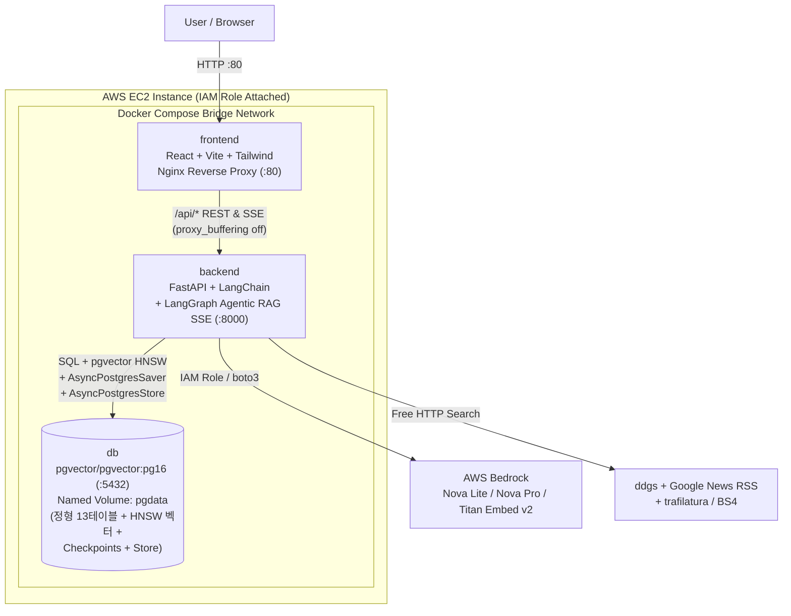
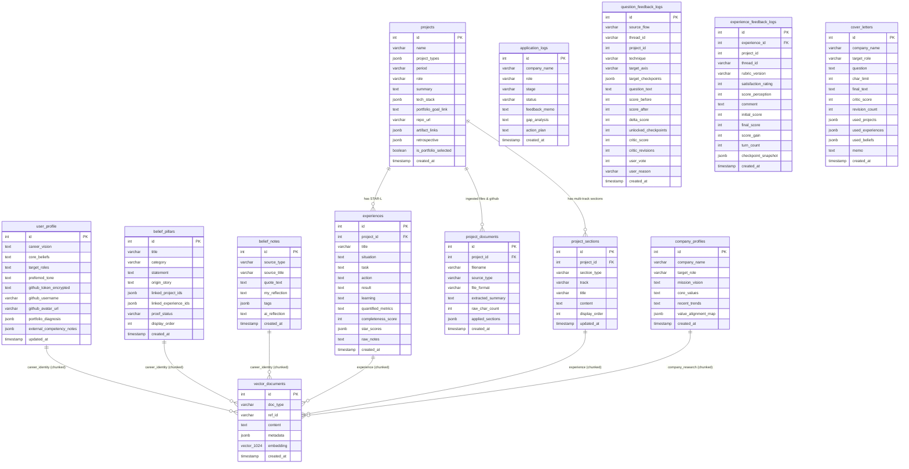

# ARCHITECTURE.md — 시스템 아키텍처 & AI(LLM · LangChain · LangGraph) 전체 설계서

이 문서는 **개인화 커리어·포트폴리오 AI 에이전트 (`write-on-vibe-lab`)**의 인프라, 데이터, **서비스 전체에서 사용되는 AWS Bedrock LLM · LangChain · LangGraph · RAG 인벤토리**, 품질 상승 루프(루프 A/B), API/SSE 통신, 7-페이지 프론트엔드 및 보안 경계 아키텍처를 정리한 기술 설계 문서입니다.

---

## 1. 아키텍처 핵심 원칙 (Design Guardrails)

| 원칙 | 내용 |
| :--- | :--- |
| **Docker Self-Contained** | EC2 1대에 `docker-compose.yml`로 `frontend`, `backend`, `db(pgvector)` 3개 컨테이너만 운영합니다. 외부 관리형 RDS/S3 없이 단일 Docker Named Volume(`pgdata`)으로 영속성을 보장합니다. |
| **AWS Bedrock Only** | OpenAI·Anthropic Direct·Tavily 등 유료 외부 API 키를 사용하지 않습니다. 모든 LLM(`ChatBedrockConverse`)과 임베딩(`BedrockEmbeddings`)은 `langchain-aws` + `boto3` 기본 자격 증명 체인(EC2 IAM Role)으로 호출합니다. |
| **RAG 데이터 엄격 격리** | 모든 벡터 검색은 `doc_types: list[str]` 필터를 강제하며 필터 없는 전체 검색을 금지합니다. 특히 우수 자소서 샘플(`jasoseo_sample`)의 사실이 지원자 경험(`experience`)에 혼입되지 않도록 프롬프트 + 코드 레벨 사후 검증으로 이중 차단합니다. |
| **측정 → 비평 → 개선 폐루프** | 모든 핵심 AI 호출은 `usage_metadata`/`stopReason`/`latencyMs` 텔레메트리를 기록하고, 질문(루프 A)·요약(루프 B)·자소서(Critic-Refiner) 모두 최대 2회 비평·수정 루프와 골든 평가셋(`backend/eval/`)을 갖춥니다. |
| **경량 UI & 실시간 SSE** | 1인 개인용 워크스페이스로 전역 상태 라이브러리(Redux/Zustand)를 배제하고 React 기본 Hook + `ReadableStream` SSE 파서로 에이전트 노드·도구 호출 과정을 실시간 시각화합니다. |

---

## 2. 인프라 & 컨테이너 아키텍처



### 컨테이너 구성 명세

| 서비스 | 이미지 / 런타임 | 노출 포트 | 기동 의존성 & 영속성 | 주요 역할 |
| :--- | :--- | :---: | :--- | :--- |
| **`frontend`** | Node 20 (빌드) → `nginx:alpine` | 호스트 `:80` → `:80` | `depends_on: backend` | 정적 SPA 서빙 및 `/api/` 리버스 프록시(SSE 버퍼링 비활성화) |
| **`backend`** | `python:3.11-slim` + Uvicorn | 내부 `:8000` | `depends_on: db (service_healthy)` | REST CRUD, LangGraph 4대 워크플로우 + Agentic RAG 코파일럿, 대화형 멀티턴 인터뷰 v3.0, 커리어 신념 카드(`belief_pillars`) 전 과정 연동, STAR-L 21지표(v2.1)·1,000 XP, 암호화 GitHub 계정/레포/PR·커밋 Diff/자동 생성 API, SSE 스트리밍 |
| **`db`** | `pgvector/pgvector:pg16` | Docker 내부 `:5432` 전용 | `healthcheck: pg_isready`, `pgdata` 볼륨 마운트 | 정형 테이블(13개) + HNSW 벡터(`vector_documents`) + 단기 기억(`checkpoints`) + 장기 기억(`store`, `store_vectors`) |

---

## 3. 데이터 아키텍처 (PostgreSQL + pgvector + LangGraph 2계층 기억)

단일 PostgreSQL(`pgvector`) 인스턴스에 **정형 테이블 13개(`belief_pillars`, `cover_letters`, `experience_feedback_logs` 포함) + HNSW 벡터 테이블 + LangGraph 단기/장기 기억 테이블**을 통합 관리합니다.



### LangGraph 2계층 기억 & 벡터 저장소 구성
- **벡터 저장소 (`vector_documents`):** Parent/Child 청킹(`ref_id::c0..cN`), `ix_vector_documents_embedding_hnsw` 코사인 HNSW 인덱스, 5종 `DocType` 엄격 격리(`experience`, `career_identity`, `company_research`, `jasoseo_sample`, `interest_clip`).
- **단기 기억 (`AsyncPostgresSaver` → `checkpoints` 등):** `interview_graph`와 `copilot_agent_graph`의 `thread_id`별 전체 State(메시지·도구 호출·결과) 자동 영속화.
- **장기 기억 (`AsyncPostgresStore` → `store`, `store_vectors`):** Titan Embed v2(1024차원) 인덱스가 연결된 사용자 서랍 `namespace=("default_user", "career_memories")`에 선호·시간 제약·목표를 새 대화창에서도 의미 검색으로 유지.

---

## 4. 서비스 전체 LLM · LangChain · LangGraph · RAG 인벤토리

### 4.1 AWS Bedrock 모델 티어링 (`backend/app/core/bedrock.py`)

| 모델 티어 | 환경변수 | 기본 AWS Bedrock 모델 ID | 기본 `max_tokens` | 담당 역할 |
| :--- | :--- | :--- | :---: | :--- |
| **Fast LLM** | `BEDROCK_FAST_MODEL_ID` | `amazon.nova-lite-v1:0` | `2048` | 빠른 구조화·판단·대화 의도 라우팅(`prepare_turn`)·21지표 근거 판별·질문 생성·질문 비평/리라이트(루프 A)·Evidence Map 추출·요약 3축 비평(루프 B)·쿼리 플래닝·Query Rewrite / HyDE·RAG 평가 생성기 |
| **Smart LLM** | `BEDROCK_SMART_MODEL_ID` | `amazon.nova-pro-v1:0` | `5000` | 고난도 합성·추론·작문: 인문·사회적 신념 카드 발굴/다듬기(`belief_pillars`), 기업 3각 매칭, 자소서 문항 해부·추천·초안·비평·퇴고·De-AI, 문서/GitHub 합성 & Auto-Repair(루프 B), Agentic RAG 코파일럿(도구 호출·설계 답변), 취준 회고 Gap 분석, **LLM-as-a-Judge 평가 채점자** |
| **Embedding** | `BEDROCK_EMBED_MODEL_ID` | `amazon.titan-embed-text-v2:0` | 1024차원 | Parent/Child 벡터 청크 임베딩, 쿼리/HyDE 임베딩, `AsyncPostgresStore` 장기 기억 벡터 인덱스 |

### 4.2 사용된 LangChain 핵심 부품 (`langchain`, `langchain-aws`, `langchain-text-splitters`)

| LangChain 부품 | 적용 모듈 | 역할 및 특징 |
| :--- | :--- | :--- |
| `ChatBedrockConverse` | [bedrock.py](backend/app/core/bedrock.py) | AWS Bedrock Converse API 통합 호출(IAM Role 자동 인증, Tool Calling 지원) |
| `BedrockEmbeddings` | [bedrock.py](backend/app/core/bedrock.py), [database.py](backend/app/core/database.py) | 1024차원 한국어/다국어 임베딩 (`asyncio.to_thread` 비동기 실행) |
| `ChatPromptTemplate` + 외부 `.txt` | [app/prompts/](backend/app/prompts/loader.py) (17개 파일) | `<role>/<rules>/<output_format>` 표준 태그로 프롬프트 외부화(`star_checkpoint_audit.txt`, `interview_intent_router.txt`, `interview_coach_reply.txt` 포함) 및 `@lru_cache` 로딩 |
| `with_structured_output(schema, include_raw=True)` | [bedrock.py](backend/app/core/bedrock.py) | Pydantic 구조화 출력 + `usage_metadata`/`stopReason`/`latencyMs` 텔레메트리 동시 수집 + JSON Schema 폴백 + `_repair_truncated_json()` 잘림 복구 |
| `LLMTelemetryTracker` (`contextvars`) | [bedrock.py](backend/app/core/bedrock.py) | 요청·그래프 단위 총 호출 수·입출력 토큰·지연시간·`max_tokens` 잘림 경고 집계 |
| `MarkdownHeaderTextSplitter` + `RecursiveCharacterTextSplitter` | [chunker.py](backend/app/core/chunker.py) | 620자 이하 단문 유지 / 장문 `500자·겹침 100자` Parent/Child 분할 + 출처 라벨(`source_label`) 태깅 |
| `trim_messages(strategy="last", start_on="human")` | [copilot_agent_graph.py](backend/app/graphs/copilot_agent_graph.py) | 체크포인트 전체 이력은 보존하고, 모델 입력만 최근 10개 메시지로 `tool_call–ToolMessage` 쌍을 깨지 않게 슬라이싱 |
| `@tool` + `llm.bind_tools()` | [copilot_tools.py](backend/app/tools/copilot_tools.py), [copilot_agent_graph.py](backend/app/graphs/copilot_agent_graph.py) | 6종 전용 도구(RAG 전략 검색·STAR-L 1,000 XP/미증명 신념/회고 Try·기업·웹·장기기억 저장/조회) 자율 선택 실행 |

### 4.3 사용된 LangGraph 워크플로우 & 에이전트 전체 맵 (`langgraph`, `langgraph-checkpoint-postgres`)

| 기능 / 화면 | 파일 | 그래프 패턴 & 핵심 노드 | LLM 티어 | 기억 / 상태 영속화 | 가드레일 / 품질 루프 |
| :--- | :--- | :--- | :---: | :--- | :--- |
| **1. 신념** | [beliefs.py](backend/app/api/beliefs.py) | REST + Direct Structured Chain (**인문·사회적 커리어 신념 카드 `belief_pillars`** AI 발굴·다듬기 + 일상 회고 심화) | Smart | `belief_pillars`(단일 진실 원천) → `user_profile.core_beliefs` 자동 동기화 + `belief_notes` + `career_identity` 청킹 벡터 | 4대 카테고리(`human_value`, `social_impact`, `career_calling`, `tech_and_people`), 레거시 폴백 매핑, `verified`/`needs_proof` 증명 추적 |
| **2. 포트폴리오** | [portfolio_manager.py](backend/app/tools/portfolio_manager.py)<br>[github.py](backend/app/api/github.py)<br>[github_analyzer.py](backend/app/tools/github_analyzer.py)<br>[star_rubric.py](backend/app/core/star_rubric.py) | **루프 B 파이프라인:** Evidence Map(Map) → 트랙 합성(Reduce) → 3축 Verifier/Repair<br>**STAR-L 1,000 XP 집계:** 대표 4개 프로젝트 × 250 XP(체감 가중치 100/80/50/20%)<br>**GitHub 계정 연동:** 암호화 PAT 저장 · 내 Public/Private 레포 조회 · 미연결 감지 · PR/커밋 Diff | Fast + Smart | `projects` (`is_portfolio_selected`), `project_sections`, `user_profile.github_token_encrypted`, `experience` 청킹 벡터 | **루프 B 최대 2회**(환각 수치 코드 검사 + 중복률 `< 0.42` + 섹션 네이밍 규칙)<br>불러오기 시 자동 경험 생성 차단, 토큰 평문 미노출 |
| **3. 경험 채굴 (Active Interviewer v3.0)** | [interview_graph.py](backend/app/graphs/interview_graph.py)<br>[star_rubric.py](backend/app/core/star_rubric.py)<br>[rubrics/rubric_v2.1.json](backend/app/rubrics/rubric_v2.1.json) | **대화형 멀티턴 LangGraph `StateGraph` (HITL):** `load_project_context` → `prepare_turn`(4갈래 의도 라우터: `answer`/`replace_question`/`ask_coach`/`save`) → `extract_star` → `grade_gaps`(21지표 v2.1) → (`generate_questions` / `coach_reply` ⇄ 사용자) → `save_experience` | Fast | **`AsyncPostgresSaver` (`thread_id`)** + `chat_messages` + `focus_context`(GitHub Diff) + `question_feedback_logs` + `experience_feedback_logs` | `recursion_limit=12`, **12종 하드 캡 + Quote Grounding(`≥0.52`)**, **GitHub Diff `code_anchor` 1순위 근거**, **보수적 루프 A**, 단일 슬롯 질문 교체, 경험 CRUD·재채점 & 프로젝트 역반영 |
| **4. 기업 리서치** | [company_graph.py](backend/app/graphs/company_graph.py) | **LangGraph `StateGraph` (4-Node Pipeline):** `query_planner` → `company_searcher` → `identity_portfolio_loader`(`belief_pillars` 1급 로드) → `alignment_synthesizer` → `save_company_profile` | Fast + Smart | `company_profiles` + `company_research` 청킹 벡터 | 웹 타임아웃 격리, 출처 번호 `[1]` 인용, JD 1급 근거 우선 반영 |
| **5. 자소서 공방** | [cover_letter_graph.py](backend/app/graphs/cover_letter_graph.py) | **2단계 HITL + LangGraph `StateGraph` (Critic-Refiner Loop):** Step1 `recommend`(프로젝트·STAR-L·**`belief_pillars` 추천**) → Step2 `multi_source_retriever`(선택 DB 팩트 + **`belief_pillars` 1급 주입** + 4종 `doc_type` Hybrid+MMR) → `drafter` → (`critic` `[신념 연결]` ⇄ `refiner`) → `de_ai_humanizer` | Smart | `cover_letters` 보관함 자동 저장(**`used_beliefs` 포함**) + 선택 DB 팩트 직접 주입 | 유효 ID 코드 검증, `refiner`에서 `identity_docs`/`company_docs` 보존, `revision_count >= 2` 또는 `critic_score >= 85` 전환, AI 클리셰·샘플 수치 코드 검증 |
| **6. 지원 회고** | [copilot_graph.py](backend/app/graphs/copilot_graph.py) | **LangGraph `StateGraph` (3-Node):** `load_retro_context` → `analyze_gap_and_plan` → `save_application_log` | Smart | `application_logs` | STAR-L 1,000 XP·약점 대조 + 코파일럿 주제 원클릭 전달 |
| **7. 프로젝트 코파일럿** | [copilot_agent_graph.py](backend/app/graphs/copilot_agent_graph.py)<br>[copilot_graph.py](backend/app/graphs/copilot_graph.py) | **청사진:** `propose_new_project_blueprints`(실시간 STAR-L 21지표 `checkpoint_heatmap` + 미증명 신념 + 회고 Try + 웹 검색) + **GitHub 새 레포 자동 생성·README 커밋·연결**<br>**채팅 (Agentic RAG ReAct `MessagesState`):** `START → model ⇄ tools → stop → END` | Fast + Smart | **단기:** `AsyncPostgresSaver` (`thread_id`) + `trim_messages`<br>**장기:** `AsyncPostgresStore` (`namespace`) | **2중 상한:** `tool_count >= 4 → stop` + `recursion_limit=14`, 웹 검색 턴당 1회, 검색 전략 에스컬레이션(`hybrid`→`rewrite`→`hyde`), 장기 기억 PII 차단 |
| **오프라인 정량 평가** | [eval/run_eval.py](backend/eval/run_eval.py)<br>[eval/run_rubric_eval.py](backend/eval/run_rubric_eval.py)<br>[eval/run_quality_eval.py](backend/eval/run_quality_eval.py) | RAG 15문항 + **STAR-L 21지표 15건 캘리브레이션(5대 지표: `Spearman ρ=0.9543`)** + 루프 A(10종)/루프 B(6종) 전후 비교 러너 | Lite(생성) + Pro(채점) | 격리 태그(`eval_corpus`) 실행 후 자동 정리 | 생성 모델 ≠ 채점 모델 원칙, `v2.0` vs `v2.1` 회귀 검증 게이트 |

### 4.4 RAG 검색 엔진 v2 (`backend/app/core/vector_store.py`)
- **격리 정책:** `validate_doc_types()`로 `doc_types` 미지정 전체 검색 원천 차단.
- **검색 전략 4종:** `basic` (코사인) / `hybrid` (코사인 + 한국어 2-gram Okapi BM25 → RRF `k=60`) / `rewrite` (Fast LLM 질문 재작성) / `hyde` (가상 답변 임베딩 검색 후 즉시 폐기).
- **품질 필터:** `max_distance` 거리 임계값(노이즈 차단) + `mmr_rerank` (`lambda_mult=0.65`, 프로젝트·섹션 다양성) + `format_hits_with_citations()` 표준 출처 태그.

---

## 5. API & 실시간 SSE 통신 프로토콜

### 5.1 공통 SSE 이벤트 스키마 (`backend/app/api/sse.py`)
- `node_start`: `{"event": "node_start", "node": "<node_name>", "message": "..."}`
- `node_end`: `{"event": "node_end", "node": "<node_name>", "data": {...}}` *(코파일럿의 경우 `tool_calls`, `tool_count`, `latest_tools` 포함)*
- `interrupt`: `{"event": "interrupt", "thread_id": "...", "data": {"questions": [...], "structured_questions": [...], "assistant_message": "...", "chat_messages": [...], "completeness_score": 45, "star_scores": {...}, "last_unlocked_checkpoints": 3}}`
- `done`: `{"event": "done", "data": {..., "telemetry": {...}}}`
- `error`: `{"event": "error", "message": "..."}`

### 5.2 주요 엔드포인트 맵

| 영역 | 메서드 & 경로 | 전송 방식 | 설명 |
| :--- | :--- | :---: | :--- |
| **Health / Profile** | `GET /api/health`, `GET / PUT /api/profile` | REST | 헬스체크, 비전·직무·선호 문체 (`career_identity` 청킹 업서트) |
| **Beliefs & Journal** | `CRUD /api/beliefs/pillars`, `POST /api/beliefs/pillars/discover`, `/{id}/sharpen`, `CRUD /api/beliefs/notes`, `/reflect`, `/synthesize-identity` | REST | **인문·사회적 커리어 신념 카드(`belief_pillars`)** CRUD·AI 발굴·다듬기(`core_beliefs` 자동 동기화) + 일상 회고 저널 |
| **GitHub Integration** | `GET /api/github/status`, `PUT / DELETE /api/github/token`, `GET /api/github/repos`, `POST /api/github/repos` | REST | **GitHub PAT 암호화 저장·검증·해제**, 내 Public/Private 레포 목록·미연결 감지, **새 GitHub 레포 생성·초기 README 커밋·프로젝트 자동 연결** |
| **Projects & Mastery** | `GET /api/projects/portfolio-mastery`, `PUT /api/projects/portfolio-selection`, `CRUD /api/projects`, `CRUD /{id}/sections` | REST | 대표 4개 프로젝트 선택·1,000 XP 마스터리·21지표 히트맵, 멀티트랙 프로젝트·섹션 관리 |
| **Doc / GitHub / Reverse-Sync** | `POST /api/projects/analyze-document`, `/analyze-github/stream`, `/{id}/sync-github`, `/{id}/github-activity`, `/{id}/github-diff-context`, `/{id}/sync-from-experience/{exp_id}`, `/{id}/apply-updates` | Multipart / SSE / REST | 루프 B 적용 문서/GitHub 분석(저장 토큰 자동 사용), 온디맨드 PR·커밋 Diff 조회, 역질문 결과 프로젝트 섹션 역반영 |
| **Experiences & Agent ①** | `CRUD /api/experiences`, `POST /api/agents/interview/start`, `/reply`, `GET /api/agents/interview/history/{thread_id}`, `POST /api/agents/question-feedback`, `/experience-feedback`, `GET /api/agents/experience-mining/metrics` | REST / SSE | 대화형 멀티턴 v3.0(의도 라우팅·질문 교체·이력 복원), STAR-L 21지표(v2.1) 채점, 2중 피드백 및 문항 분석 |
| **Agent ② (Company)** | `POST /api/agents/company/research`, `GET / DELETE /api/companies` | SSE / REST | 4관점 멀티소스 리서치 & 신념 카드(`belief_pillars`) 3각 매칭 |
| **Agent ③ (Cover Letter)** | `POST /api/agents/cover-letter/recommend`, `/generate`, `CRUD /api/cover-letters`, `GET/POST /api/samples` | REST / SSE | 문항 해부·소재+신념 추천 → 3축 융합·`[신념 연결]` 비평·퇴고·De-AI + 자소서 보관함(`used_beliefs`) CRUD |
| **Agent ④ (Retrospect)** | `POST /api/agents/applications/retrospect`, `GET / DELETE /api/applications` | SSE / REST | STAR-L 마스터리 기반 Gap 분석 & 코파일럿 주제 연계 |
| **Agent ④ (Copilot v2)** | `POST /api/agents/copilot/propose-projects`, `/chat`, `GET /history/{thread_id}`, `GET / DELETE /memories` | REST / SSE | STAR-L 21지표·미증명 신념 청사진 추천 + Agentic RAG ReAct 채팅(단기 `thread_id` & 장기 기억 서랍 CRUD) |

---

## 6. 프론트엔드 아키텍처 (`frontend/`)

- **레이아웃:** 좌측 고정 사이드바(`Sidebar.jsx`) + 우측 **7개 독립 기능 뷰** 전환 구조 (군더더기 설명 및 괄호 제거한 간결 UI).
- **상태 관리:** React 기본 Hook + [client.js](./frontend/src/api/client.js) (`apiRequest()` / `streamSSE()`) + 섹션 전환·멀티턴 인터뷰 세션 복원용 `localStorage`/`sessionStorage`.

| 순서 | 화면 컴포넌트 | 역할 |
| :---: | :--- | :--- |
| 1 | `IdentityBeliefsPage.jsx` | **인문·사회적 커리어 신념 카드(`belief_pillars`)** CRUD·AI 발굴·다듬기(단일 진실 원천) + 비전/직무/선호 문체 + 일상 회고 저널 |
| 2 | `IdentityPortfolioPage.jsx` | **STAR-L 1,000 XP 마스터리 보드** + **GitHub 계정 연동·내 레포 브라우저(`GitHubAccountBrowser.jsx`)** + 멀티트랙 프로젝트 워크스페이스 |
| 3 | `ExperienceMinerPage.jsx` | **대화형 멀티턴 v3.0 채굴 채팅**(질문 교체·빠른 조향 칩·이력 복원) + GitHub PR·커밋 Diff 앵커링 + 21지표 실시간 감사표 + 2중 피드백 + 수정·재채점·프로젝트 역반영 |
| 4 | `CompanyInterestPage.jsx` | 목표 기업 4관점 멀티소스 리서치 + 출처 인용 & 신념 3각 매칭 |
| 5 | `CoverLetterStudioPage.jsx` | 자소서 공방(문항 해부 → 프로젝트·STAR-L·**신념 카드** 선택 → 3축 융합·비평·퇴고·De-AI) + 자소서 보관함(`used_beliefs` 표시·편집·메모) |
| 6 | `ApplicationRetroPage.jsx` | 지원 현황 통계 + Gap 분석 + 코파일럿 원클릭 연계 |
| 7 | `ProjectCopilotPage.jsx` | 실시간 STAR-L 1,000 XP·취약 지표·미증명 신념 칩 + 청사진 추천(**GitHub 새 레포 자동 생성 토글**) + Agentic RAG 코파일럿 |

---

## 7. 모노레포 디렉토리 구조

```text
write-on-vibe-lab/
├── docker-compose.yml                  # frontend + backend + db(pgvector) 3-컨테이너
├── README.md                           # 프로젝트 개요 & 빠른 시작
├── EXPERIENCE_MINING_ARCHITECTURE.md   # ★ 핵심 엔진: 경험 채굴 v3.0 · STAR-L v2.1 · 1,000 XP 심층 설계서
├── ARCHITECTURE.md                     # 본 시스템 아키텍처 & AI(LLM·LangChain·LangGraph) 설계서
├── WORKFLOWS.md                        # LangGraph 워크플로우 & 루브릭 명세서
├── LANGCHAIN_LANGGRAPH_UPGRADE.md      # LangChain/LangGraph/RAG 4-Phase 고도화 기록
├── QUALITY_LOOPS_PLAN.md               # 질문(루프 A)·요약(루프 B) 품질 상승 루프 설계 및 현황
├── DEPLOY_EC2.md                       # AWS EC2 배포 & E2E/영속성 검증 매뉴얼
├── SECRETS.md                          # 비밀번호·AWS 키·GitHub PAT 보안 관리 지침
├── scripts/                            # deploy_ec2.sh, e2e_verify.py
├── backend/
│   ├── Dockerfile / requirements.txt
│   ├── eval/                           # 골든 평가셋 4종(RAG 15 / 루브릭 15 / 질문 10 / 요약 6) + 평가 러너 3종
│   ├── tests/                          # 단위 테스트 60건 (10개 모듈: STAR-L v2.1 · 대화형 인터뷰 · 신념/코파일럿 · GitHub 통합 · RAG v2 · 루프 A/B)
│   └── app/
│       ├── main.py / config.py
│       ├── rubrics/                    # 버전 관리형 체크표 번들 (rubric_v2.0.json, rubric_v2.1.json)
│       ├── prompts/                    # 외부 프롬프트 템플릿 17종 (<role>/<rules>/<output_format>) + loader.py
│       ├── core/                       # bedrock.py(관측성), database.py(13테이블/HNSW/Saver/Store), token_crypto.py(PAT 암호화),
│       │                               # chunker.py, vector_store.py(BM25+RRF/MMR/Rewrite/HyDE), project_templates.py,
│       │                               # star_rubric.py(21지표 하이브리드/1,000 XP), question_critic.py(루프A), summary_verifier.py(루프B)
│       ├── schemas/                    # Pydantic 입출력 스키마
│       ├── tools/                      # web_search, document_parser, github_analyzer(계정·레포·PR/Diff·생성), portfolio_manager, copilot_tools(@tool 6종)
│       ├── graphs/                     # interview_graph, company_graph, cover_letter_graph, copilot_graph, copilot_agent_graph
│       ├── api/                        # FastAPI REST & SSE 라우터 (beliefs, github, projects, experiences, agents 등)
│       ├── scripts/                    # verify_bedrock.py, reindex_vectors.py
│       └── seeds/                      # jasoseo_samples 시드 로더
└── frontend/
    ├── Dockerfile / nginx.conf / package.json
    └── src/
        ├── api/client.js
        ├── components/                 # Sidebar, PortfolioDiagnosisPanel(1,000 XP), GitHubAccountBrowser, ProjectWorkspaceView, StarMeter(21지표),
        │                               # ExperienceDetailModal(수정·재채점), ExperienceProjectSyncModal, GitHubActivityPickerModal
        └── pages/                      # 7개 독립 페이지
```

---

## 8. 보안 및 운영 경계

- **네트워크 경계:** 외부에는 Nginx HTTP(`80`) 포트만 공개하고 PostgreSQL(`5432`)과 FastAPI(`8000`)는 Docker 내부 네트워크로 격리합니다.
- **자격 증명 경계:** EC2 운영 환경에서는 코드나 파일에 AWS 키를 두지 않고 **EC2 IAM Role**을 통해 Bedrock 호출 권한만 최소 부여합니다.
- **GitHub PAT 암호화 저장:** UI에서 연결한 GitHub PAT는 [token_crypto.py](backend/app/core/token_crypto.py)의 인증 암호화(`SHA256-CTR + HMAC-SHA256`, `enc1:` 포맷)로 암호화되어 `user_profile.github_token_encrypted`에 저장되며, API 응답에는 마스킹 힌트 외 평문을 절대 반환하지 않습니다.
- **장기 기억 PII 보호:** `save_career_memory` 도구에 비밀번호·연락처·주민번호·계좌/카드번호 저장을 차단하는 코드 레벨 정규식 가드레일을 적용합니다.
- **비밀 정보 관리:** DB 비밀번호, `.env`, `APP_SECRET_KEY`, SSH `.pem` 키, 개인 자소서 시드(`*.local.json`) 관리는 [SECRETS.md](./SECRETS.md)를 따릅니다.
