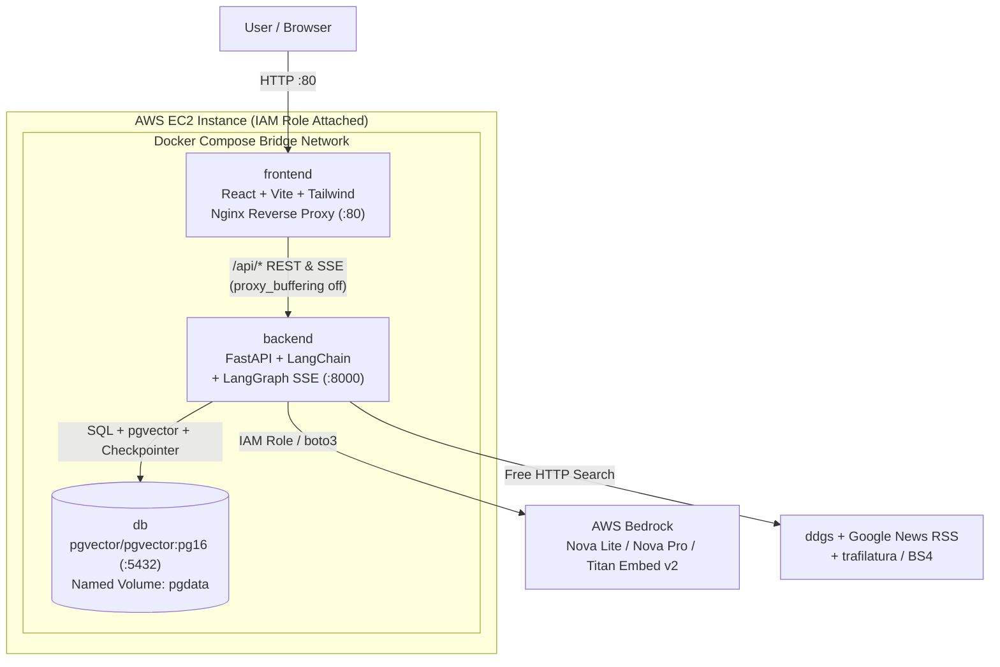
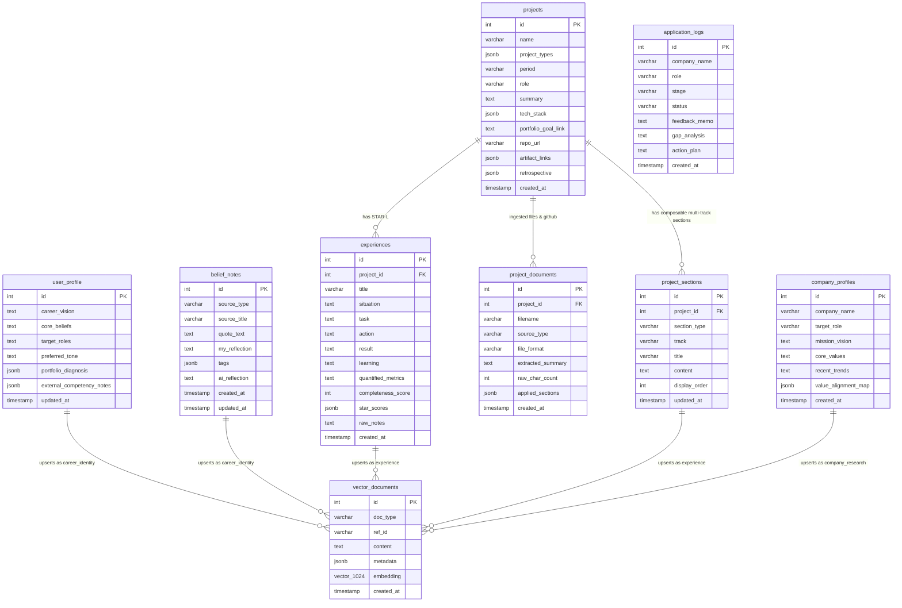
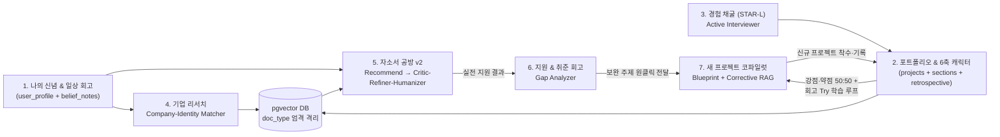
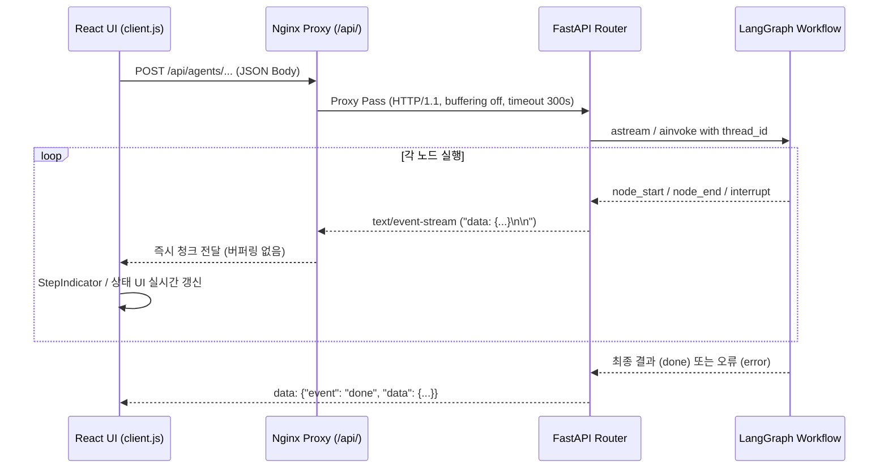

# ARCHITECTURE.md — 시스템 아키텍처 설계서

이 문서는 **개인화 커리어·포트폴리오 AI 에이전트 (`write-on-vibe-lab`)**의 인프라, 데이터, AI 에이전트(LangGraph), 평가 루브릭, API/SSE 통신, 7-페이지 프론트엔드 및 보안 경계 아키텍처를 정리한 기술 설계 문서입니다.

---

## 1. 아키텍처 핵심 원칙 (Design Guardrails)

| 원칙 | 내용 |
| :--- | :--- |
| **Docker Self-Contained** | EC2 1대에 `docker-compose.yml`로 `frontend`, `backend`, `db(pgvector)` 3개 컨테이너만 운영합니다. 외부 관리형 RDS/S3 없이 단일 Docker Named Volume(`pgdata`)으로 영속성을 보장합니다. |
| **AWS Bedrock Only** | OpenAI·Anthropic Direct·Tavily 등 유료 외부 API 키를 사용하지 않습니다. 모든 LLM(`ChatBedrockConverse`)과 임베딩(`BedrockEmbeddings`)은 `langchain-aws` + `boto3` 기본 자격 증명 체인(EC2 IAM Role)으로 호출합니다. |
| **RAG 데이터 엄격 격리** | 모든 벡터 검색은 `doc_types: list[str]` 필터를 강제하며 필터 없는 전체 검색을 금지합니다. 특히 우수 자소서 샘플(`jasoseo_sample`)의 사실이 지원자 경험(`experience`)에 혼입되지 않도록 원천 차단합니다. |
| **경량 UI & 실시간 SSE** | 1인 개인용 워크스페이스로 전역 상태 라이브러리(Redux/Zustand)를 배제하고 React 기본 Hook + `ReadableStream` SSE 파서로 에이전트 사고 과정을 실시간 시각화합니다. |

---

## 2. 인프라 & 컨테이너 아키텍처



### 컨테이너 구성 명세

| 서비스 | 이미지 / 런타임 | 노출 포트 | 기동 의존성 & 영속성 | 주요 역할 |
| :--- | :--- | :---: | :--- | :--- |
| **`frontend`** | Node 20 (빌드) → `nginx:alpine` | 호스트 `:80` → `:80` | `depends_on: backend` | 정적 SPA 서빙 및 `/api/` 리버스 프록시(SSE 버퍼링 비활성화) |
| **`backend`** | `python:3.11-slim` + Uvicorn | 내부 `:8000` (로컬 디버깅용 선택 매핑) | `depends_on: db (service_healthy)` | REST CRUD, 4대 LangGraph 에이전트, 5축 STAR-L / 6축 캐릭터 평가, 문서/GitHub 파서, SSE 스트리밍 |
| **`db`** | `pgvector/pgvector:pg16` | Docker 내부 `:5432` 전용 | `healthcheck: pg_isready`, `pgdata` 볼륨 마운트 | 정형 테이블(9개) + 벡터 테이블(`vector_documents`) + LangGraph 체크포인트 |

---

## 3. 데이터 아키텍처 (PostgreSQL + pgvector)

정형 데이터, 1024차원 벡터 임베딩, LangGraph 대화 상태(`AsyncPostgresSaver`)를 **단일 PostgreSQL(`pgvector`) 인스턴스**에 통합하여 관리합니다.



> 참고: 레거시 호환을 위해 `user_interests` 테이블과 `DocType.INTEREST_CLIP` Enum은 DB 스키마에 유지되지만, UI·워크플로우는 **신념 저널 + 기업 리서치 + 캐릭터 약점 기반 코파일럿** 중심으로 단순화되었습니다.

### RAG `doc_type` 격리 정책 (`backend/app/core/vector_store.py`)

| `doc_type` (Enum) | 원본 소스 | 활용 워크플로우 | 격리 / 안전 규칙 |
| :--- | :--- | :--- | :--- |
| `experience` | `experiences`, `project_sections` | ① 경험 채굴, ③ 자소서 공방, ④ 새 프로젝트 코파일럿 | 자소서 작성 시 **유일한 사실(팩트·수치) 근거**로 사용 (임베딩 선행 실행으로 DB 세션 오염 방지) |
| `career_identity` | `user_profile`, `belief_notes` | ② 기업 리서치, ③ 자소서 공방, ④ 새 프로젝트 코파일럿 | 프로필·일상 회고 저널 수정 시 `ref_id` 기준 자동 Upsert |
| `company_research` | `company_profiles` | ② 기업 리서치, ③ 자소서 공방, ④ 새 프로젝트 코파일럿 | 목표 기업 이념·비전·최근 동향·3각 매칭 컨텍스트 제공 |
| `jasoseo_sample` | `seeds/jasoseo_samples.json` (+ 로컬/UI 등록) | ③ 자소서 공방 초안 | **문단 전개 구조·설득 논리 참고 전용** (샘플 경험·수치·기업명 차용 절대 금지) |
| `interest_clip` | 레거시 호환용 예약 | — | 필터 강제 Enum 유지 |

---

## 4. AI 모델 티어링 & 평가 루브릭 · LangGraph 아키텍처

> 각 에이전트별 상세 노드 다이어그램, 상태 전이, 5축 STAR-L / 6축 캐릭터 루브릭 및 조건부 분기 규약은 [WORKFLOWS.md](./WORKFLOWS.md)에 별도로 정리되어 있습니다.

### 4.1 AWS Bedrock 모델 티어 분리 (`backend/app/core/bedrock.py`)

| 티어 | 환경변수 | 기본 모델 ID | 기본 `max_tokens` | 담당 작업 |
| :--- | :--- | :--- | :---: | :--- |
| **Fast Tier** | `BEDROCK_FAST_MODEL_ID` | `amazon.nova-lite-v1:0` | `2048` | 쿼리 플래닝, STAR-L 추출, 5축 BARS 채점, DDI/Bar-Raiser 역질문 생성, Corrective RAG 충분성 평가 |
| **Smart Tier** | `BEDROCK_SMART_MODEL_ID` | `amazon.nova-pro-v1:0` | `5000` | 기업 3각 매칭, 6축 캐릭터 진단, 자소서 문항 해부·추천·초안·비평·퇴고·De-AI, 문서/GitHub 합성, 프로젝트 회고, 코파일럿 청사진·채팅, 취준 회고 |
| **Embedding** | `BEDROCK_EMBED_MODEL_ID` | `amazon.titan-embed-text-v2:0` | 1024차원 | 한국어/다국어 문서 벡터화 및 pgvector 코사인 유사도 검색 |

- **Structured Output 안정성 가드레일 (`ainvoke_structured`):** 1차 Native Tool-Calling(`with_structured_output`) → 실패 시 2차 명시적 JSON Schema 프롬프트 재시도(최대 2회) → `max_tokens` 잘림 시 `_repair_truncated_json()` 자동 복구 및 간결화 힌트 삽입.

### 4.2 순환형(Closed-Loop) 에이전트 & 학습 루프 연결 구조



---

## 5. API & 실시간 SSE 통신 프로토콜

### 5.1 SSE 스트리밍 시퀀스



### 5.2 공통 SSE 이벤트 스키마 (`backend/app/api/sse.py`)

- `node_start`: `{"event": "node_start", "node": "<node_name>", "message": "..."}`
- `node_end`: `{"event": "node_end", "node": "<node_name>", "data": {...}}`
- `interrupt`: `{"event": "interrupt", "thread_id": "...", "data": {"questions": [...], "structured_questions": [...], "completeness_score": 65, "star_scores": {...}}}`
- `done`: `{"event": "done", "data": {...}}`
- `error`: `{"event": "error", "message": "..."}`

### 5.3 엔드포인트 맵

| 영역 | 메서드 & 경로 | 전송 방식 | 설명 |
| :--- | :--- | :---: | :--- |
| **Health** | `GET /api/health` | REST | 백엔드 기동 상태 확인 |
| **Profile** | `GET / PUT /api/profile` | REST | 신념·비전·선호 문체·외적 역량 보조 메모 조회/수정 (`career_identity` Upsert 포함) |
| **Beliefs Journal** | `GET / POST / PUT / DELETE /api/beliefs/notes`, `/notes/{id}/reflect`, `/synthesize-identity` | REST | 일상 생각·책·강의·아티클 회고 저널 (`career_identity` 자동 동기화), AI 생각 심화 회고 및 신념·비전 정제 |
| **Templates** | `GET /api/projects/templates` | REST | 조합형 멀티트랙 레지스트리(공통 코어 2개 + 5대 역할 트랙 팩) 메타 조회 |
| **Projects** | `GET / POST / PUT / DELETE /api/projects`, `POST /{id}/tracks` | REST | 멀티트랙 프로젝트 CRUD 및 신규 역할 트랙 동적 추가 |
| **Sections** | `POST / PUT / DELETE /api/projects/{id}/sections` | REST | 코어·트랙별·커스텀 섹션 개별 편집·삭제 (`experience` 벡터 자동 동기화) |
| **Doc / GitHub Auto** | `POST /api/projects/analyze-document`, `/import-structured`, `/analyze-github/stream`, `/import-github`, `/{id}/sync-github` | Multipart / SSE / REST | 기획서·발표자료(`.pdf`/`.pptx`/`.docx`/`.md`) 또는 GitHub 딥 분석 → 멀티트랙 프로젝트·섹션·STAR-L 자동 생성 |
| **Section & Doc Update** | `POST /api/projects/{id}/ingest-document`, `/{id}/sections/{sec_id}/ingest-document`, `/{id}/apply-updates` | Multipart / REST | 프로젝트 전체 또는 **개별 섹션 전용** 파일·메모 업로드 → Before/After Diff 제안 및 반영 (`merge`/`replace`/`append`) |
| **STAR-L & Persona** | `POST /api/projects/{id}/star-onboarding/questions`, `/apply`, `/{id}/evaluate-stars`, `GET/POST /api/projects/portfolio-diagnosis` | REST | 선택형 STAR-L 온보딩 역질문, 5축 STAR-L BARS 채점, 6축 포트폴리오 캐릭터 진단(내적 3 × 외적 3, 강점·약점 50:50) |
| **Project Retro & Loop** | `POST /api/projects/{id}/retrospective/questions`, `/apply`, `PUT /{id}/retrospective`, `GET /api/projects/learning-loop` | REST | 프로젝트 회고 인터뷰(`KPT` / `4Ls` / `Post-Mortem`) 및 프로젝트 간 `Try` 학습 루프 조회 |
| **AI Prune / Export** | `POST /api/projects/{id}/prune`, `/prune/apply`, `/{id}/recap`, `GET /{id}/export-markdown` | REST | 트랙별 심사 기준 기반 가지치기, AI 리캡, 즉시 Markdown 내보내기 |
| **Experiences** | `GET / PUT / DELETE /api/experiences/{id}` | REST | 5축 STAR-L 경험 카드 조회·수정·삭제 (`star_scores` 포함) |
| **Agent ① (Interview)** | `POST /api/agents/interview/start`, `/reply` | SSE | 5축 STAR-L 경험 채굴 · DDI Funnel × Bar Raiser 역질문 루프 · 강제저장(`force_save`) |
| **Agent ② (Company)** | `POST /api/agents/company/research`, `GET / DELETE /api/companies` | SSE / REST | 목표 기업 4관점 멀티소스 리서치 & 신념 3각 매칭 저장 |
| **Agent ③ (Cover Letter)** | `POST /api/agents/cover-letter/recommend`, `/generate`, `GET / POST /api/jasoseo-samples` | REST / SSE | 기업 문항 심층 해부 & 프로젝트·STAR-L 추천(1단계) → 선택 소재 × 기업·내 신념 3축 융합 작성·비평·퇴고·De-AI(2단계) |
| **Agent ④ (Retrospect)** | `POST /api/agents/applications/retrospect`, `GET / DELETE /api/applications` | SSE / REST | 지원 결과 저장 + 6축 캐릭터 대비 Gap 분석 + 코파일럿 연계 보완 플랜 도출 |
| **Agent ④ (Copilot)** | `POST /api/agents/copilot/propose-projects`, `/chat` | REST / SSE | 캐릭터 약점 + 기업 리서치 + 회고 `Try` 학습 루프 + 실시간 웹 검색 기반 새 프로젝트 청사진 추천 & 설계 채팅 |

---

## 6. 프론트엔드 아키텍처 (`frontend/`)

- **레이아웃:** 좌측 고정 사이드바(`Sidebar.jsx`: 나의 신념 요약, 회고 노트·프로젝트·STAR-L 카운트) + 우측 **7개 독립 기능 뷰** 전환 구조.
- **상태 관리:** 전역 스토어 없이 React `useState` / `useEffect` + [client.js](./frontend/src/api/client.js)의 `apiRequest()` / `streamSSE()` 조합으로 경량 유지.

| 순서 | 화면 컴포넌트 | 역할 | 주요 연동 |
| :---: | :--- | :--- | :--- |
| 1 | `IdentityBeliefsPage.jsx` | 나의 신념·비전·선호 문체 편집, 일상 회고 저널(책·강의·아티클·생각), AI 심화 회고 & 신념 정제 | `/api/profile`, `/api/beliefs/*` |
| 2 | `IdentityPortfolioPage.jsx` | 접이식 6축 포트폴리오 캐릭터 진단(`PortfolioDiagnosisPanel`) + 멀티트랙 프로젝트 허브 & 워크스페이스(`ProjectWorkspaceView`: 섹션 AI 업데이트·STAR-L 온보딩·프로젝트 회고 인터뷰) | `/api/projects/*` |
| 3 | `ExperienceMinerPage.jsx` | 거친 메모 입력, 5축 STAR-L 레이더 & 등급(`StarMeter`, `RadarChart`), 기법 배지 포함 역질문 채팅, `[이 상태로 저장하기]` | SSE + `thread_id` 재개 |
| 4 | `CompanyInterestPage.jsx` | 목표 기업 4관점 멀티소스 리서치, 출처 인용 배지 & 신념×포트폴리오 3각 매칭 | SSE + REST |
| 5 | `CoverLetterStudioPage.jsx` | 자소서 공방 v2: 문항 심층 해부 → 프로젝트·STAR-L 추천/체크박스 선택 → 3축 융합 작성·비평·퇴고·De-AI & 합격 자소서 레퍼런스 | REST + SSE |
| 6 | `ApplicationRetroPage.jsx` | 지원 현황 통계, 6축 캐릭터 대비 Gap 분석, 단기/중기 보완 플랜 & 새 프로젝트 코파일럿 원클릭 연계 | SSE + REST |
| 7 | `ProjectCopilotPage.jsx` | 새 프로젝트 코파일럿: 이전 회고 `Try` 학습 루프 + 캐릭터 약점 + 기업 리서치 + 웹 검색 기반 청사진 추천 & 설계 채팅 | REST + SSE |

---

## 7. 모노레포 디렉토리 구조

```text
write-on-vibe-lab/
├── docker-compose.yml                  # frontend + backend + db(pgvector) 3-컨테이너 오케스트레이션
├── .env.example                        # 환경변수 템플릿 (실제 비밀값 미포함)
├── .gitignore                          # 민감 정보(.env, *.pem, *.local.json 등) 차단
├── README.md                           # 저장소 개요 및 빠른 시작 가이드
├── ARCHITECTURE.md                     # 본 시스템 아키텍처 설계서
├── WORKFLOWS.md                        # LangGraph 에이전트 & 루브릭 상세 명세서
├── DEPLOY_EC2.md                       # AWS EC2 배포 & 영속성 검증 매뉴얼
├── SECRETS.md                          # 비밀번호·AWS 키 보안 관리 지침
├── ai.md                               # 마스터 기획서
├── agents_md.md                        # 개발 에이전트 작업 지침서
├── scripts/
│   ├── deploy_ec2.sh                   # EC2 무손실 재배포 스크립트
│   └── e2e_verify.py                   # 스모크 & pgdata 영속성 검증 스크립트
├── backend/
│   ├── Dockerfile
│   ├── requirements.txt
│   ├── tests/                          # 단위 테스트 (26+ 케이스)
│   └── app/
│       ├── main.py                     # FastAPI 앱, CORS, 라우터, lifespan
│       ├── config.py                   # pydantic-settings 환경변수 로더
│       ├── core/
│       │   ├── bedrock.py              # Fast/Smart LLM, Titan Embed v2, Structured Output & JSON 복구
│       │   ├── database.py             # SQLAlchemy 2.0 비동기 ORM + Checkpointer 초기화
│       │   ├── vector_store.py         # doc_type 필터 강제 pgvector 저장/검색
│       │   ├── project_templates.py    # 공통 코어 2개 + 5대 역할 트랙 레지스트리
│       │   └── star_rubric.py          # 5축 STAR-L BARS + 6축 캐릭터 + DDI/Bar-Raiser + 프로젝트 회고
│       ├── schemas/                    # Pydantic 입출력 스키마
│       ├── tools/                      # web_search, document_parser, github_analyzer, portfolio_manager
│       ├── graphs/                     # interview / company / cover_letter / copilot
│       ├── api/                        # FastAPI REST & SSE 라우터
│       └── seeds/                      # jasoseo_samples 시드 로더
└── frontend/
    ├── Dockerfile                      # Node build -> Nginx multi-stage
    ├── nginx.conf                      # SPA fallback + /api/ SSE 리버스 프록시
    ├── package.json
    └── src/
        ├── api/client.js               # REST & ReadableStream SSE 클라이언트
        ├── components/                 # Sidebar, RadarChart, PortfolioDiagnosisPanel, ProjectWorkspaceView 등
        └── pages/                      # 7개 메인 페이지
```

---

## 8. 보안 및 운영 경계

- **네트워크 경계:** 외부에는 Nginx HTTP(`80`) 포트만 공개하고 PostgreSQL(`5432`)과 FastAPI(`8000`)는 Docker 내부 네트워크로 격리합니다.
- **자격 증명 경계:** EC2 운영 환경에서는 코드나 파일에 AWS 키를 두지 않고 **EC2 IAM Role**을 통해 Bedrock 호출 권한만 최소 부여합니다.
- **비밀 정보 관리:** DB 비밀번호, `.env`, SSH `.pem` 키, 개인 자소서 시드(`*.local.json`)의 관리 및 유출 대응 절차는 [SECRETS.md](./SECRETS.md)를 따릅니다.
