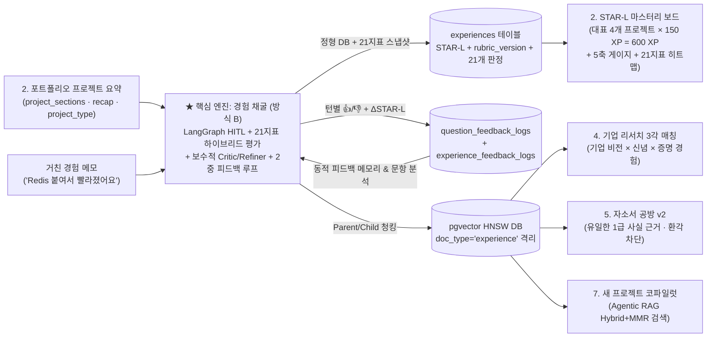
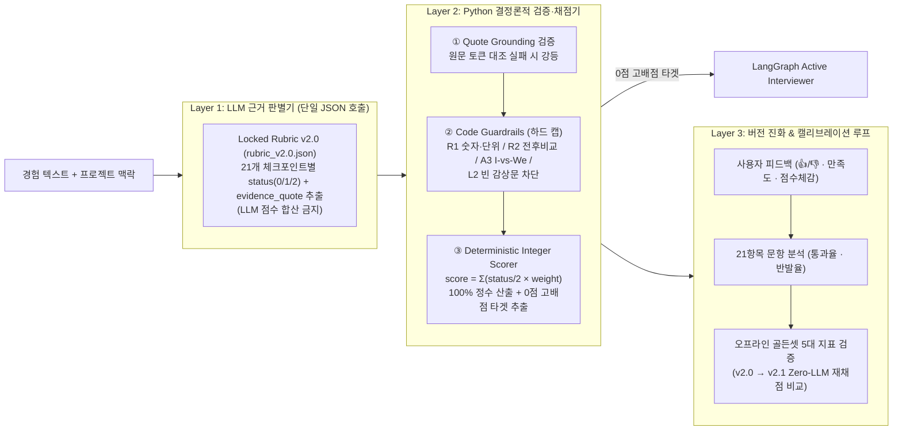
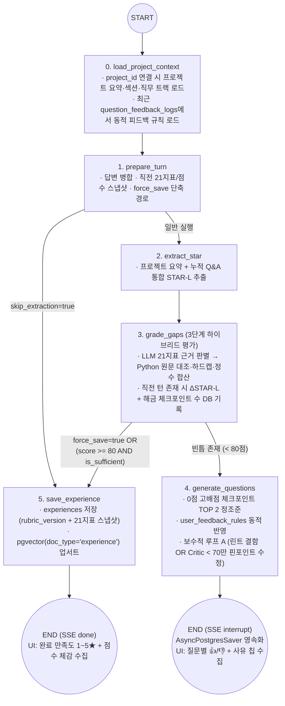

# EXPERIENCE_MINING_ARCHITECTURE.md — 핵심 엔진: 경험 채굴 (Active Interviewer) & STAR-L 21지표 하이브리드 아키텍처 (v2.0)

> **우리 프로젝트의 심장(Core Engine):**  
> 모든 AI 자소서·포트폴리오 도구의 진짜 병목은 "글을 못 써서"가 아니라, **지원자가 자신의 모호한 경험 메모에서 면접관이 검증하려는 핵심 의사결정·기여도·정량 근거를 스스로 끌어내지 못하는 것(Garbage In, Garbage Out)**입니다.  
> `write-on-vibe-lab`의 핵심 엔진인 **경험 채굴 (`Active Interviewer`)**은 프로젝트 요약과 거친 메모를 **Stateful LangGraph Human-in-the-Loop(HITL) 인터뷰 루프**로 파고들어, **21개 Atomic 체크포인트 기반 3단계 하이브리드 평가 엔진(`rubric_v2.0`)**으로 객관 채점·보강한 뒤, **대표 4개 프로젝트 누적식 600 XP 포트폴리오**와 다운스트림 AI 워크플로우 전체에 공급합니다.

---

## 1. 전체 시스템에서 '경험 채굴'의 위치 (Hub-and-Spoke)

- **단일 진입 파이프라인:** `2. 포트폴리오`의 1회성 온보딩 역질문을 제거하고, 프로젝트 요약에서 **`[이 프로젝트 요약으로 경험 채굴 시작 →]`**으로 방식 B(`interview_graph.py`)에 직결합니다.
- **포트폴리오 점수 일원화:** 기존 6축 육각형 레이더 및 캐릭터 아키타입 진단을 제거하고, **STAR-L 21지표 + 대표 4개 프로젝트 누적식 600 XP 체계**로 단일화합니다.

---

## 2. 설계 레퍼런스 (학술 · 빅테크 채용 검증 근거)

### 2.1 STAR-L 루브릭 & 역질문 프로빙 근거
| 레퍼런스 | 핵심 근거 | 본 서비스 반영 |
| :--- | :--- | :--- |
| **Sackett, Zhang, Berry, & Lievens (2022)** (*JAP*) | 메타분석 결과 **구조화 면접(`r = 0.42`)이 직무 성과 예측 타당도 1위**(비구조화 `0.19`의 2배 이상) | 표준 STAR 구조 + 21개 행동 체크포인트 + 원문 근거 인용 채점 |
| **Google re:Work Structured Interviewing & BARS** | 형용사 대신 **관찰 가능한 행동 앵커(BARS)**, verbatim 근거 기록, **Action·Result 중심 배분** | 21개 항목별 `0/1/2` 앵커 + **`S 12 · T 14 · A 36 · R 26 · L 12`** (`A+R = 62%`) |
| **Amazon Bar Raiser STAR Probing** | **`"I vs We"` 원칙**(팀 공로 시그널 0), 대안 비교·트레이드오프·실패 투명성·리스크 대응 프로빙 | `A2(대안 비교)` · `A3(본인 주도성)` · `A4(장애물 돌파)` · `A5(일정·스코프·리스크)` 체크포인트화 |

### 2.2 3단계 하이브리드 LLM 평가 & 버전 루브릭 근거
| 레퍼런스 | 핵심 근거 | 본 서비스 반영 |
| :--- | :--- | :--- |
| **CheckEval** (Lee et al., 2024, `arXiv:2403.18771`) | Likert 자유 점수 대신 **분해된 체크리스트 평가**로 인간 상관도 `+0.10`, 모델 간 일치도 `+0.45` 향상 | 자유 채점 폐지 → **21개 Atomic 체크포인트 `0/1/2` 판별** |
| **Rulers** (2026, `LabRAI/Rulers`) | **버전 고정 루브릭(Locked Rubric) + 원문 근거 앵커링 + 결정론적 검증 + 사후 캘리브레이션** | `rubric_v2.0.json` 버전 번들 + LLM `quote` 추출 + Python 원문 대조·하드캡·합산 |
| **FActScore** (Min et al., EMNLP 2023, `arXiv:2305.14251`) | 긴 서술을 원자적 사실 단위로 분해해 근거 지지 여부 판별 후 수식 집계 | 21개 체크포인트별 `evidence_quote` 원문 지지 검증 후 정수 합산 |
| **FLASK** (Ye et al., ICLR 2024, `arXiv:2307.10928`) | 단일 총점 대신 세부 역량 프로파일로 분해해야 정밀 약점 진단 가능 | 5축 게이지 + 21개 체크리스트 히트맵(`○ / ◐ / ✅`) |
| **Rubrics as Rewards — RaR** (2025, `arXiv:2507.17746`) | 개방형 도메인에서도 체크리스트 루브릭 변화량을 신뢰할 수 있는 품질/보상 신호로 활용 가능 | 턴 전/후 **`ΔSTAR-L` + 해금된 체크포인트 수**를 역질문 보상 신호로 추적 |

---

## 3. 3단계 하이브리드 평가 엔진 (`backend/app/core/star_rubric.py` & `rubrics/rubric_v2.0.json`)

> **비유:** LLM 혼자 면접관과 채점표를 다 처리하면 늘 75~85점으로 후하게(Leniency Bias) 채점합니다.  
> 하이브리드 구조에서는 **LLM = "형광펜 치는 조교"(근거 유무 판별)**, **Python 코드 = "깐깐한 채점기"(원문 대조·하드캡·점수 합산)**로 역할을 완전히 분리합니다.

### 3.1 STAR-L 21개 Atomic 체크포인트 & 짝수 정수 배점표 (총 100점)

| 축 (만점) | ID | 체크포인트 | 배점 (`0/1/2`) | 판정 기준 (`2 = 입증`) & Python 하드 캡 |
| :--- | :---: | :--- | :---: | :--- |
| **S. 상황·맥락** **12점 (4항목)** | `S1` | 배경·환경 구체성 | `0 / 2 / 4` | 시기·조직/팀·서비스·도메인 맥락 명시 |
| | `S2` | 문제·결핍의 구체화 | `0 / 2 / 4` | 구체적 병목·장애·이탈·비효율 사실 명시 |
| | `S3` | 제약조건·난이도 | `0 / 1 / 2` | 마감·인력·예산·기술 제약·갈등 등 난이도 조건 |
| | `S4` | 규모·중요도 | `0 / 1 / 2` | 트래픽·사용자·매출·팀 규모·영향 범위 제시 |
| **T. 과제·책임** **14점 (4항목)** | `T1` | 목표·성공 기준 | `0 / 2 / 4` | 정량 목표 또는 관찰 가능한 완료 기준(DoD) |
| | `T2` | 본인 역할·책임 경계 | `0 / 2 / 4` | 팀 과제 중 본인이 오너십을 가진 범위 분리 |
| | `T3` | 원인 진단·가설 수립 | `0 / 2 / 4` | 해결 전 핵심 원인을 데이터·로그·인터뷰로 진단 |
| | `T4` | 우선순위 판단 기준 | `0 / 1 / 2` | 여러 후보 중 해당 과제를 최우선 선택한 근거 |
| **A. 행동·실행** **36점 (6항목)** | `A1` | 실행 방법·절차 구체성 | `0 / 3 / 6` | 실제 수행한 구현·실험·도구·프로세스 단계 |
| | `A2` | 대안 비교·트레이드오프 | `0 / 3 / 6` | 대안 A vs B 비교 및 현재 방식 선택 근거 |
| | `A3` | 본인 주도성 (`I vs We`) | `0 / 3 / 6` | 본인 고유 기여 *(하드캡: "우리/팀"만 있고 개인 단서 없으면 최대 1)* |
| | `A4` | 장애물·예외·실패 돌파 | `0 / 3 / 6` | 난관·시행착오·반발을 감지하고 수정·돌파한 과정 |
| | `A5` | 일정·스코프·리스크 관리 | `0 / 3 / 6` | 기한 내 범위 조정, 마일스톤, 리스크 사전 대비 |
| | `A6` | 협업·이해관계자 조율 | `0 / 3 / 6` | 타 직군/팀원/고객과의 합의 과정 및 설득 근거 |
| **R. 결과·검증** **26점 (4항목)** | `R1` | 정량 수치 지표 | `0 / 4 / 8` | 객관적 수치+단위 *(하드캡: 숫자+단위 없으면 최대 0)* |
| | `R2` | 비교 기준선 (`Before/After`) | `0 / 3 / 6` | 개선 전/후 또는 목표 대비 변화량 *(하드캡: 비교 신호 없으면 최대 1)* |
| | `R3` | 행동→결과 인과관계 | `0 / 3 / 6` | 내 Action이 결과로 이어졌음을 뒷받침하는 인과 설명 |
| | `R4` | 외부 검증·확산 효과 | `0 / 3 / 6` | 실배포·조직 채택·고객 반응·수상 등 제3자 검증 |
| **L. 회고·전이** **12점 (3항목)** | `L1` | 한계·아쉬움 메타인지 | `0 / 2 / 4` | 당시 판단의 한계·놓친 리스크·개선 여지 성찰 |
| | `L2` | 일반화된 원칙·인사이트 | `0 / 2 / 4` | 일하는 기준·설계 원칙 도출 *(하드캡: "많이 배웠다" 빈 감상문 0)* |
| | `L3` | 후속 적용·재현성 | `0 / 2 / 4` | 배운 원칙을 후속 프로젝트/업무에 적용·계획 |

### 3.2 보수적 등급 체계 & 누적식 600 XP 포트폴리오

- **경험 등급 및 품질 게이트 XP 배수:**
  - **S (85~100):** `× 1.50` / **A (70~84):** `× 1.30` / **B (50~69):** `× 1.00` / **C (30~49):** `× 0.60` / **D (0~29):** `× 0.25`
- **단일 프로젝트 캡 (`150 XP`) × 대표 4개 프로젝트 선택 (`총 600 XP 만점`):**
  - 보유한 여러 프로젝트 중 **최대 4개를 대표 프로젝트로 선택** (`projects.is_portfolio_selected`; 4개 미만 선택 시 XP 상위 프로젝트 자동 충원).
  - 프로젝트 1개가 아무리 고득점이어도 `150 XP` 상한에 막혀 Lv.2 초반을 넘지 못하며, **4개 대표 프로젝트가 고르게 A~S등급을 달성해야 `Lv.4 Bar Raiser (480~600 XP)`**에 도달합니다.
  - 레벨 구간: `Lv.1 Seed (0~149)` · `Lv.2 Builder (150~299)` · `Lv.3 Proven (300~479)` · `Lv.4 Bar Raiser (480~600)`.

---

## 4. LangGraph 상태 머신 & 닫힌 피드백 루프 (`interview_graph.py` & `question_critic.py`)

### 4.1 닫힌 피드백 루프 (Closed Loop) & 체크표 버전 진화
1. **사전 검수 보수화 (`question_critic.py`):** EC2 실측에서 과잉 수정 시 `specificity`가 하락(`0.74 → 0.56`)했던 교훈을 반영해 **코드 린트 결함(복합·장황·폐쇄·중복·타겟 축 누락) 또는 Critic `< 70점`**일 때만 수정합니다.
2. **2중 사용자 피드백 수집:**
   - **턴별(`question_feedback_logs`):** 질문 카드별 `👍/👎` + 4종 사유 칩(`이미 답한 내용`, `너무 추상적`, `직무/맥락 불일치`, `길고 복잡함`) + 자동 `ΔSTAR-L` 및 해금 체크포인트 수.
   - **완료별(`experience_feedback_logs`):** 최종 만족도(`1~5★`) + 점수 체감(`후함 +1 / 적절 0 / 박함 -1`) + 초안→최종 상승폭.
3. **동적 프롬프트 주입 & 문항 분석(`GET /api/agents/experience-mining/metrics`):**
   - 최근 `👎` 최다 사유와 `👍 + 높은 Δ` 패턴을 `<user_feedback_rules>`로 실시간 주입.
   - 21개 체크포인트별 통과율(`>90%` 너무 쉬움 / `<10%` 과도하게 빡셈)과 `👎` 반발율을 자동 진단해 `rubric_v2.0.json` → `v2.1` 업그레이드 및 **Zero-LLM 재채점 + 오프라인 5대 캘리브레이션 지표(`Spearman ρ`, `MAE`, `Leniency Bias`, `Fluff Trap`, `Monotonicity`)** 회귀 검증으로 연결합니다.

---

## 5. 라이브 EC2 5대 캘리브레이션 실측 결과 (`rubric_v2.0`, 15건 골든셋)

`backend/eval/run_rubric_eval.py`로 AWS Bedrock(`Nova Lite`) + Python Layer 2 결정론적 검증기를 실측한 결과입니다.

| 캘리브레이션 지표 | 목표 기준 | 실측 결과 (`v2.0`) | 해석 |
| :--- | :---: | :---: | :--- |
| **Spearman ρ (순위 상관계수)** | `≥ 0.85` | **`0.8676`** | S~D 등급 간 서열 정합성 확보 |
| **MAE (평균 절대 오차)** | `≤ 12.0` | **`8.20점`** | 100점 척도에서 오차 ±8.2점 이내 |
| **Leniency Bias (관대화 편향)** | `-5 ~ +5` | **`+1.67점`** | 기존 LLM 관대화 편향(+20~30점) 사실상 제거 |
| **Fluff Trap 차단률** | `100%` | **`100.0%` (2/2)** | 유려한 미사여구·무근거 2건 모두 **`25점 (D)`** 차단 |
| **Monotonicity (보강 단조성)** | `100%` | **`100.0%` (2/2)** | `24→86 (+62점)`, `19→64 (+45점)` 정직한 상승 |
| **점수 변별 스펙트럼** | 넓은 분포 | **`6점 ~ 100점`** | 거친 초안 `6점(코드캡 3회)` ~ S급 `99~100점` |
