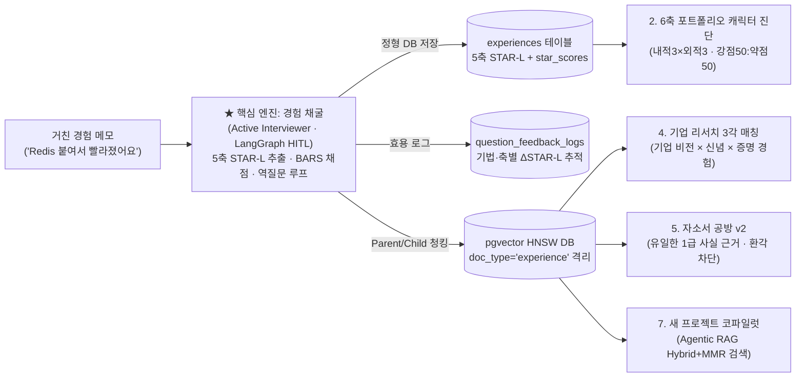
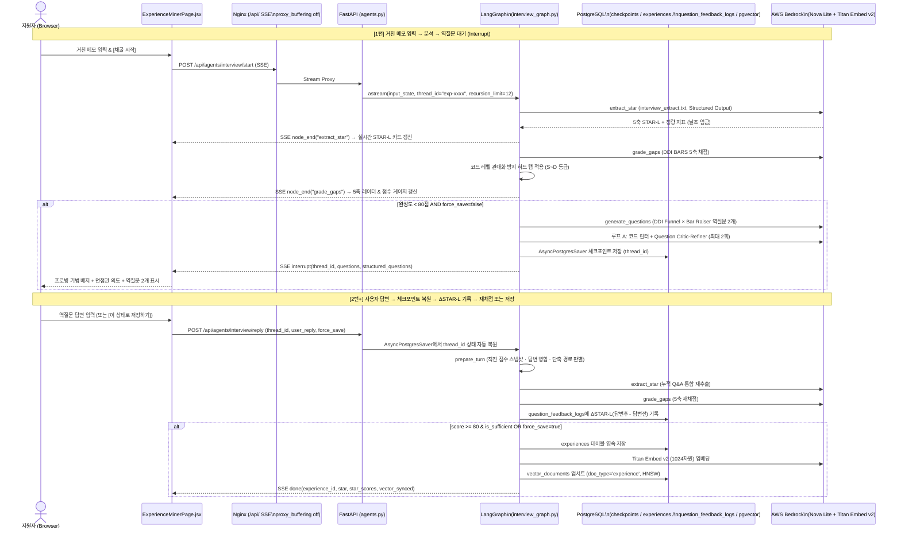
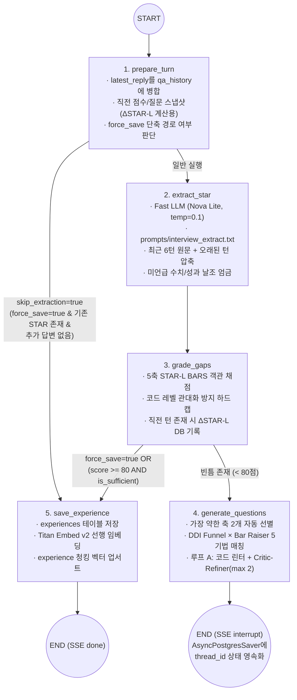
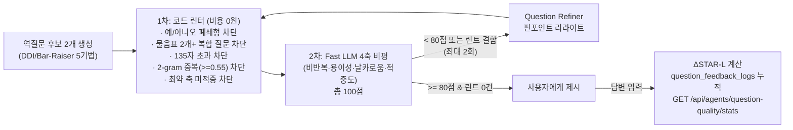

# EXPERIENCE_MINING_ARCHITECTURE.md — 핵심 엔진: 경험 채굴 (Active Interviewer) 심층 아키텍처

> **우리 프로젝트의 심장(Core Engine):**  
> 모든 AI 자소서·포트폴리오 도구의 진짜 병목은 "글을 못 써서"가 아니라, **지원자가 자신의 모호한 경험 메모에서 면접관이 검증하려는 핵심 의사결정·기여도·정량 근거를 스스로 끌어내지 못하는 것(Garbage In, Garbage Out)**입니다.  
> `write-on-vibe-lab`의 핵심 엔진인 **경험 채굴 (`Active Interviewer`)**은 거친 메모 한 줄을 **Stateful LangGraph Human-in-the-Loop(HITL) 인터뷰 루프**로 파고들어, 객관적으로 검증된 **5축 STAR-L 1급 데이터**로 정련한 뒤 서비스 전체(캐릭터 진단·기업 매칭·자소서·코파일럿)에 공급합니다.

---

## 1. 전체 시스템에서 '경험 채굴'의 위치 (Hub-and-Spoke)

- **왜 핵심인가?** 경험 채굴에서 확보된 **사실 밀도 높은 STAR-L 1건**이 아래 4개 다운스트림 AI 워크플로우의 품질 상한선을 결정합니다.

---

## 2. End-to-End 작동 과정 (실시간 SSE & 멀티턴 체크포인터 시퀀스)

사용자가 메모를 입력하고 역질문에 답해 저장하기까지의 전체 실행 흐름입니다.

---

## 3. LangGraph 내부 상태 머신 아키텍처 (`backend/app/graphs/interview_graph.py`)

### 3.1 노드 · 조건부 엣지 그래프

### 3.2 `InterviewState` 핵심 필드 설계

| 필드 | 역할 | 설계 포인트 |
| :--- | :--- | :--- |
| `raw_notes`, `qa_history`, `latest_reply` | 초기 메모 및 멀티턴 질의응답 누적 | 6턴 초과 시 오래된 턴은 핵심 180자 요약으로 자동 압축해 토큰 폭증 방지(`_build_context_text`) |
| `star`, `completeness_score`, `star_scores` | 5축 STAR-L 본문 및 축별 BARS 점수·등급 | 매 턴 전체 누적 맥락을 재통합해 S·T·A·R·L이 점진적으로 고밀도화됨 |
| `prev_completeness_score`, `prev_structured_questions` | 직전 턴 스냅샷 | 답변 직후 `ΔSTAR-L = new_score - prev_score`를 정확히 산출해 `question_feedback_logs`에 저장 |
| `force_save`, `skip_extraction` | 사용자 즉시 탈출 제어 | 사용자가 `[이 상태로 저장하기]` 클릭 시 추가 답변이 없으면 LLM 호출 없이 즉시 `save_experience`로 단축 라우팅 |
| `question_critic_score`, `question_critic_revisions` | 루프 A 품질 메타 | 질문 비평 점수 및 리라이트 횟수(최대 2회) 추적 |

### 3.3 운영 안전장치 (Guardrails)
1. **체크포인터 영속화 (`AsyncPostgresSaver`):** 서버가 재시작되거나 네트워크가 잠시 끊겨도 `thread_id`로 직전 노드 상태에서 대화를 이어갈 수 있습니다.
2. **실행 상한 (`recursion_limit=12`):** 그래프 레벨 무한 순환을 원천 차단합니다.
3. **트랜잭션 격리 업서트 (`try_upsert_document`):** `save_experience`에서 Bedrock 임베딩 호출을 DB 벡터 쓰기보다 먼저 수행해, 임베딩 장애가 발생해도 이미 저장된 `experiences` 정형 레코드와 ORM 세션이 롤백/만료되지 않습니다.

---

## 4. 객관화 채점 엔진 해부 (`backend/app/core/star_rubric.py`)

일반 LLM에게 "이 경험 몇 점이야?"라고 물으면 대부분 **80~90점의 관대화 편향(Leniency Bias)**을 보입니다. 이를 해결하기 위해 **글로벌 채용 평가 프레임워크 3종 + 코드 레벨 하드 캡**을 결합했습니다.

### 4.1 5축 STAR-L 가중치 공식 & 레퍼런스

$$\text{종합 점수} = 0.15 \times S + 0.15 \times T + 0.35 \times A + 0.25 \times R + 0.10 \times L$$

| 축 | 가중치 | 레퍼런스 기준 | 핵심 검증 포인트 |
| :---: | :---: | :--- | :--- |
| **S (Situation)** | 15% | DDI Targeted Selection BARS | 배경·제약조건·문제 심각성(규모·긴급도)이 명확한가 |
| **T (Task)** | 15% | Amazon Bar Raiser ('I' Rule) | 팀 목표가 아니라 **본인 고유 책임 범위**와 달성 목표가 분리되었는가 |
| **A (Action)** | **35%** | Amazon Bar Raiser × Google GCA | "우리가" 아닌 **"내가" 직접 내린 의사결정, 대안 비교, 트레이드오프, 실행 행동**인가 |
| **R (Result)** | **25%** | Google XYZ Formula | 전/후 비교 정량 지표(`Accomplished X as measured by Y`) 또는 객관 검증 근거가 있는가 |
| **L (Learning)** | 10% | Post-Mortem / Learning Agility | 단순 소감이 아니라 **재발 방지 설계·다음 프로젝트 적용 원칙**으로 일반화되었는가 |

### 4.2 5단계 행동 앵커(BARS Lv.1~5) & S~D 캘리브레이션 + 코드 하드 캡
- **S (90+)** Bar Raiser Top 10% / **A (80~89)** 면접 즉시 활용 가능 / **B (65~79)** 핵심 구조 양호·정량 보강 필요 / **C (50~64)** 서술 추상적·본인 기여 불명확 / **D (< 50)** 메모 초안 수준
- **코드 레벨 관대화 방지 하드 캡 (Post-Validation):**
  - `quantified_metrics`가 비어 있고 `Result`에 정량 수치가 전혀 없으면, LLM이 높은 점수를 주더라도 코드가 `Result` 상한을 강제 제한
  - `Learning`이 비어 있거나 너무 짧으면 `Learning` 상한 강제 제한
  - `Action`·`Result`에 치명적 공백이 있으면 `is_sufficient=False`를 유지해 역질문 루프로 유도

---

## 5. 2단계 에스컬레이션 프로빙 & 루프 A(질문 퀄리티 상승 루프)

### 5.1 턴 깊이에 따른 질문 전략 전환 (`interview_graph.py`)
1. **1턴 (Directed Probe):** 5축 점수 중 **가장 낮은 축 2개**를 자동 정렬해, 먼저 `'우리가 했다' → '내가 했다'` 경계 분리(`ownership_drilldown`)와 핵심 빈틈 사실부터 끌어냅니다.
2. **2턴 이상 (Micro-Behavioral & Counter-Factual Drill-Down):** 직전 답변에서 아직 모호한 지점을 파고들어 포기한 대안·트레이드오프(`counter_factual`), 구체 행동 장면(`micro_behavioral`), 전후 비교 수치(`xyz_quantification`), 재발 방지 원칙(`learning_transfer`)을 서로 다른 기법으로 공략합니다.
3. **반복 차단:** `prev_qs`(이미 물어본 질문 목록)를 프롬프트와 코드 린터 양쪽에 전달해 동일 질문 재출제를 방지합니다.

### 5.2 루프 A: 질문 사전 비평 & 실전 효용 추적 (`question_critic.py`)

---

## 6. 포트폴리오·발표·면접용 핵심 Q&A 포인트

| 예상 질문 | 핵심 답변 (우리 아키텍처 근거) |
| :--- | :--- |
| **Q1. 그냥 ChatGPT 멀티턴 대화로 STAR 정리하면 되지 않나요?** | 일반 챗봇은 ① 매 턴 점수가 객관화되지 않아 관대하게 넘어가고 ② 대화가 길어지면 앞 문맥을 놓치거나 같은 질문을 반복하며 ③ 결과가 텍스트로 흩어집니다. 우리는 **LangGraph `StateGraph` + `AsyncPostgresSaver` + 5축 BARS 코드 하드 캡 + 5종 구조화 프로빙**으로 "빈틈이 채워질 때까지 정조준"하고, 결과를 **정형 DB + HNSW 격리 벡터 DB**로 즉시 자산화합니다. |
| **Q2. LLM 채점의 관대화 편향과 환각은 어떻게 통제했나요?** | ① `extract_star`에서 미언급 수치·기술 날조 금지 프롬프트 외부화(`interview_extract.txt`) ② `grade_gaps`에서 BARS Lv.1~5 풀 앵커 제공 + **코드 레벨 정량/회고 미기재 하드 캡**으로 LLM 점수를 결정론적으로 보정했습니다. |
| **Q3. 질문 퀄리티 루프(루프 A)를 도입하고 숫자로 검증해 보셨나요?** | 네. 10종 빈약 메모 골든셋(`question_golden_dataset.json`)으로 Nova Pro Judge 실측을 돌린 결과, **코드 린터가 결함을 `1 → 0건`으로 제거**한 반면, `Nova Lite` Critic이 이미 좋은 1차 질문까지 과도하게 리라이트해 `specificity`가 `0.74 → 0.56`으로 하락하는 트레이드오프를 숫자로 발견했습니다. 덕분에 "무조건 루프를 돌리는 것보다 코드 린트 결함·저점수(`< 70`) 핀포인트 개입이 최적"이라는 데이터 기반 설계 결론을 도출했습니다. |
| **Q4. 채굴한 경험이 이후 서비스에서 어떻게 재활용되나요?** | 저장 즉시 Parent/Child 청킹(500자/겹침 100자)으로 `doc_type='experience'` 벡터에 색인되어, **자소서 공방의 유일한 팩트 근거**, **기업 3각 매칭의 증명 소재**, **6축 캐릭터 진단의 근거**, **코파일럿 Agentic RAG의 한국어 2-gram BM25+Vector RRF 검색 대상(`MRR 1.000`, 토큰 `-35%`)**으로 연결됩니다. |
