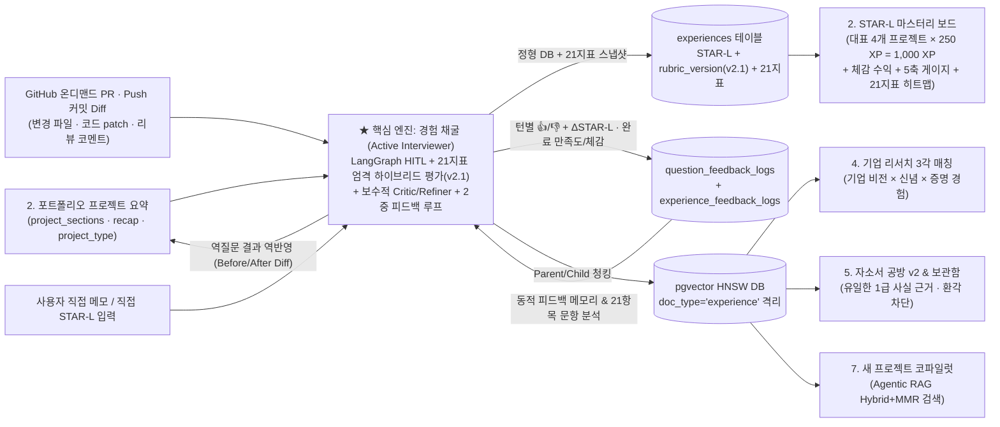
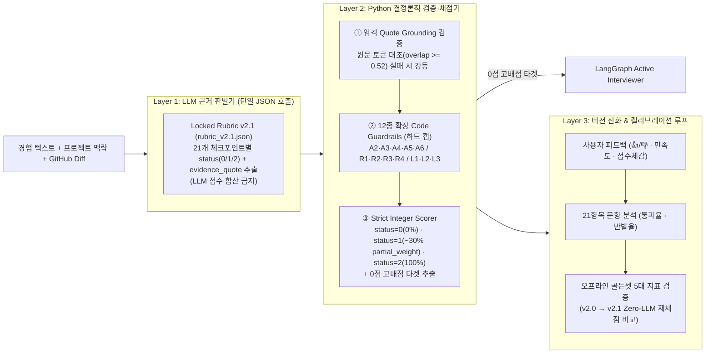
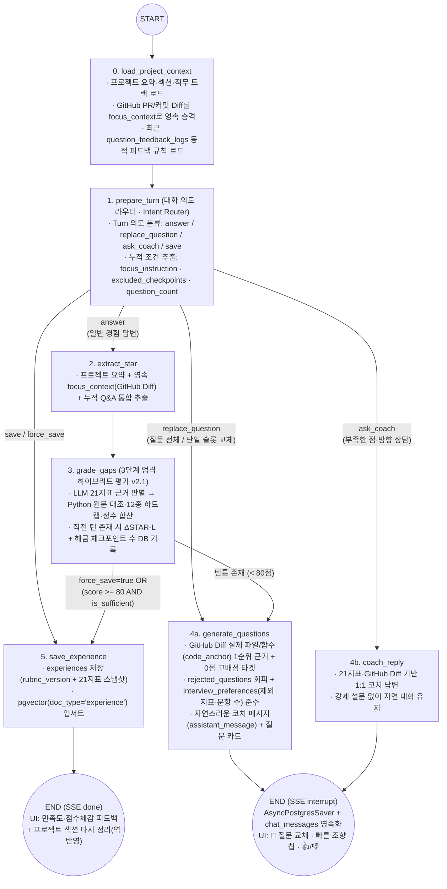

# EXPERIENCE_MINING_ARCHITECTURE.md — 핵심 엔진: 경험 채굴 (Active Interviewer) & STAR-L 21지표 하이브리드 아키텍처 (v2.1)

> **우리 프로젝트의 심장(Core Engine):**  
> 모든 AI 자소서·포트폴리오 도구의 진짜 병목은 "글을 못 써서"가 아니라, **지원자가 자신의 모호한 경험 메모에서 면접관이 검증하려는 핵심 의사결정·기여도·정량 근거를 스스로 끌어내지 못하는 것(Garbage In, Garbage Out)**입니다.  
> `write-on-vibe-lab`의 핵심 엔진인 **경험 채굴 (`Active Interviewer`)**은 프로젝트 요약, **온디맨드 GitHub PR·Push 커밋 실제 코드 Diff**, 또는 사용자 직접 메모를 **Stateful LangGraph Human-in-the-Loop(HITL) 인터뷰 루프**로 파고들어, **21개 Atomic 체크포인트 기반 3단계 엄격 하이브리드 평가 엔진(`rubric_v2.1`)**으로 객관 채점·보강한 뒤, **대표 4개 프로젝트 누적식 1,000 XP 포트폴리오(체감 수익 적용)**와 프로젝트 섹션 재정리·다운스트림 AI 워크플로우 전체에 공급합니다.

---

## 1. 전체 시스템에서 '경험 채굴'의 위치 (Hub-and-Spoke)

- **단일 진입 & 무거품 원칙:**
  - `2. 포트폴리오`의 1회성 온보딩 역질문과 프로젝트 불러오기 시 **자동 STAR 경험 생성**을 모두 제거했습니다.
  - 모든 경험은 사용자가 **`3. 경험 채굴`**(프로젝트 요약 연동 · 온디맨드 GitHub PR/커밋 Diff · 직접 STAR-L 입력)으로 직접 검증·등록하며, 저장 후 언제든 **상세 모달에서 수정·즉시 21지표 재채점** 및 **프로젝트 섹션 다시 정리(역반영)**가 가능합니다.
- **포트폴리오 점수 일원화:** 기존 6축 육각형 레이더 및 캐릭터 아키타입 진단을 제거하고, **STAR-L 21지표 + 대표 4개 프로젝트 누적식 1,000 XP 체계**로 단일화했습니다.

---

## 2. 설계 레퍼런스 (학술 · 빅테크 채용 검증 근거)

### 2.1 STAR-L 루브릭 & 역질문 프로빙 근거
| 레퍼런스 | 핵심 근거 | 본 서비스 반영 |
| :--- | :--- | :--- |
| **Sackett, Zhang, Berry, & Lievens (2022)** (*JAP*) | 메타분석 결과 **구조화 면접(`r = 0.42`)이 직무 성과 예측 타당도 1위**(비구조화 `0.19`의 2배 이상) | 표준 STAR 구조 + 21개 행동 체크포인트 + 원문 근거 인용 채점 |
| **Google re:Work Structured Interviewing & BARS** | 형용사 대신 **관찰 가능한 행동 앵커(BARS)**, verbatim 근거 기록, **Action·Result 중심 배분** | 21개 항목별 `0/1/2` 앵커 + **`S 12 · T 14 · A 36 · R 26 · L 12`** (`A+R = 62%`) |
| **Amazon Bar Raiser STAR Probing** | **`"I vs We"` 원칙**(팀 공로 시그널 0), 대안 비교·트레이드오프·실패 투명성·리스크 대응 프로빙 | `A2(대안 비교)` · `A3(본인 주도성)` · `A4(장애물 돌파)` · `A5(일정·스코프·리스크)` 체크포인트화 |

### 2.2 3단계 하이브리드 LLM 평가 & 버전 루브릭 근거
| 레퍼런스 | 핵심 근거 | 본 서비스 반영 |
| :--- | :--- | :--- |
| **CheckEval** (Lee et al., 2024, `arXiv:2403.18771`) | Likert 자유 점수 대신 **분해된 체크리스트 평가**로 인간 상관도 `+0.10`, 모델 간 일치도 `+0.45` 향상 | 자유 채점 폐지 → **21개 Atomic 체크포인트 `0/1/2` 판별** |
| **Rulers** (2026, `LabRAI/Rulers`) | **버전 고정 루브릭(Locked Rubric) + 원문 근거 앵커링 + 결정론적 검증 + 사후 캘리브레이션** | `rubric_v2.0.json` → `rubric_v2.1.json` 버전 진화 + LLM `quote` 추출 + Python 원문 대조·12종 하드캡·정수 합산 |
| **FActScore** (Min et al., EMNLP 2023, `arXiv:2305.14251`) | 긴 서술을 원자적 사실 단위로 분해해 근거 지지 여부 판별 후 수식 집계 | 21개 체크포인트별 `evidence_quote` 원문 지지 검증(`overlap ≥ 0.52`) 후 정수 합산 |
| **FLASK** (Ye et al., ICLR 2024, `arXiv:2307.10928`) | 단일 총점 대신 세부 역량 프로파일로 분해해야 정밀 약점 진단 가능 | 5축 게이지 + 21개 체크리스트 히트맵(`○ / ◐ / ✅`) |
| **Rubrics as Rewards — RaR** (2025, `arXiv:2507.17746`) | 개방형 도메인에서도 체크리스트 루브릭 변화량을 신뢰할 수 있는 품질/보상 신호로 활용 가능 | 턴 전/후 **`ΔSTAR-L` + 해금된 체크포인트 수**를 역질문 보상 신호로 추적 |

---

## 3. 3단계 엄격 하이브리드 평가 엔진 (`star_rubric.py` & `rubrics/rubric_v2.1.json`)

> **역할 분리:** **LLM = "형광펜 치는 조교"(21개 항목 `0/1/2` 근거 판별 + 원문 직접 인용)**, **Python 코드 = "깐깐한 채점기"(원문 대조 · 12종 하드캡 · 엄격 부분배점 정수 합산)**로 역할을 완전히 분리해 LLM 관대화 편향(Leniency Bias)을 구조적으로 차단합니다.

### 3.1 STAR-L 21개 Atomic 체크포인트 & 엄격 배점표 (`rubric_v2.1`, 총 100점)

> `v2.1`에서 부분 충족(`status = 1`) 배점을 50% → **약 30%(`partial_weight`)**로 낮추고, Python 하드 캡을 **12개 핵심 체크포인트**로 확장해 근거 없는 고득점을 원천 차단했습니다.

| 축 (만점) | ID | 체크포인트 | 배점 (`0 / 1 / 2`) | 판정 기준 (`2 = 입증`) & Python 하드 캡 (`v2.1`) |
| :--- | :---: | :--- | :---: | :--- |
| **S. 상황·맥락** **12점 (4항목)** | `S1` | 배경·환경 구체성 | `0 / 1 / 4` | 시기·조직/팀·서비스·도메인 맥락 명시 |
| | `S2` | 문제·결핍의 구체화 | `0 / 1 / 4` | 구체적 병목·장애·이탈·비효율 사실 명시 |
| | `S3` | 제약조건·난이도 | `0 / 1 / 2` | 마감·인력·예산·기술 제약·갈등 등 난이도 조건 |
| | `S4` | 규모·중요도 | `0 / 1 / 2` | 트래픽·사용자·매출·팀 규모·영향 범위 제시 |
| **T. 과제·책임** **14점 (4항목)** | `T1` | 목표·성공 기준 | `0 / 1 / 4` | 정량 목표 또는 관찰 가능한 완료 기준(DoD) |
| | `T2` | 본인 역할·책임 경계 | `0 / 1 / 4` | 팀 과제 중 본인이 오너십을 가진 범위 분리 |
| | `T3` | 원인 진단·가설 수립 | `0 / 1 / 4` | 해결 전 핵심 원인을 데이터·로그·인터뷰로 진단 |
| | `T4` | 우선순위 판단 기준 | `0 / 1 / 2` | 여러 후보 중 해당 과제를 최우선 선택한 근거 |
| **A. 행동·실행** **36점 (6항목)** | `A1` | 실행 방법·절차 구체성 | `0 / 2 / 6` | 실제 수행한 구현·실험·도구·프로세스 단계 |
| | `A2` | 대안 비교·트레이드오프 | `0 / 2 / 6` | 대안 A vs B 비교 근거 *(하드캡: 비교·대안 단서 없으면 최대 1)* |
| | `A3` | 본인 주도성 (`I vs We`) | `0 / 2 / 6` | 본인 고유 기여 *(하드캡: "우리/팀"만 있고 개인 단서 없으면 최대 1)* |
| | `A4` | 장애물·예외·실패 돌파 | `0 / 2 / 6` | 난관·시행착오 돌파 과정 *(하드캡: 장애·실패·수정 단서 없으면 최대 1)* |
| | `A5` | 일정·스코프·리스크 관리 | `0 / 2 / 6` | 범위 조정·리스크 대비 *(하드캡: 일정·스코프·롤백 단서 없으면 최대 1)* |
| | `A6` | 협업·이해관계자 조율 | `0 / 2 / 6` | 타 직군·팀원·고객 설득·합의 *(하드캡: 협업·조율 단서 없으면 최대 1)* |
| **R. 결과·검증** **26점 (4항목)** | `R1` | 정량 수치 지표 | `0 / 2 / 8` | 객관적 수치+단위 *(하드캡: 숫자 없으면 0, 단위 없으면 최대 1)* |
| | `R2` | 비교 기준선 (`Before/After`) | `0 / 2 / 6` | 개선 전/후 변화량 *(하드캡: 비교 신호 없으면 최대 1)* |
| | `R3` | 행동→결과 인과관계 | `0 / 2 / 6` | 측정·테스트·로그 기반 인과 입증 *(하드캡: 검증 단서 없으면 최대 1)* |
| | `R4` | 외부 검증·확산 효과 | `0 / 2 / 6` | 실배포·채택·피드백·수상 등 제3자 검증 *(하드캡: 외부 단서 없으면 최대 1)* |
| **L. 회고·전이** **12점 (3항목)** | `L1` | 한계·아쉬움 메타인지 | `0 / 1 / 4` | 당시 판단의 한계·놓친 리스크 성찰 *(하드캡: 성찰 단서 없으면 최대 1)* |
| | `L2` | 일반화된 원칙·인사이트 | `0 / 1 / 4` | 재사용 가능한 설계·업무 원칙 *(하드캡: 빈 감상문 0, 원칙 단서 없으면 최대 1)* |
| | `L3` | 후속 적용·재현성 | `0 / 1 / 4` | 후속 프로젝트 실제 적용·계획 *(하드캡: 전이 단서 없으면 최대 1)* |

### 3.2 엄격 누적식 1,000 XP 포트폴리오 (프로젝트당 250 XP · 체감 수익)

- **단일 경험 XP (보너스 배수 폐지, 최대 `100 XP`):**
  - **S (85~100):** `× 1.00` / **A (70~84):** `× 0.85` / **B (55~69):** `× 0.60` / **C (35~54):** `× 0.30` / **D (0~34):** `× 0.10`
- **프로젝트당 체감 수익(Diminishing Returns, 최대 `250 XP`):**
  - 프로젝트 내 경험들을 XP 높은 순으로 정렬해 상위 4개만 **`100% · 80% · 50% · 20%`** 가중 합산 (5번째 이후 `0%`, 최대 `100 + 80 + 50 + 20 = 250 XP`).
  - 부실한 C·D급 경험을 여러 개 양산해도 프로젝트 XP가 거의 오르지 않으며, **만점 250 XP는 S급 경험 4건**이 모여야 도달합니다.
- **대표 4개 프로젝트 선택 (`총 1,000 XP 만점`):**
  - 보유 프로젝트 중 최대 4개 선택(`projects.is_portfolio_selected`, 미선택 슬롯은 XP 상위 프로젝트 자동 충원).
  - 레벨 구간: `Lv.1 Seed (0~249)` · `Lv.2 Builder (250~499)` · `Lv.3 Proven (500~799)` · `Lv.4 Bar Raiser (800~1000)`.

---

## 4. 대화형 멀티턴 LangGraph 상태 머신 (v3.0), GitHub Diff 앵커링 & 닫힌 피드백 루프

### 4.1 온디맨드 GitHub PR · Push 커밋 Diff 앵커링 & 대화형 멀티턴 채굴
- **온디맨드 PR/Diff 조회 (`github_analyzer.py`):**
  - `POST /api/projects/{project_id}/github-activity`: 연결된 저장소의 최근 **Pull Request(Merged/Open/Closed)** 및 **Push 커밋** 목록을 온디맨드 조회(UI에서 연결한 **암호화 저장 GitHub PAT 자동 사용**, 미연결 시 Public 무토큰 또는 1회용 PAT 지원).
  - `POST /api/projects/{project_id}/github-diff-context`: 선택한 PR(최대 3개)·커밋(최대 5개)의 실제 코드 Diff(`patch`)와 리뷰 코멘트를 노이즈 파일(`package-lock.json`, `dist/` 등) 제외 후 구조화해 별도 영속 필드 **`focus_context`**로 주입.
- **PR/Diff 1순위 앵커링 (`code_anchor`):**
  - `focus_context`가 로드된 세션에서는 모든 역질문이 **실제 변경된 파일·함수·PR 변경점(`code_anchor`)을 직접 지목**해 질문하며, STAR-L 체크포인트는 추상적 교과서 질문이 아니라 해당 코드 변경의 **의사결정·대안·검증 수치·회고**를 끌어내는 렌즈로 작동합니다.
- **멀티턴 채팅 · 의도 라우팅 · 질문 교체 & 컨텍스트 영속 복원:**
  - `prepare_turn` 의도 라우터가 사용자 발화를 `answer`(경험 답변·재채점), `replace_question`(전체 또는 특정 슬롯 `replace_question_index` 즉시 교체 — `qa_history` 미오염), `ask_coach`(부족한 점·작성 팁 1:1 상담), `save`(즉시 저장) 4갈래로 분기합니다.
  - 대화 중 *"1인 개발이라 협업(A6) 빼줘"*, *"X 파일 위주로 물어봐줘"*, *"질문 1개씩만"* 같은 요청은 `interview_preferences`에 누적 영속화됩니다.
  - `AsyncPostgresSaver` + `chat_messages` + `GET /api/agents/interview/history/{thread_id}` + `sessionStorage` 연동으로 탭 이동·새로고침 시에도 진행 중인 대화와 Diff 컨텍스트를 그대로 복원합니다.

### 4.2 경험 CRUD & 프로젝트 역반영 순환
- **직접 입력 & 수정·즉시 재채점:** `POST /api/experiences`, `PUT /api/experiences/{id}`로 경험 직접 작성·수정 시 즉시 `rubric_v2.1` 21지표 재채점 + `pgvector` 재동기화 + 1,000 XP 보드 자동 갱신.
- **역질문 결과 → 프로젝트 섹션 재정리:** `POST /api/projects/{project_id}/sync-from-experience/{experience_id}`로 채굴된 STAR-L 및 역질문 Q&A 이력을 기존 프로젝트 섹션 Before/After Diff로 제안(루프 B Verifier 적용) 후 선택 반영.

---

## 5. 라이브 EC2 5대 캘리브레이션 실측 비교 (`v2.0` → `v2.1`, 15건 골든셋)

`backend/eval/run_rubric_eval.py`로 AWS Bedrock(`Nova Lite`) + Python Layer 2 결정론적 검증기를 동일 15건 골든셋(S~D 등급 + 미사여구 함정 + 단조성 쌍)에서 실측 비교한 결과입니다.

| 캘리브레이션 지표 | 목표 기준 | `v2.0` (초기) | **`v2.1` (엄격 개편)** | 변화 및 해석 |
| :--- | :---: | :---: | :---: | :--- |
| **Spearman ρ (순위 상관계수)** | `≥ 0.85` | `0.8676` | **`0.9543`** | **`+0.0867` 대폭 향상** — 거의 완벽한 서열 정합 |
| **MAE (평균 절대 오차)** | `≤ 12.0` | `8.20점` | **`9.67점`** | 보수화 하향 반영에도 목표(12점) 이내 유지 |
| **Leniency Bias (관대화 편향)** | `-5 ~ +5` | `+1.67점` | **`-5.40점`** | **후한 채점 편향 완전 제거** (엄격 보수 기준 확립) |
| **Python 하드 캡 발동 횟수** | — | `5회` | **`17회`** | 12종 확장 컷으로 근거 없는 고득점 3.4배 정밀 차단 |
| **Fluff Trap 차단률** | `100%` | `100%` (`25/25점`) | **`100%` (`12/21점`)** | 유려한 무근거 미사여구 2건 모두 `D등급` 강하게 차단 |
| **Monotonicity (보강 단조성)** | `100%` | `100%` (`+62/+45점`) | **`100%` (`9→89 +80`, `11→58 +47`)** | 초안 `9~11점` 출발 → 보강 시 극적이고 정직한 상승 |
| **점수 변별 스펙트럼** | 넓은 분포 | `6점 ~ 100점` | **`3점 ~ 95점`** | 거친 초안 `3점` · B급 `55점` · A급 `77~82점` · S급 `95점` |
