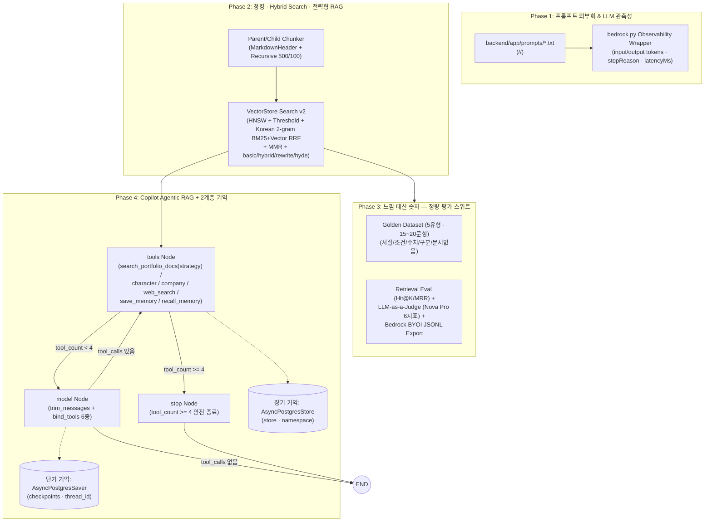

# LANGCHAIN_LANGGRAPH_UPGRADE.md — LangChain · LangGraph · RAG 고도화 설계서

> **기준 아키텍처:** LangChain · LangGraph · RAG Production Engineering Principles (Unit 2~8)  
> **핵심 원칙:** *"한 번에 하나씩 바꾸고, 같은 시험지로 숫자를 비교하며, 기존 7-Page 기능·Docker 3-컨테이너·AWS Bedrock Only·`doc_type` 격리 가드레일을 100% 보존한다."*

---

## 1. 기존 구조 진단 (As-Is vs. Target Architecture)

| 영역 | 목표 아키텍처 (Target) | 기존 구조 (As-Is) | 해결할 병목 |
| :--- | :--- | :--- | :--- |
| **LangChain 설계·관측성** | 외부 프롬프트 파일(`<role>/<rules>/<output_format>`) + `ChatPromptTemplate` + `usage_metadata`/`stopReason`/`latencyMs` 로깅 | Python 코드 내 긴 f-string 산재, 토큰·지연시간·잘림 추적 없음 | 프롬프트 버전 관리 불가, 노드별 토큰 비용·`max_tokens` 잘림 원인 파악 불가 |
| **문서 청킹·출처·인덱스** | `MarkdownHeaderTextSplitter` + `RecursiveCharacterTextSplitter(500/100)` Parent/Child 청킹 + 출처 메타데이터 + HNSW 인덱스 | 섹션·경험·자소서 샘플을 길이 무관 1개 행으로 통임베딩, HNSW 인덱스 없음 | 장문(2,000~5,000자) 의미 희석 및 검색 정확도 저하 |
| **RAG 검색 품질** | 거리 임계값 + **한국어 2-gram BM25 + Vector RRF 하이브리드** + **MMR 다양성** + **Query Rewrite / HyDE** | 단순 pgvector 코사인 유사도(`ORDER BY distance LIMIT k`) 1종 | 무관 문서 노이즈 혼입, 한국어 고유명사/기술스택 누락, 중복 청크 쏠림, 어휘 불일치 |
| **RAG 정량 평가** | 5유형 골든 데이터셋(문서에 없음 포함) + 다른 모델(Nova Pro) LLM-as-a-Judge 6지표 + **Bedrock Evaluations BYOI JSONL** | 검색·생성 품질을 숫자로 비교하는 평가 파이프라인 부재 | 변경 전후 개선 여부 및 회귀(Regression) 객관 검증 불가 |
| **에이전트 & 도구 호출** | `@tool`(명확한 docstring + 허용값) + `bind_tools` + `ToolNode` + ReAct 반복(`model ⇄ tools`) | 4개 그래프 모두 고정 파이프라인(Fixed Graph), 도구 자율 선택 부재 | 인사말/간단 질문에도 매번 DB 전체 덤프 + RAG + Grader 중복 실행 |
| **Agentic RAG & 2계층 기억** | 검색 전략 에스컬레이션(`basic`→`hybrid`→`rewrite`→`hyde`) + `tool_count`/`stop`·`recursion_limit` 2중 상한 + `AsyncPostgresSaver`(단기/`trim_messages`) + `AsyncPostgresStore`(장기) | Copilot에 체크포인터/장기 기억 부재, `chat_history[-6:]` 단일 문자열 전달 | 검색 부족 시 전략 전환 불가, 새 대화에서 사용자 선호/제약조건 망각 |

---

## 2. 목표 아키텍처 청사진 (To-Be)

---

## 3. 단계별 구현 & 검증 로드맵

### Phase 1. 프롬프트 외부화 · LCEL 표준화 · LLM 관측성 계층
- `backend/app/prompts/` 외부 프롬프트 템플릿 분리 (`<role>/<rules>/<output_format>`) 및 `ChatPromptTemplate` 로더
- `backend/app/core/bedrock.py`에 `usage_metadata`, `stopReason`, `latencyMs` 구조화 로깅 및 요청별 `LLMTelemetryTracker` 추가
- `cover_letter_graph.py` 코드 레벨 사후 검증(금지 AI 클리셰 잔존 탐지 및 샘플 수치 유입 점검) 추가

### Phase 2. 문서 청킹 · HNSW 인덱스 · Hybrid Search · MMR · 전략형 검색
- `backend/app/core/chunker.py`: `MarkdownHeaderTextSplitter` + `RecursiveCharacterTextSplitter(500/100)` Parent/Child 분할 + 출처 메타데이터(`parent_ref_id`, `chunk_index`, `source_label`, `section_header`)
- `backend/app/core/database.py`: `vector_documents.embedding` HNSW 코사인 인덱스 자동 생성
- `backend/app/core/vector_store.py`: `doc_types` 격리 유지 + `max_distance` 임계값 + **한국어 2-gram BM25 + Vector RRF** + **MMR 다양성** + `strategy=("basic"|"hybrid"|"rewrite"|"hyde")` 통합 검색 API
- `backend/app/scripts/reindex_vectors.py`: 기존 저장 데이터 일괄 재청킹 유틸리티

### Phase 3. RAG 정량 평가 스위트 (느낌 대신 숫자)
- `backend/eval/golden_dataset.json`: 5대 질문 유형(사실 찾기 / 조건·직무 적용 / 수치·지표 검증 / 유사 항목 구분 / 문서에 없음 거절) 골든 평가셋
- `backend/eval/run_eval.py`:
  - `--mode retrieval`: 전략별 `Hit@K`, `MRR`, `Noise Rate` 비교
  - `--mode judge`: 별도 채점 모델(`Nova Pro`) 기반 6대 지표(`Context Relevance`, `Context Coverage`, `Correctness`, `Completeness`, `Faithfulness`, `Helpfulness`) 채점
  - `--export-byoi`: Amazon Bedrock Evaluations BYOI JSONL(`conversationTurns`) 내보내기

### Phase 4. Copilot 진정한 LangGraph Agentic RAG + 단기·장기 2계층 기억
- `backend/app/tools/copilot_tools.py`: `@tool` 6종 (`search_portfolio_docs`, `get_portfolio_character_and_loop`, `get_company_research`, `web_search_reference`, `save_career_memory`, `recall_career_memory`)
- `backend/app/graphs/copilot_agent_graph.py`: `MessagesState` + `trim_messages(..., start_on="human")` + `tool_count >= 4 → stop` & `recursion_limit=14` 2중 상한 + `AsyncPostgresSaver` + `AsyncPostgresStore`
- `frontend/src/pages/ProjectCopilotPage.jsx`: `thread_id` 대화 연속성, `[새 대화]`, 실시간 **에이전트 도구 호출 타임라인**, **장기 기억 서랍** 조회/삭제 UI
- `backend/app/graphs/interview_graph.py`: `recursion_limit=12` 및 장기 인터뷰 `qa_history` 압축 안전장치 추가

---

## 4. 정량 평가 비교 기록 (Baseline vs. Upgraded)

*(Phase 2~3 실행 완료 후 실측 숫자가 아래에 기록됩니다.)*
