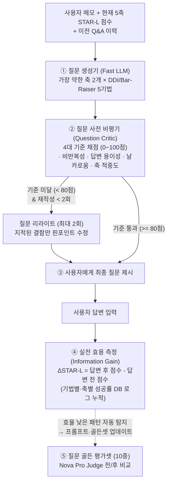
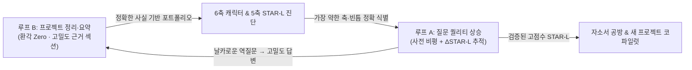

# QUALITY_LOOPS_PLAN.md — 질문 · 프로젝트 정리/요약 2대 품질 상승 루프 설계서

> **목적:** 지금까지 구축한 LangChain 관측성(`usage_metadata`), 외부 프롬프트 템플릿, 골든 평가셋(`eval/`), LangGraph 루프 인프라 위에 **① 질문 퀄리티 상승 루프**와 **② 프로젝트 정리·요약 퀄리티 상승 루프**를 얹어, AI 출력 품질이 "운"이 아니라 **측정 → 비평 → 개선의 폐루프(Closed-Loop)**로 계속 높아지게 만드는 설계서입니다.

---

## 1. 한눈에 보기: 왜 "1회성 생성"에서 "품질 상승 루프"로 가야 하나?

현재 우리 앱의 핵심 입력(경험 채굴·프로젝트 정리)은 대부분 **1-Pass(한 번 생성하고 끝)** 구조입니다.

| 구분 | 현재 방식 (1-Pass) | 품질 상승 루프 (Closed-Loop) |
| :--- | :--- | :--- |
| **역질문 / 회고 질문** | LLM이 질문 2개를 한 번 뽑아 바로 사용자에게 전달 | **사전 비평(Critic)**으로 모호·중복·폐쇄형 질문 걸러냄 + 답변 후 **실제 점수 상승폭(`ΔSTAR-L`)**을 기록해 잘 먹히는 질문 패턴을 학습 |
| **프로젝트 정리 / 요약** | 긴 문서·GitHub 코드를 한 번에 10개 섹션으로 통요약 | **1단계 사실 팩트 추출(Evidence Map) → 2단계 트랙별 합성 → 3단계 환각·누락·중복 검증(Critic-Repair)** 후 반영 |
| **품질 개선 방식** | "왠지 좋아진 것 같다" (느낌 기반 프롬프트 수정) | **고정 골든 시험지 + Nova Pro LLM-as-a-Judge**로 변경 전/후 점수를 숫자로 비교해 확실히 오른 변경만 채택 |

---

## 2. 루프 A: 질문 퀄리티 상승 루프 (Question Quality Improvement Loop)

### 2.1 적용 대상
1. **경험 채굴 역질문** (`backend/app/graphs/interview_graph.py`)
2. **프로젝트 STAR-L 온보딩 역질문** (`POST /api/projects/{id}/star-onboarding/questions`)
3. **프로젝트 회고 인터뷰 질문** (`POST /api/projects/{id}/retrospective/questions`)

### 2.2 좋은 질문 vs. 나쁜 질문 (구체적 기준)

| 실패 유형 | 나쁜 질문 예시 (걸러내야 할 대상) | 좋은 질문 예시 (루프 통과 기준) |
| :--- | :--- | :--- |
| **폐쇄형 질문** | *"Redis를 도입해서 성능이 좋아졌나요?"* (네/아니오로 끝남) | *"Redis 도입 전후로 P99 응답시간이나 DB CPU가 어떤 수치로 변했나요?"* |
| **과부하 복합 질문** | *"당시 팀 구성과 본인 역할, 포기한 대안, 그리고 전후 수치를 모두 알려주세요."* (답변 피로감 큼) | *"캐싱 도입 시 Memcached 대신 Redis를 고른 결정적 제약조건 1가지는 무엇이었나요?"* |
| **문맥 중복 질문** | 이미 메모에 *"Kafka 사용"*이라고 썼는데 *"어떤 메시지 큐를 쓰셨나요?"* 재질문 | 이미 언급된 Kafka를 전제로 *"Kafka 파티션 키를 무엇으로 잡고 순서 보장을 설계했나요?"* |
| **약한 축 미적중** | `Action`은 85점인데 `Result`가 25점인 상태에서 또 `Action`을 질문 | 가장 점수가 낮은 `Result(25점)` 축에 `xyz_quantification` 기법을 정조준 |

### 2.3 3단계 폐루프 아키텍처

### 2.4 단계별 핵심 설계
1. **질문 사전 비평기 (`Question Critic-Refiner`, 최대 2회 루프):**
   - **코드 레벨 빠른 검사(비용 0원):** 이미 물어본 질문과 2-gram 유사도가 높거나, 한 질문에 물음표(`?`)가 2개 이상이거나, 130자를 넘는 장황한 질문은 즉시 리라이트 대상 지정.
   - **경량 LLM 비평(Fast LLM):** `비반복성(25) + 답변 용이성(25) + 날카로움(25) + 약한 축 적중도(25)` 100점 만점 채점 → **80점 미만이면 최대 2회까지 수정** (2회 완료 또는 80점 이상 시 즉시 통과).
2. **실전 효용 피드백 (`ΔSTAR-L` Information Gain 로그):**
   - `question_feedback_logs` (또는 경량 JSONB 로그)에 `[프로빙 기법, 타겟 축, 질문 전 점수, 질문 후 점수, Δscore, 사용자 스킵 여부]`를 기록.
   - 예: `counter_factual` 기법은 평균 `Δ +14점`인데 `learning_transfer`가 평균 `Δ +3점`에 그치면, 어떤 프롬프트 문구를 고쳐야 할지 데이터로 바로 확인 가능.
3. **질문 전용 골든 평가셋 (`backend/eval/question_golden_dataset.json`):**
   - 흔한 빈약 메모 10개(예: *"팀플로 쇼핑몰 백엔드 함"*, *"성능 최적화해서 빨라짐"*, *"협업 갈등을 대화로 잘 풀었음"* 등)를 고정 시험지로 두고, 프롬프트를 바꿀 때마다 **Nova Pro Judge**로 4지표 점수를 자동 비교.

---

## 3. 루프 B: 프로젝트 정리 & 요약 퀄리티 상승 루프 (Project Synthesis & Summary Loop)

### 3.1 적용 대상
1. **문서 → 프로젝트 자동 생성** (`analyze-document`)
2. **GitHub 딥 분석 → 멀티트랙 섹션·STAR-L 합성** (`analyze-github/stream`)
3. **개별 섹션 파일·메모 AI 업데이트** (`sections/{sec_id}/ingest-document`)
4. **프로젝트 AI 리캡 & 가지치기** (`recap`, `prune`)

### 3.2 기존 통요약(1-Pass)에서 발생하는 3대 품질 문제

| 문제 유형 | 실제 발생하는 증상 | 해결 전략 |
| :--- | :--- | :--- |
| **1. 환각·과장 (Low Faithfulness)** | README나 기획서에 없는 수치(*"응답속도 50% 개선"*)나 안 쓴 기술을 LLM이 그럴듯하게 덧붙임 | 원문에서 먼저 **검증된 팩트 카드**만 추출하고, 합성 후 **원문 대조 검증**으로 미확인 수치·기술 강제 제거 |
| **2. 핵심 누락 (Low Coverage)** | 긴 PDF/코드베이스를 한 번에 10개 섹션으로 요약하다 보니, 정작 중요한 트러블슈팅 원인이나 아키텍처 트레이드오프가 빠짐 | **Map(청크별 근거 추출) → Reduce(트랙 섹션 합성)** 2단계로 분리해 원문 핵심 사실의 손실 차단 |
| **3. 장황함·중복 (Low Signal-Density)** | `개요`, `아키텍처`, `핵심 구현` 섹션에 같은 배경 설명이 3번 반복되고, 추상적인 미사여구만 길어짐 | 섹션별 **고유 책임 범위(Owner Scope)** 명시 + **중복/미사여구 압축 검증**으로 면접관이 30초 만에 읽히는 밀도 확보 |

### 3.3 3단계 폐루프 아키텍처

```mermaid
flowchart TD
    RAW["원본 소스\n(PDF·PPTX·DOCX·MD / GitHub 코드 / 섹션 메모)"] --> MAP["① Evidence Map (근거 팩트 추출)\n청크별로 팩트 카드 추출\n· 기술 결정 · 수치 · 트러블슈팅 · 역할\n+ 출처 위치(파일명/페이지/헤더) 태깅"]
    MAP --> REDUCE["② Track-Aware Section Synthesizer (섹션 합성)\n선택된 멀티트랙(Engineering/Product/Data/Ops)에 맞춰\n중복 없이 각 섹션별 고유 책임 범위만 배치"]
    REDUCE --> VERIFY["③ 3축 Critic 검증기 (Fact · Coverage · Density)\n1) 코드 검사: 원문에 없는 수치(%)·기술명 유입 탐지\n2) LLM 검사: 핵심 팩트 누락 & 섹션 간 중복/장황함 탐지"]
    VERIFY -->|"환각·누락·중복 감지\n(재수정 최대 2회)"| REPAIR["④ Auto-Repair (핀포인트 보정)\n환각 제거 · 누락 팩트 복구 · 중복 압축"]
    REPAIR --> FINAL["최종 프로젝트 섹션 + 출처 근거 + 품질 배지\n(Before/After Diff 제공)"]
    VERIFY -->|"3축 모두 기준 통과"| FINAL
    FINAL -.-> EVAL["⑤ 요약 골든 케이스 평가 (6~8종)\nFaithfulness · Coverage · Density · Track Fit"]
```

### 3.4 단계별 핵심 설계
1. **Evidence Map(근거 카드) → Reduce(트랙별 합성) 2단계 분리:**
   - 기존에는 12,000자 원문을 통째로 넣고 10개 섹션 JSON을 한 번에 뽑느라 `max_tokens` 잘림과 정보 누락이 잦았습니다.
   - 개선 후에는 먼저 Fast LLM으로 원문 청크에서 **구조화된 팩트 카드 목록(`fact`, `category`, `metric`, `source_ref`)**을 추출(Map)한 뒤, Smart LLM이 이 팩트 카드를 각 트랙 섹션에 중복 없이 배치(Reduce)합니다.
   - 장점: 모든 정리 문장에 `[근거: architecture.md]` 출처가 남아 신뢰도가 올라가고, 출력 토큰 폭발도 자연스럽게 방지됩니다.
2. **3축 검증 & 자동 보정 (`Fact-Faithfulness` × `Key-Coverage` × `Signal-Density`, 최대 2회):**
   - **Fact-Faithfulness (사실 충실도):** 코드 레벨 정규식으로 합성 결과에 등장한 수치(`%`, `ms`, `배`, `건`, `명`)가 원본 팩트 카드/원문에 실제로 존재하는지 1차 검증 + LLM 교차 확인.
   - **Key-Coverage (핵심 보존율):** Evidence Map에서 `importance="high"`로 뽑힌 핵심 의사결정·수치가 최소 1개 섹션에 반영되었는지 체크.
   - **Signal-Density (정보 밀도):** 섹션 간 2-gram 중복률이 임계치(예: 35%)를 넘거나 추상 수식어 비율이 높으면 자동으로 중복 제거 및 불릿 압축.
3. **요약 전용 골든 평가셋 (`backend/eval/summary_golden_dataset.json`):**
   - 대표적인 기획서·기술 블로그·GitHub 요약 샘플 6~8종과 사람이 정리한 필수 포함 팩트 체크리스트를 준비해, 프롬프트/파이프라인 변경 전후를 **Faithfulness · Coverage · Density · Track Fit** 4지표로 정량 비교.

---

## 4. 두 루프가 만드는 커리어 스튜디오 전체 선순환

- **루프 B**가 원문에서 환각 없이 핵심 사실만 깔끔하게 정리해 주면,
- **5축 STAR-L / 6축 캐릭터 진단**이 진짜 부족한 빈틈을 정확히 짚어내고,
- **루프 A**가 그 빈틈을 가장 적은 피로도로 채워주는 날카로운 역질문을 던져,
- 결과적으로 **자소서 공방과 새 프로젝트 코파일럿의 입력 재료 품질 자체가 근본적으로 상승**합니다.

---

## 5. 권장 구현 로드맵 (한 번에 하나씩 · 숫자로 검증)

| 단계 | 작업 내용 | 핵심 산출물 & 완료 기준 (KPI) |
| :---: | :--- | :--- |
| **Step 1** 골든 평가셋 구축 | 질문 골든셋(10종) + 요약 골든셋(6~8종) 및 `eval/run_quality_eval.py` 구축 → **현재(Baseline) 점수 먼저 측정** | Baseline 4지표(질문) + 4지표(요약) 실측 리포트 확보 |
| **Step 2** 루프 A 구현 & 전후 비교 | `question_critic.py` (코드 필터 + Fast LLM 사전 비평·1회 리라이트) + `ΔSTAR-L` 효용 로깅 적용 (`interview_graph` · 온보딩 · 회고) | 골든셋 기준 **날카로움·축 적중도 상승**, 중복/폐쇄형 질문 **0건** 확인 |
| **Step 3** 루프 B 구현 & 전후 비교 | `evidence_mapper.py` (Evidence Map → Reduce 2단계) + `summary_verifier.py` (수치 환각 코드 검사 + 3축 Critic-Repair 1회) 적용 | 골든셋 기준 **환각 수치 0건**, **핵심 팩트 보존율(Coverage) ≥ 90%**, 섹션 간 중복률 대폭 감소 확인 |

---

## 6. 다음 결정 사항

1. 두 루프 중 **루프 A(질문 퀄리티)**와 **루프 B(프로젝트 정리/요약 퀄리티)** 어느 쪽부터 먼저 착수할까요? (또는 Step 1 골든 평가셋을 둘 다 한꺼번에 만든 뒤 A → B 순서로 진행할까요?)
2. 각 루프의 최대 재시도 횟수는 **응답 속도·비용 균형을 위해 1회**로 설계했는데, 더 엄격한 품질이 필요하면 2회까지 확장할 수 있습니다.
3. EC2 새 퍼블릭 IP를 알려주시면, 앞서 완료한 **LangChain/LangGraph 고도화(`5d70c84`) 배포 및 RAG 정량 평가**를 먼저 마무리한 뒤 이 설계서대로 바로 이어서 진행하겠습니다!
