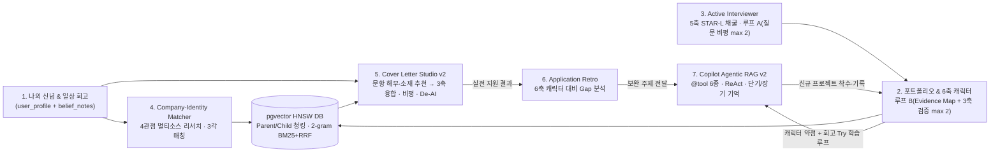
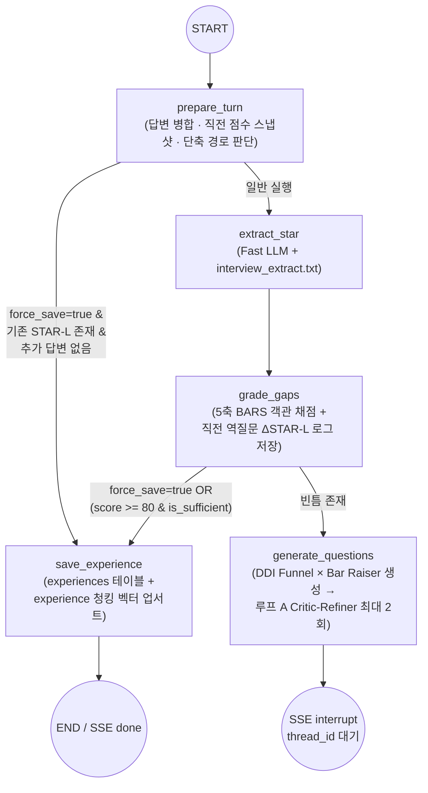
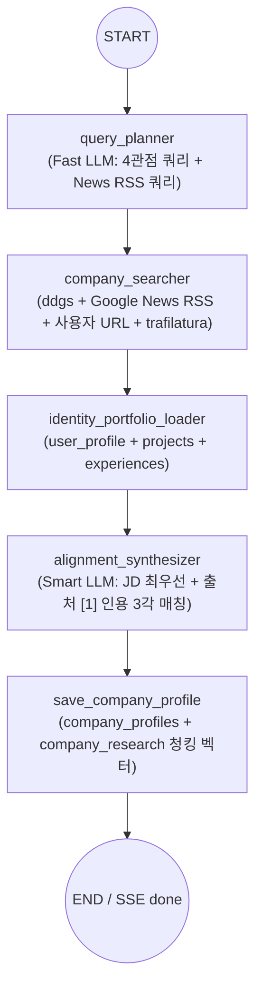
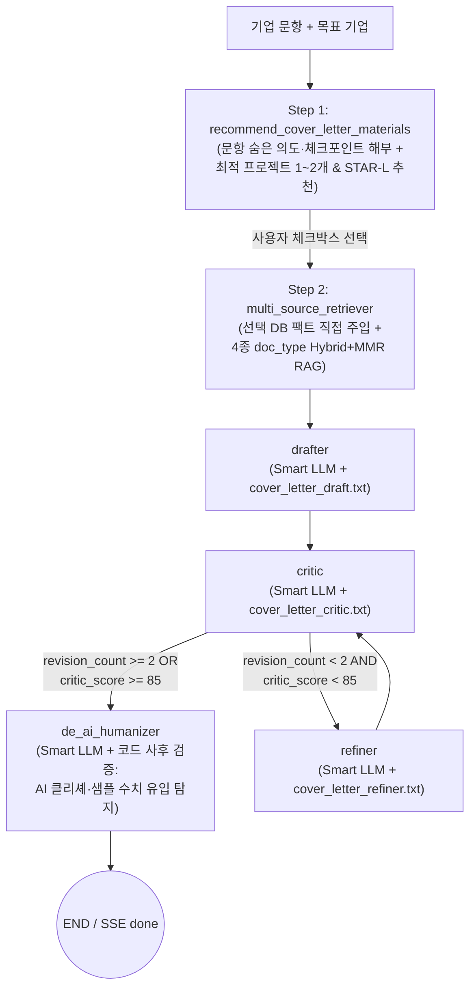
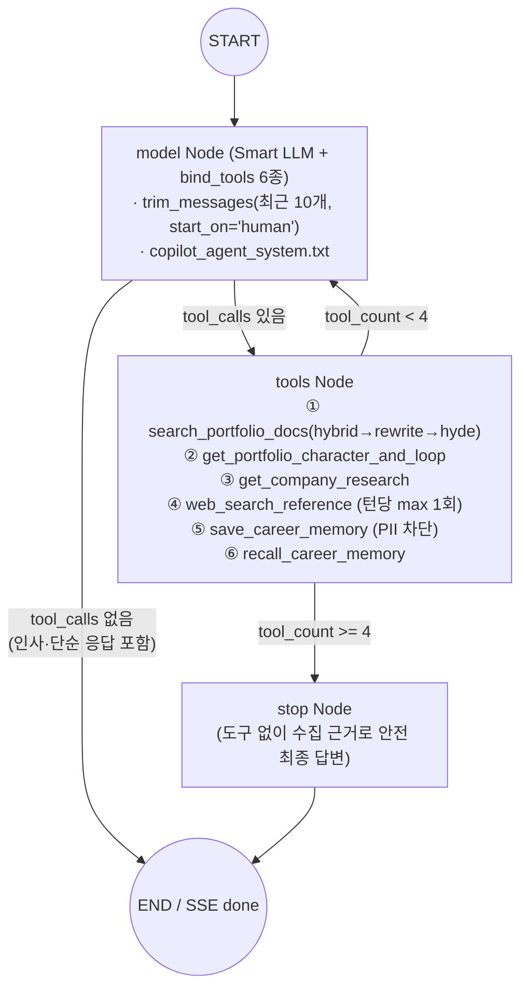

# WORKFLOWS.md — LangGraph AI 에이전트 & 품질 상승 루프 명세서

이 문서는 **개인화 커리어·포트폴리오 AI 에이전트 (`write-on-vibe-lab`)**의 **LangGraph 에이전트 워크플로우**, **객관화 평가 루브릭**, 그리고 **질문(루프 A)·요약(루프 B) 품질 상승 루프**의 노드 구조, 조건부 분기, 기억 계층, 가드레일 및 SSE 스트리밍 규약을 정리한 문서입니다.

---

## 1. 전체 순환형(Closed-Loop) 에이전트 연결 구조

---

## 2. 공통 에이전트 실행 규약

### 2.1 AWS Bedrock 모델 티어링 & 관측성 (`backend/app/core/bedrock.py`)
- **Fast Tier (`amazon.nova-lite-v1:0`, `max_tokens=2048`):** 쿼리 플래닝, STAR-L 추출, 5축 BARS 채점, DDI/Bar-Raiser 역질문 생성, 질문 비평/리라이트(루프 A), Evidence Map 추출 및 3축 요약 비평(루프 B), Query Rewrite / HyDE
- **Smart Tier (`amazon.nova-pro-v1:0`, `max_tokens=5000`):** 기업 3각 매칭, 6축 캐릭터 진단, 자소서 문항 해부·추천·초안·비평·퇴고·De-AI, 문서/GitHub 합성 & Auto-Repair(루프 B), Agentic RAG 코파일럿(`bind_tools`), 취준 회고 Gap 분석, LLM-as-a-Judge 평가 채점자
- **Embedding (`amazon.titan-embed-text-v2:0`, 1024차원):** Parent/Child 청크 및 `AsyncPostgresStore` 장기 기억 벡터화
- **관측성 & 안정성:** 모든 프롬프트는 `backend/app/prompts/*.txt` (`<role>/<rules>/<output_format>`)로 외부화되며, `ainvoke_structured()`/`ainvoke_tracked()`가 `input_tokens`, `output_tokens`, `stopReason`(`max_tokens` 자동 경고), `latencyMs`를 `LLMTelemetryTracker`로 집계합니다.

### 2.2 RAG 검색 엔진 v2 (`backend/app/core/vector_store.py`)
- **필수 격리:** 모든 검색은 5종 `DocType` (`experience`, `career_identity`, `company_research`, `jasoseo_sample`, `interest_clip`) 필터를 강제합니다.
- **청킹 & 인덱스:** 장문(> 620자)은 `MarkdownHeaderTextSplitter` + `RecursiveCharacterTextSplitter(500/100)`로 Parent/Child(`ref_id::c0..cN`) 분할하고 HNSW 인덱스로 검색합니다.
- **다전략 검색:** `basic` / `hybrid`(한국어 2-gram BM25 + Vector RRF) / `rewrite` / `hyde` + `max_distance` 임계값 + `MMR` 다양성 재정렬 + 표준 출처 태그(`[출처: ...]`).

---

## 3. 객관화 평가 루브릭 & 2대 품질 상승 루프

### 3.1 5축 STAR-L BARS & 6축 포트폴리오 캐릭터 (`star_rubric.py`)
- **5축 STAR-L:** `0.15S + 0.15T + 0.35A + 0.25R + 0.10L` (BARS Lv.1~5 풀 앵커 + `S/A/B/C/D` 등급 + 정량/행동 미기재 시 코드 레벨 하드 캡)
- **6축 캐릭터:** 내적 3축 × 외적 3축(`KFLA × Google × Spencer Iceberg`), `verified`/`partial`/`missing` 정직성 규칙, 강점 50 : 약점 50 균형 리포트
- **프로젝트 회고 학습 루프:** `KPT` / `4Ls` / `Post-Mortem` 인터뷰에서 추출한 `try_items`를 **7. 새 프로젝트 코파일럿**으로 자동 인계

### 3.2 루프 A — 질문 퀄리티 상승 루프 (`question_critic.py`, 최대 2회)
- **적용처:** 경험 채굴 역질문(`interview_graph`), 프로젝트 STAR-L 온보딩 역질문, 프로젝트 회고 인터뷰 질문
- **흐름:** `질문 생성` → `코드 린터`(폐쇄형·물음표 2개+·135자 초과·2-gram 중복·약한 축 미적중) + `Fast LLM 4축 비평(100점)` → 80점 미만 또는 린트 결함 시 **최대 2회 핀포인트 리라이트**
- **실전 효용 추적:** 사용자 답변 직후 `ΔSTAR-L = 답변 후 점수 - 답변 전 점수`를 `question_feedback_logs`에 자동 기록 (`GET /api/agents/question-quality/stats` 집계)

### 3.3 루프 B — 프로젝트 정리·요약 퀄리티 상승 루프 (`summary_verifier.py`, 최대 2회)
- **적용처:** 문서→프로젝트 자동 생성(`analyze_document_to_portfolio`), 문서 기반 섹션 Diff-Merge 업데이트(`propose_document_updates`)
- **흐름:** `Stage 1 Evidence Map`(원문 청크별 확인 팩트·수치·출처 카드 추출) → `Stage 2 트랙별 섹션 합성(Reduce)` → `Stage 3 3축 검증(Fact-Faithfulness · Key-Coverage · Signal-Density)`(코드 미확인 수치 탐지 + 섹션 간 2-gram 중복률 `< 0.42`) → 기준 미달 시 **최대 2회 Auto-Repair**

---

## 4. 워크플로우 ①: 경험 채굴 & 루프 A 역질문 (`interview_graph.py`)

- **엔드포인트:** `POST /api/agents/interview/start`, `/reply` (SSE) | **체크포인터:** `AsyncPostgresSaver` (`thread_id`, `recursion_limit=12`)

---

## 5. 워크플로우 ②: 목표 기업 멀티소스 리서치 & 신념 3각 매칭 (`company_graph.py`)

- **엔드포인트:** `POST /api/agents/company/research` (SSE), `GET / DELETE /api/companies` (REST)

---

## 6. 워크플로우 ③: 자소서 공방 v2 (`cover_letter_graph.py`)

- **엔드포인트:** 1단계 `POST /api/agents/cover-letter/recommend` (REST) → 2단계 `POST /api/agents/cover-letter/generate` (SSE)

---

## 7. 워크플로우 ④: 지원 회고 & Agentic RAG 새 프로젝트 코파일럿

### 7.1 모드 B — 지원 & 취준 회고 (`copilot_graph.py`)
- **엔드포인트:** `POST /api/agents/applications/retrospect` (SSE)
- **흐름:** `load_retro_context` (6축 캐릭터 + 프로젝트 + STAR-L + 과거 이력) → `analyze_gap_and_plan` (Gap 분석 + 단기/중기 플랜 + 코파일럿 주제) → `save_application_log`

### 7.2 모드 A-1 — 보완형 새 프로젝트 청사진 추천 (`copilot_graph.py`)
- **엔드포인트:** `POST /api/agents/copilot/propose-projects` (REST)
- **흐름:** `6축 캐릭터 약점` + `기업 리서치` + `이전 프로젝트 회고 Try 학습 루프` + `실시간 웹 검색` → 보완형 새 프로젝트 청사진 2~3종 생성

### 7.3 모드 A-2 — Agentic RAG 코파일럿 채팅 (`copilot_agent_graph.py` + `copilot_tools.py`)
- **엔드포인트:** `POST /api/agents/copilot/chat` (SSE), `GET /api/agents/copilot/history/{thread_id}`, `GET / DELETE /api/agents/copilot/memories`
- **2계층 기억:** 단기 `AsyncPostgresSaver` (`thread_id`) + 장기 `AsyncPostgresStore` (`namespace=("default_user", "career_memories")`, Titan Embed v2)

- **2중 반복 상한:** 라우터 상한(`tool_count >= 4 → stop`) + LangGraph 실행 상한(`recursion_limit=14`).

---

## 8. 오프라인 정량 평가 스위트 (`backend/eval/`)

| 평가 스크립트 | 골든 데이터셋 | 비교 대상 & 지표 |
| :--- | :--- | :--- |
| [run_eval.py](backend/eval/run_eval.py) | `golden_dataset.json` (5유형 15문항) | Baseline(미청킹·basic) vs Chunked·Hybrid(2-gram BM25+RRF)·MMR·Rewrite·HyDE 검색(`Hit@3`, `MRR`, `OOS 차단률`) + Nova Pro 6지표 Judge + **Bedrock BYOI JSONL** |
| [run_quality_eval.py](backend/eval/run_quality_eval.py) | `question_golden_dataset.json` (10종) `summary_golden_dataset.json` (6종) | 루프 A(Baseline vs Critic-Refiner max 2): 코드 린트 + 4지표 Judge 루프 B(Baseline vs EvidenceMap+3축 검증 max 2): 환각 수치·중복률 + 4지표 Judge |
