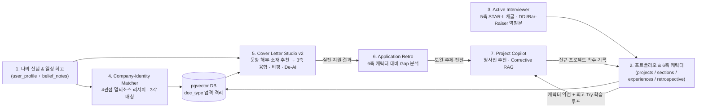
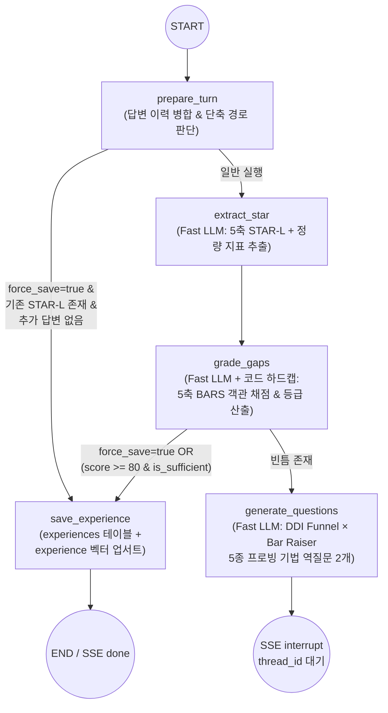
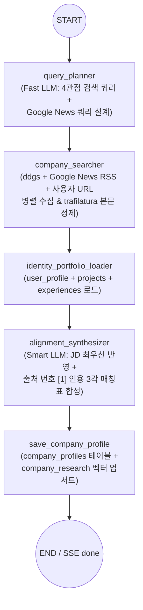
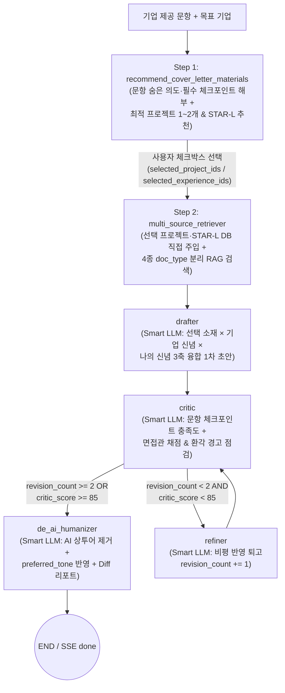
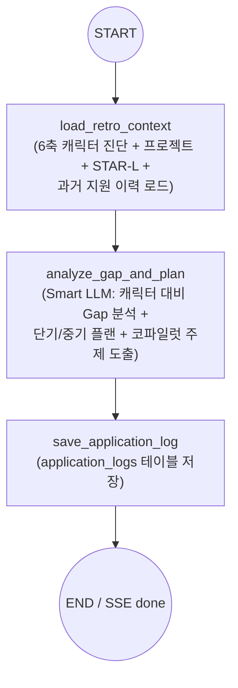
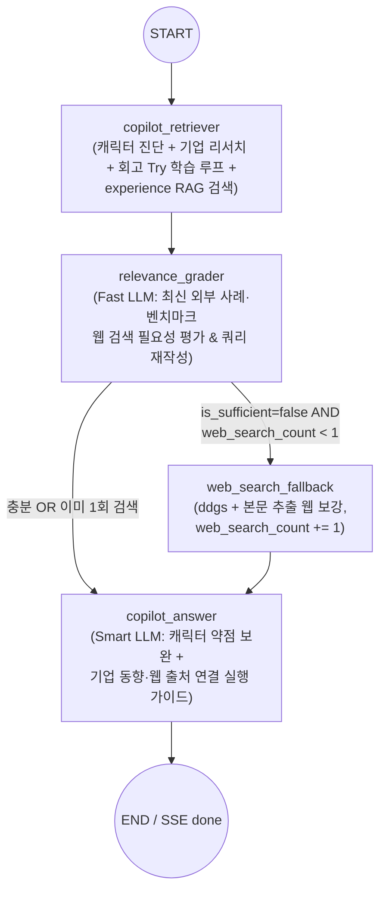

# WORKFLOWS.md — LangGraph AI 에이전트 & 평가 루브릭 명세서

이 문서는 **개인화 커리어·포트폴리오 AI 에이전트 (`write-on-vibe-lab`)**의 **4대 LangGraph 에이전트 워크플로우**와 **객관화 평가·회고 파이프라인**의 노드 구조, 조건부 분기, 가드레일 및 SSE 스트리밍 규약을 정리한 문서입니다.

---

## 1. 전체 순환형(Closed-Loop) 에이전트 연결 구조



---

## 2. 공통 에이전트 실행 규약

### 2.1 AWS Bedrock 모델 티어링 (`backend/app/core/bedrock.py`)
- **Fast Tier (`BEDROCK_FAST_MODEL_ID`, 기본 `amazon.nova-lite-v1:0`, `max_tokens=2048`):** 쿼리 플래닝, STAR-L 추출, 5축 BARS 채점, DDI/Bar-Raiser 역질문 생성, Corrective RAG 충분성 평가
- **Smart Tier (`BEDROCK_SMART_MODEL_ID`, 기본 `amazon.nova-pro-v1:0`, `max_tokens=5000`):** 기업 3각 매칭, 6축 캐릭터 진단, 자소서 문항 해부·추천·초안·비평·퇴고·De-AI, 문서/GitHub 합성, 프로젝트 회고 인터뷰, 코파일럿 청사진·채팅, 취준 회고 Gap 분석
- **Embedding (`BEDROCK_EMBED_MODEL_ID`, 기본 `amazon.titan-embed-text-v2:0`, 1024차원):** 한국어/다국어 문서 벡터화
- **Structured Output 안정성:** `ainvoke_structured()` 래퍼를 통해 1차 Native Tool-Calling 실패 시 명시적 JSON Schema 프롬프트 재시도(최대 2회) 및 `max_tokens` 잘림 시 `_repair_truncated_json()` 자동 복구를 수행합니다.

### 2.2 RAG 데이터 격리 (`doc_types` 필수 필터)
모든 벡터 검색(`search_documents`)은 아래 허용 `doc_type` Enum 중 필요한 타입을 명시해야 하며, 필터 없는 전체 검색을 금지합니다.
1. `experience` — 지원자 실제 경험 팩트 (`experiences`, `project_sections`)
2. `career_identity` — 지원자 신념·비전·선호 문체·일상 회고 저널 (`user_profile`, `belief_notes`)
3. `company_research` — 목표 기업 이념·비전·동향·3각 매칭 (`company_profiles`)
4. `jasoseo_sample` — 우수 자소서 레퍼런스 (*전개 구조·설득 논리 참고 전용*)
5. `interest_clip` — 레거시 호환용 예약 타입

### 2.3 공통 SSE 스트리밍 이벤트 포맷 (`backend/app/api/sse.py`)
```json
data: {"event": "node_start", "node": "critic", "message": "면접관 관점에서 초안을 평가하는 중..."}
data: {"event": "node_end", "node": "critic", "data": {"score": 78, "feedback": "..."}}
data: {"event": "interrupt", "thread_id": "exp-123", "data": {"questions": ["..."], "structured_questions": [...], "completeness_score": 65}}
data: {"event": "done", "data": {"final_text": "...", "diff_summary": ["..."]}}
data: {"event": "error", "message": "오류 설명"}
```

---

## 3. 객관화 평가 루브릭 & 프로젝트 회고 파이프라인 (`star_rubric.py`)

### 3.1 5축 STAR-L BARS 평가 체계 (`DDI BARS × Amazon Bar Raiser × Google XYZ`)
- **가중치 공식:** `0.15 × S + 0.15 × T + 0.35 × A + 0.25 × R + 0.10 × L`
- **5단계 행동 기준 척도(BARS Lv.1~5):** 각 축별로 `Lv.1(0~20)` ~ `Lv.5(81~100)` 풀 앵커 정의 + `S(90+)` / `A(80+)` / `B(65+)` / `C(50+)` / `D(<50)` 캘리브레이션 등급 부여
- **관대화 편향 방지 하드 캡(Code-Level Post-Validation):**
  - `Action`·`Result`가 빈약하거나 정량 수치가 전혀 없는 경우 LLM이 높은 점수를 주더라도 코드 레벨에서 상한을 강제 보정합니다.

### 3.2 6축 포트폴리오 캐릭터 진단 (`KFLA × Google 4 Attributes × Spencer Iceberg`)
- **내적 3축 (프로젝트 산출물 내부 역량):** 문제정의·전략(Problem Framing), 실행·기술깊이(Execution Depth), 성과·증거력(Evidence & Impact)
- **외적 3축 (운영·협업·메타 역량):** 협업·이해관계자 관리(People & Collaboration), 일정·우선순위·리스크 관리(Time & Scope Execution), 주도성·학습민첩성(Ownership & Learning Agility)
- **정직성 가드레일:** 각 축을 `verified` / `partial` / `missing` 증거 상태로 판별하고, **강점 50 : 약점·사각지대 50** 균형 리포트를 산출합니다. 외적 축은 프로젝트 회고 및 선택형 외적 역량 보조 메모(`external_competency_notes`)까지 통합 반영합니다.

### 3.3 프로젝트 회고 인터뷰 & 프로젝트 간 학습 루프
- **엔드포인트:** `POST /api/projects/{id}/retrospective/questions`, `/apply`, `GET /api/projects/learning-loop`
- **프레임워크:** `KPT` (Keep-Problem-Try) / `4Ls` (Liked-Learned-Lacked-Longed for) / `Post-Mortem` (Blameless Root-Cause)
- **학습 루프 연결:** 회고 인터뷰에서 추출된 `try_items` 규칙은 `projects.retrospective`에 저장되며, **7. 새 프로젝트 코파일럿**의 청사진 추천 및 설계 채팅 컨텍스트에 자동 주입됩니다.

---

## 4. 워크플로우 ①: 경험 채굴 & DDI/Bar-Raiser 역질문 루프 (`Active Interviewer`)

- **구현 파일:** [interview_graph.py](./backend/app/graphs/interview_graph.py)
- **엔드포인트:** `POST /api/agents/interview/start` / `POST /api/agents/interview/reply` (SSE)
- **상태 영속화:** `AsyncPostgresSaver` Checkpointer + `thread_id`



### 5종 구조화 프로빙 기법 (`PROBING_TECHNIQUES`)
- `ownership_drilldown` ('I' Rule — 팀 성과에서 본인 고유 의사결정 경계 분리)
- `micro_behavioral` (추상적 요약을 실제 행동·데이터·소통 장면으로 분해)
- `counter_factual` (포기한 대안·제약조건·트레이드오프 근거 검증)
- `xyz_quantification` (Google XYZ 전후 비교 수치·규모·검증 근거 확인)
- `learning_transfer` (단순 소감 대신 재발 방지 설계·다음 프로젝트 적용 원칙 도출)

### 핵심 가드레일
- 거친 메모에 언급되지 않은 수치·기술·성과는 절대 날조하지 않습니다.
- 이미 물어본 질문 목록(`prev_qs`)을 전달해 중복 역질문을 차단하고, 현재 점수가 가장 낮은 STAR-L 축 2개를 서로 다른 기법으로 공략합니다.
- 사용자가 **`[이 상태로 저장하기]` (`force_save=true`)**를 보내면 완성도 점수와 무관하게 즉시 `save_experience` 노드로 탈출합니다.

---

## 5. 워크플로우 ②: 목표 기업 멀티소스 리서치 & 신념 3각 매칭 (`Company-Identity Matcher`)

- **구현 파일:** [company_graph.py](./backend/app/graphs/company_graph.py)
- **엔드포인트:** `POST /api/agents/company/research` (SSE), `GET / DELETE /api/companies` (REST)



### 3각 매칭 출력 구조 (`value_alignment_map.triangular_matches`)
- `company_vision_or_issue`: 기업의 비전·핵심가치·기술/사업 과제 (출처 번호 `[1]` 등 인용)
- `my_belief`: 연결되는 지원자의 커리어 신념
- `proof_project`: 이를 증명하는 지원자의 실제 프로젝트·STAR-L 경험
- `pitch_angle`: 자소서·면접에서 설득력 있게 풀어낼 핵심 논리 1~2문장

---

## 6. 워크플로우 ③: 자소서 공방 v2 (`Recommend` → `Critic-Refiner-Humanizer`)

- **구현 파일:** [cover_letter_graph.py](./backend/app/graphs/cover_letter_graph.py)
- **엔드포인트:**
  - 1단계: `POST /api/agents/cover-letter/recommend` (REST)
  - 2단계: `POST /api/agents/cover-letter/generate` (SSE)



### 핵심 가드레일
1. **환각 방지 규칙:**
   > `jasoseo_sample`은 문단 전개 구조와 설득 논리만 참고한다. 샘플 속 경험·수치·기업명을 지원자의 사실처럼 차용하는 것을 엄격히 금지하며, 모든 사실 근거는 사용자가 선택한 프로젝트·`experience`에서만 가져온다.
2. **유효 ID 코드 검증:** 1단계 추천 결과에서 DB에 실제 존재하는 `project_id` / `experience_id`만 필터링합니다.
3. **무한 루프 차단:** `revision_count >= 2`에 도달하거나 `critic_score >= 85`이면 무조건 `de_ai_humanizer` 노드로 전환합니다.
4. **De-AI Humanizer:** 상투적 AI 표현 제거, 추상 수식어 축소(실제 기술명·수치·행동 동사 중심), 문장 호흡 다양화, `preferred_tone` 반영 및 `humanizer_changes` Diff 리포트 반환.

---

## 7. 워크플로우 ④: 지원 회고 & 새 프로젝트 코파일럿 (`copilot_graph.py`)

- **구현 파일:** [copilot_graph.py](./backend/app/graphs/copilot_graph.py)

### 7.1 모드 B — 지원 & 취준 회고 Gap 플래너 (`6. 지원 & 취준 회고`)
- **엔드포인트:** `POST /api/agents/applications/retrospect` (SSE), `GET / DELETE /api/applications` (REST)



- 도출된 `recommended_copilot_topic`은 UI에서 버튼 한 번으로 **7. 새 프로젝트 코파일럿**의 기획 주제로 전달됩니다.

### 7.2 모드 A-1 — 보완형 새 프로젝트 청사진 추천 (`7. 새 프로젝트 코파일럿`)
- **엔드포인트:** `POST /api/agents/copilot/propose-projects` (REST)
- **흐름:** `6축 캐릭터 약점` + `기업 리서치` + `이전 프로젝트 회고 Try 학습 루프` + `신념·일상 회고 저널` + `실시간 웹 검색(선택)` → 서로 다른 각도의 보완형 새 프로젝트 청사진 2~3종(추천 멀티트랙·실행 로드맵·남겨야 할 증거 계획) 생성.

### 7.3 모드 A-2 — 새 프로젝트 설계 코파일럿 채팅 (Corrective RAG)
- **엔드포인트:** `POST /api/agents/copilot/chat` (SSE)



- **가드레일:** Corrective RAG 웹 검색 Fallback은 요청당 **최대 1회**로 엄격히 제한합니다.

---

## 8. 에이전트별 가드레일 요약

| 워크플로우 | 주요 모델 | 루프 / 안전장치 | 저장소 연동 |
| :--- | :--- | :--- | :--- |
| **① 경험 채굴 (STAR-L)** | Fast LLM | `AsyncPostgresSaver` + `thread_id`, BARS 하드 캡, `force_save=true` 즉시 탈출 | `experiences` + `experience` 벡터 |
| **② 기업 리서치** | Fast + Smart | 웹 타임아웃 격리, 출처 번호 `[1]` 인용, JD 최우선 반영 | `company_profiles` + `company_research` 벡터 |
| **③ 자소서 공방 v2** | Smart LLM | 유효 ID 검증, `revision_count >= 2` 또는 `critic_score >= 85` 강제 전환, `jasoseo_sample` 사실 차용 금지 | 선택 DB 사실 주입 + 4종 `doc_type` 분리 RAG |
| **④ 지원 회고** | Smart LLM | 6축 캐릭터 약점 대조, 코파일럿 주제 원클릭 연계 | `application_logs` |
| **④ 새 프로젝트 코파일럿** | Fast + Smart | Corrective RAG 웹 검색 요청당 **최대 1회** 제한, 회고 `Try` 학습 루프 자동 주입 | `experience` + 캐릭터/기업/회고 종합 컨텍스트 |
