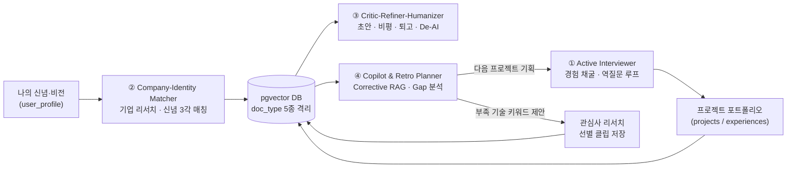
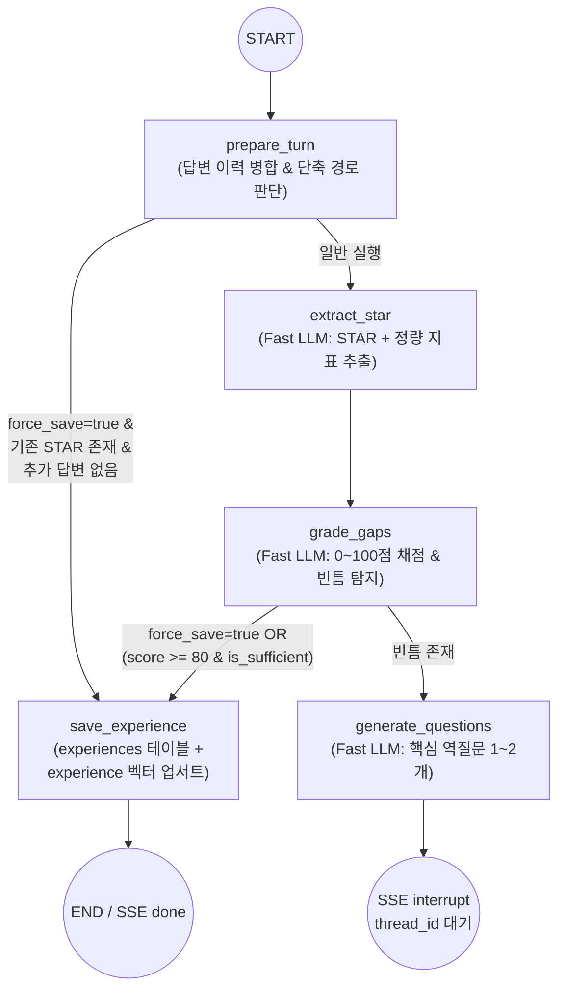
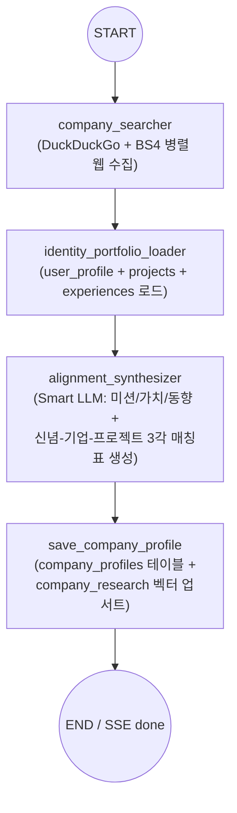
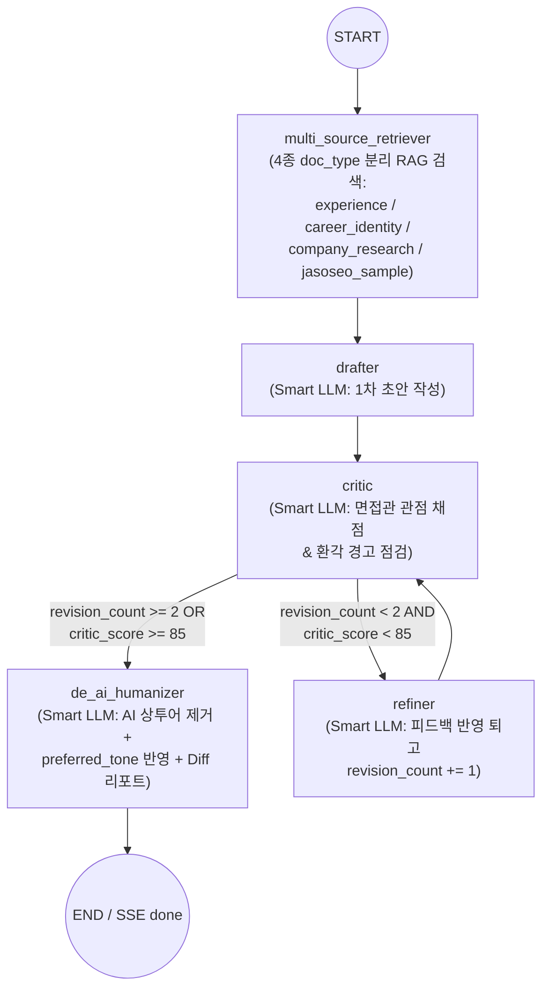
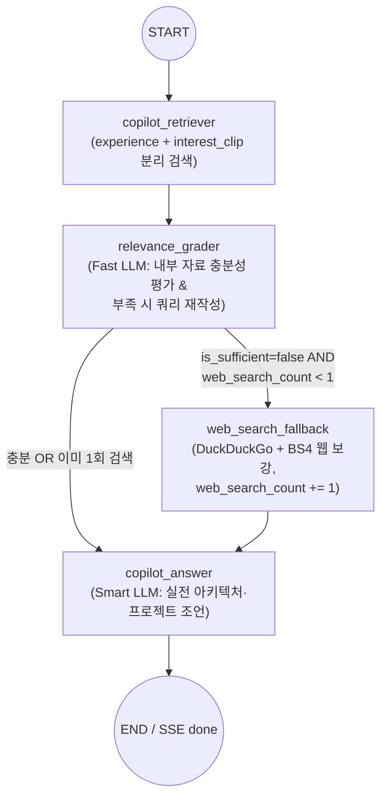
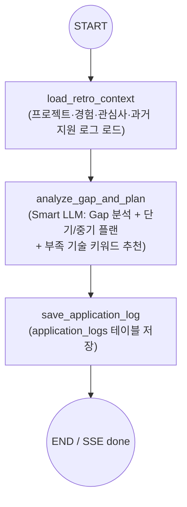

# WORKFLOWS.md — LangGraph AI 에이전트 워크플로우 명세서

이 문서는 **개인화 커리어·포트폴리오 AI 에이전트 (`write-on-vibe-lab`)**의 핵심 **4대 LangGraph 에이전트 워크플로우**와 보조 리서치 파이프라인의 노드 구조, 조건부 분기, 가드레일 및 SSE 스트리밍 규약을 정리한 문서입니다.

---

## 1. 전체 순환형(Closed-Loop) 에이전트 연결 구조



---

## 2. 공통 에이전트 실행 규약

### 2.1 AWS Bedrock 모델 티어링 (`backend/app/core/bedrock.py`)
- **Fast Tier (`BEDROCK_FAST_MODEL_ID`):** STAR 추출, 완성도 채점, 역질문 생성, 관련성 평가, 관심사 요약 등 빠른 판단/구조화 작업
- **Smart Tier (`BEDROCK_SMART_MODEL_ID`):** 기업 3각 매칭, 자소서 초안·비평·퇴고·De-AI 교정, 코파일럿 조언, 취준 회고 Gap 분석 등 고난도 추론/작문 작업
- **Structured Output 안정성:** `ainvoke_structured()` 래퍼를 통해 JSON 파싱 실패 시 **최대 1회 자동 재시도**

### 2.2 RAG 데이터 격리 (`doc_types` 필수 필터)
모든 벡터 검색(`search_documents`)은 아래 5종 `doc_type` Enum 중 필요한 타입을 명시해야 하며, 필터 없는 전체 검색을 금지합니다.
1. `experience` — 지원자 실제 경험 팩트
2. `career_identity` — 지원자 신념·비전·선호 문체
3. `company_research` — 목표 기업 이념·비전·동향·3각 매칭
4. `interest_clip` — 관심 분야 외부 기술/트렌드 선별 클립
5. `jasoseo_sample` — 우수 자소서 레퍼런스 (*전개 구조·설득 논리 참고 전용*)

### 2.3 공통 SSE 스트리밍 이벤트 포맷 (`backend/app/api/sse.py`)
```json
data: {"event": "node_start", "node": "critic", "message": "면접관 관점에서 초안을 평가하는 중..."}
data: {"event": "node_end", "node": "critic", "data": {"score": 78, "feedback": "..."}}
data: {"event": "interrupt", "thread_id": "exp-123", "data": {"questions": ["..."], "completeness_score": 65}}
data: {"event": "done", "data": {"final_text": "...", "diff_summary": ["..."]}}
data: {"event": "error", "message": "오류 설명"}
```

---

## 3. 워크플로우 ①: 경험 채굴 & 연속 역질문 루프 (`Active Interviewer`)

- **구현 파일:** [interview_graph.py](./backend/app/graphs/interview_graph.py)
- **엔드포인트:** `POST /api/agents/interview/start` / `POST /api/agents/interview/reply` (SSE)
- **상태 영속화:** `AsyncPostgresSaver` Checkpointer + `thread_id`



### 핵심 동작 & 가드레일
- 거친 메모에서 언급되지 않은 수치·기술·성과는 절대 추측하거나 날조하지 않습니다.
- 완성도 80점 미만이면 빠진 정량 지표·트러블슈팅 원인·본인 기여도를 묻는 역질문 1~2개를 `interrupt` 이벤트로 반환합니다.
- 사용자가 **`[이 상태로 저장하기]` (`force_save=true`)**를 보내면 완성도 점수와 무관하게 즉시 `save_experience` 노드로 탈출해 저장합니다.

---

## 4. 워크플로우 ②: 목표 기업 리서치 & 신념 3각 매칭 (`Company-Identity Matcher`)

- **구현 파일:** [company_graph.py](./backend/app/graphs/company_graph.py)
- **엔드포인트:** `POST /api/agents/company/research` (SSE), `GET /api/companies` (REST)



### 3각 매칭 출력 구조 (`value_alignment_map.triangular_matches`)
각 매칭 항목은 아래 4요소를 연결합니다.
- `company_vision_or_issue`: 기업의 비전·핵심가치·기술/사업 과제
- `my_belief`: 연결되는 지원자의 커리어 신념
- `proof_project`: 이를 증명하는 지원자의 실제 프로젝트·STAR 경험
- `pitch_angle`: 자소서·면접에서 설득력 있게 풀어낼 핵심 논리 1~2문장

---

## 5. 워크플로우 ③: 자소서 생성 · 비평 · 퇴고 · De-AI 루프 (`Critic-Refiner-Humanizer`)

- **구현 파일:** [cover_letter_graph.py](./backend/app/graphs/cover_letter_graph.py)
- **엔드포인트:** `POST /api/agents/cover-letter/generate` (SSE)



### 핵심 가드레일
1. **환각 방지 규칙 (필수 프롬프트 제약):**
   > `jasoseo_sample`은 문단 전개 구조와 설득 논리만 참고한다. 샘플 속 경험·수치·기업명을 지원자의 사실처럼 차용하는 것을 엄격히 금지하며, 모든 사실 근거는 `experience`에서만 가져온다.
2. **무한 루프 차단:** `revision_count >= 2`에 도달하거나 `critic_score >= 85`이면 무조건 `de_ai_humanizer` 노드로 넘어갑니다.
3. **De-AI Humanizer 체크리스트:**
   - 상투적 AI 표현 제거 (`"~을 통해 한 단계 성장"`, `"귀사의 무궁한 발전"`, `"혁신적인 시너지"`, `"단순한 ~을 넘어"`, `"결론적으로"`)
   - 과도한 추상 명사·수식어 축소 → 실제 기술명, 수치, 행동 동사 중심 서술
   - 문장 길이 리듬 다양화 및 `user_profile.preferred_tone` 반영 + 변경 요약(`diff_summary`) 반환

---

## 6. 워크플로우 ④: 프로젝트 코파일럿 & 취준 회고 플래너 (`copilot_graph.py`)

- **구현 파일:** [copilot_graph.py](./backend/app/graphs/copilot_graph.py)

### 6.1 모드 A — 프로젝트 코파일럿 (Corrective RAG)
- **엔드포인트:** `POST /api/agents/copilot/chat` (SSE)



- **가드레일:** 웹 검색 Fallback은 요청당 **최대 1회**로 엄격히 제한합니다.

### 6.2 모드 B — 취준 결과 회고 & Gap 플래너
- **엔드포인트:** `POST /api/agents/applications/retrospect` (SSE), `GET/DELETE /api/applications` (REST)



- 도출된 `suggested_interests`는 기존 관심사와 중복 제거된 뒤 UI에서 원클릭으로 `user_interests` (`source="retrospective_suggested"`)에 추가할 수 있습니다.

---

## 7. 보조 파이프라인: 관심사 웹 리서치 & 선별 클립 저장

- **엔드포인트:** `POST /api/agents/interests/search` (SSE), `POST /api/agents/interests/clip` (REST)
- **흐름:** `web_search` (DuckDuckGo + BS4) → `summarizer` (Fast LLM 핵심 요약 + 실무 포인트 정리) → 사용자가 선택한 카드만 `interest_clip`으로 벡터 DB 저장 → 이후 워크플로우 ④ 코파일럿 RAG 컨텍스트로 재활용됩니다.

---

## 8. 에이전트별 가드레일 요약

| 워크플로우 | 주요 모델 | 루프 / 안전장치 | 저장소 연동 |
| :--- | :--- | :--- | :--- |
| **① 경험 채굴** | Fast LLM | `PostgresSaver` + `thread_id`, `force_save=true` 즉시 저장 탈출 | `experiences` + `experience` 벡터 |
| **② 기업 매칭** | Smart LLM | 웹 타임아웃 8초 격리, 지원자 사실 외 날조 금지 | `company_profiles` + `company_research` 벡터 |
| **③ 자소서 공방** | Smart LLM | `revision_count >= 2` 또는 `critic_score >= 85` 시 De-AI 강제 전환, `jasoseo_sample` 사실 차용 금지 | 4종 `doc_type` 분리 RAG 조회 |
| **④ 코파일럿** | Fast + Smart | Corrective RAG 웹 검색 요청당 **최대 1회** 제한 | `experience` + `interest_clip` 조회 |
| **④ 취준 회고** | Smart LLM | 기존 관심사 중복 제거 후 신규 부족 키워드 제안 | `application_logs` 저장 + `user_interests` 연동 |
