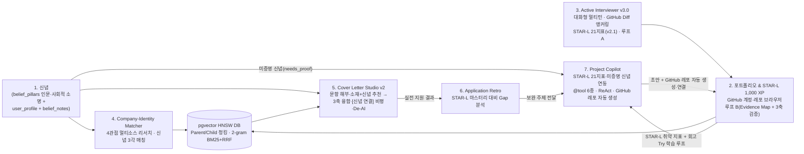
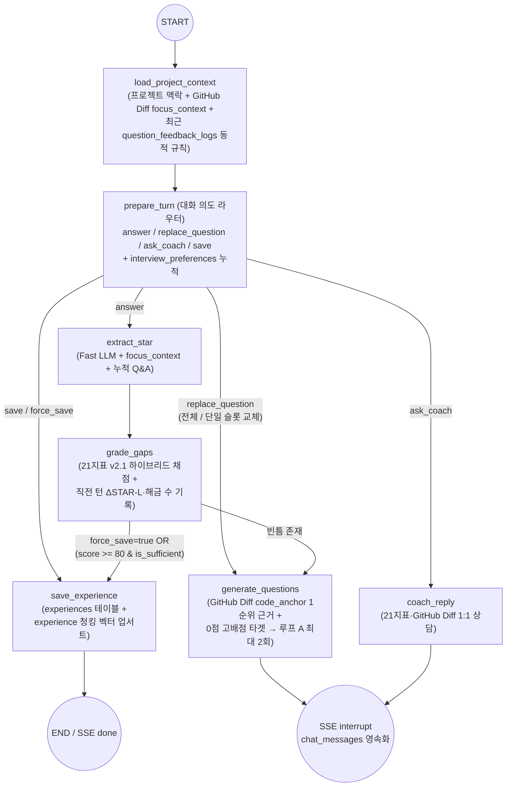
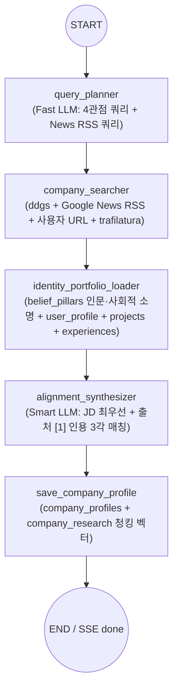
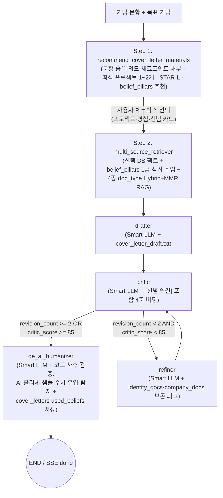
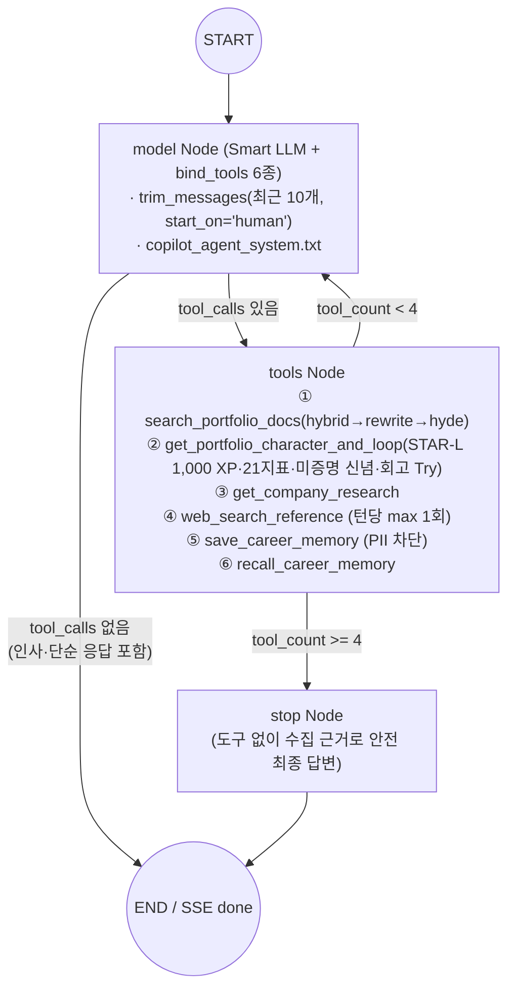

# WORKFLOWS.md — LangGraph AI 에이전트 & 품질 상승 루프 명세서

이 문서는 **개인화 커리어·포트폴리오 AI 에이전트 (`write-on-vibe-lab`)**의 **LangGraph 에이전트 워크플로우**, **객관화 평가 루브릭**, 그리고 **질문(루프 A)·요약(루프 B) 품질 상승 루프**의 노드 구조, 조건부 분기, 기억 계층, 가드레일 및 SSE 스트리밍 규약을 정리한 문서입니다.

---

## 1. 전체 순환형(Closed-Loop) 에이전트 연결 구조

---

## 2. 공통 에이전트 실행 규약

### 2.1 AWS Bedrock 모델 티어링 & 관측성 (`backend/app/core/bedrock.py`)
- **Fast Tier (`amazon.nova-lite-v1:0`, `max_tokens=2048`):** 쿼리 플래닝, 대화 의도 라우팅(`prepare_turn`), STAR-L 추출, 21지표 근거 판별(`rubric_v2.1`), DDI/Bar-Raiser·GitHub Diff 앵커링 역질문 생성, 보수적 질문 비평/리라이트(루프 A), Evidence Map 추출 및 3축 요약 비평(루프 B), Query Rewrite / HyDE
- **Smart Tier (`amazon.nova-pro-v1:0`, `max_tokens=5000`):** 커리어 신념 발굴·정제(`belief_pillars`), 기업 3각 매칭, 자소서 문항 해부·추천·초안·비평·퇴고·De-AI, 문서/GitHub 합성 & Auto-Repair(루프 B), Agentic RAG 코파일럿(`bind_tools`), 취준 회고 Gap 분석, LLM-as-a-Judge 평가 채점자
- **Embedding (`amazon.titan-embed-text-v2:0`, 1024차원):** Parent/Child 청크 및 `AsyncPostgresStore` 장기 기억 벡터화
- **관측성 & 안정성:** 모든 프롬프트는 `backend/app/prompts/*.txt` 17종(`<role>/<rules>/<output_format>`)로 외부화되며, `ainvoke_structured()`/`ainvoke_tracked()`가 `input_tokens`, `output_tokens`, `stopReason`(`max_tokens` 자동 경고), `latencyMs`를 `LLMTelemetryTracker`로 집계합니다.

### 2.2 RAG 검색 엔진 v2 (`backend/app/core/vector_store.py`)
- **필수 격리:** 모든 검색은 5종 `DocType` (`experience`, `career_identity`, `company_research`, `jasoseo_sample`, `interest_clip`) 필터를 강제합니다.
- **청킹 & 인덱스:** 장문(> 620자)은 `MarkdownHeaderTextSplitter` + `RecursiveCharacterTextSplitter(500/100)`로 Parent/Child(`ref_id::c0..cN`) 분할하고 HNSW 인덱스로 검색합니다.
- **다전략 검색:** `basic` / `hybrid`(한국어 2-gram BM25 + Vector RRF) / `rewrite` / `hyde` + `max_distance` 임계값 + `MMR` 다양성 재정렬 + 표준 출처 태그(`[출처: ...]`).

---

## 3. 객관화 평가 루브릭 & 2대 품질 상승 루프

### 3.1 STAR-L 21지표 하이브리드(`rubric_v2.1`) & 누적 1,000 XP (`star_rubric.py`)
- **21개 Atomic 체크포인트 (`S 12 · T 14 · A 36 · R 26 · L 12`):** LLM이 `0/1/2` 근거 인용(`evidence_quote`)만 판별하고, Python 결정론적 검증기가 원문 대조(`overlap ≥ 0.52`), 12종 하드 캡, 엄격 부분배점(`~30%`) 정수 합산을 수행합니다.
- **누적식 1,000 XP (구 6축 캐릭터 완전 대체):** 대표 4개 프로젝트 × 프로젝트당 최대 `250 XP` (경험 상위 4개 체감 수익 `100%·80%·50%·20%`, 5번째 이후 `0%`). 레벨 구간 `Lv.1 Seed ~ Lv.4 Bar Raiser`.
- **프로젝트 회고 학습 루프:** `KPT` / `4Ls` / `Post-Mortem` 인터뷰에서 추출한 `try_items`를 **7. 프로젝트 코파일럿**으로 자동 인계.

### 3.2 루프 A — 보수적 질문 퀄리티 상승 루프 (`question_critic.py`, 최대 2회)
- **적용처:** 경험 채굴 역질문(`interview_graph`), 프로젝트 회고 인터뷰 질문
- **흐름:** `질문 생성` → `코드 린터`(폐쇄형·물음표 2개+·135자 초과·2-gram 중복·타겟 미적중) + `Fast LLM 4축 비평(100점)` → `70점 미만` 또는 린트 결함 시 **최대 2회 핀포인트 리라이트**
- **실전 효용 추적:** 턴 전/후 `ΔSTAR-L`·해금 체크포인트 수·`👍/👎` 사유를 `question_feedback_logs`에, 완료 만족도·점수 체감을 `experience_feedback_logs`에 기록해 동적 `<user_feedback_rules>`로 반영.

### 3.3 루프 B — 프로젝트 정리·요약 퀄리티 상승 루프 (`summary_verifier.py`, 최대 2회)
- **적용처:** 문서→프로젝트 자동 생성(`analyze_document_to_portfolio`), 문서/GitHub/경험 역반영 Diff-Merge 업데이트(`propose_document_updates`)
- **흐름:** `Stage 1 Evidence Map`(원문 청크별 확인 팩트·수치·출처 카드 추출) → `Stage 2 트랙별 섹션 합성(Reduce)` → `Stage 3 3축 검증(Fact-Faithfulness · Key-Coverage · Signal-Density)`(코드 미확인 수치 탐지 + 섹션 간 2-gram 중복률 `< 0.42`) → 기준 미달 시 **최대 2회 Auto-Repair**

---

## 4. 워크플로우 ①: 대화형 멀티턴 경험 채굴 v3.0 (`interview_graph.py`)

- **엔드포인트:** `POST /api/agents/interview/start`, `/reply` (SSE), `GET /api/agents/interview/history/{thread_id}` | **체크포인터:** `AsyncPostgresSaver` (`thread_id`, `recursion_limit=12`)

---

## 5. 워크플로우 ②: 목표 기업 멀티소스 리서치 & 신념 3각 매칭 (`company_graph.py`)

- **엔드포인트:** `POST /api/agents/company/research` (SSE), `GET / DELETE /api/companies` (REST)

---

## 6. 워크플로우 ③: 자소서 공방 v2 & 신념 엔드투엔드 연동 (`cover_letter_graph.py`)

- **엔드포인트:** 1단계 `POST /api/agents/cover-letter/recommend` (REST) → 2단계 `POST /api/agents/cover-letter/generate` (SSE), 보관함 `CRUD /api/cover-letters`

---

## 7. 워크플로우 ④: 지원 회고 & Agentic RAG 프로젝트 코파일럿

### 7.1 모드 B — 지원 회고 (`copilot_graph.py`)
- **엔드포인트:** `POST /api/agents/applications/retrospect` (SSE)
- **흐름:** `load_retro_context` (실시간 STAR-L 1,000 XP·21지표 약점 + 미증명 신념 + 프로젝트 + STAR-L + 과거 이력) → `analyze_gap_and_plan` (Gap 분석 + 단기/중기 플랜 + 코파일럿 주제) → `save_application_log`

### 7.2 모드 A-1 — STAR-L 보완형 청사진 추천 & GitHub 새 레포 자동 생성 (`copilot_graph.py` + `api/github.py`)
- **엔드포인트:** `POST /api/agents/copilot/propose-projects` (REST), `POST /api/github/repos` (REST)
- **흐름:** `STAR-L 21지표 취약 히트맵(checkpoint_heatmap)` + `미증명 신념 카드(needs_proof)` + `기업 리서치` + `이전 프로젝트 회고 Try 학습 루프` + `실시간 웹 검색` → 보완형 새 프로젝트 청사진 2~3종 생성 → 초안 생성 시 선택적으로 **GitHub 새 레포(`Private/Public`) + 초기 `README.md` 커밋 + `repo_url` 자동 연결** 수행

### 7.3 모드 A-2 — Agentic RAG 코파일럿 채팅 (`copilot_agent_graph.py` + `copilot_tools.py`)
- **엔드포인트:** `POST /api/agents/copilot/chat` (SSE), `GET /api/agents/copilot/history/{thread_id}`, `GET / DELETE /api/agents/copilot/memories`
- **2계층 기억:** 단기 `AsyncPostgresSaver` (`thread_id`) + 장기 `AsyncPostgresStore` (`namespace=("default_user", "career_memories")`, Titan Embed v2)

- **2중 반복 상한:** 라우터 상한(`tool_count >= 4 → stop`) + LangGraph 실행 상한(`recursion_limit=14`).

---

## 8. 오프라인 정량 평가 스위트 (`backend/eval/`)

| 평가 스크립트 | 골든 데이터셋 | 비교 대상 & 지표 |
| :--- | :--- | :--- |
| [run_eval.py](backend/eval/run_eval.py) | `golden_dataset.json` (5유형 15문항) | Baseline(미청킹·basic) vs Chunked·Hybrid(2-gram BM25+RRF)·MMR·Rewrite·HyDE 검색(`Hit@3`, `MRR`, `OOS 차단률`) + Nova Pro 6지표 Judge + **Bedrock BYOI JSONL** |
| [run_rubric_eval.py](backend/eval/run_rubric_eval.py) | `rubric_golden_dataset.json` (15건) | STAR-L 21지표 `v2.0` vs `v2.1` 5대 캘리브레이션 지표 (`Spearman ρ=0.9543`, `MAE=9.67`, `Fluff Trap 100%`, `Monotonicity 100%`) |
| [run_quality_eval.py](backend/eval/run_quality_eval.py) | `question_golden_dataset.json` (10종) `summary_golden_dataset.json` (6종) | 루프 A(Baseline vs Critic-Refiner max 2): 코드 린트 + 4지표 Judge 루프 B(Baseline vs EvidenceMap+3축 검증 max 2): 환각 수치·중복률 + 4지표 Judge |
