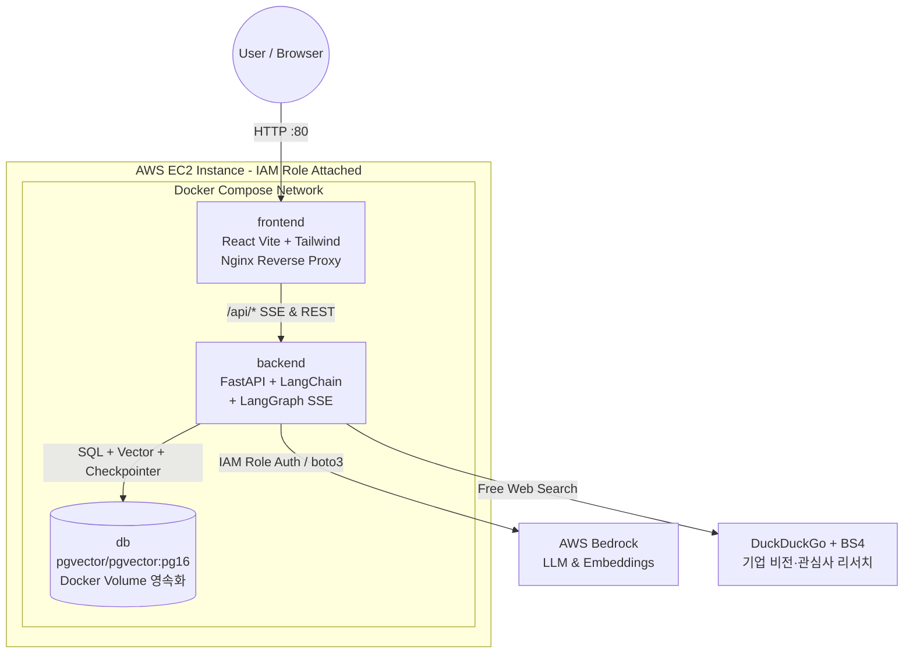
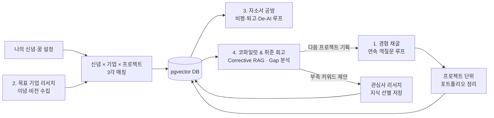

# 개인화 커리어·포트폴리오 AI 에이전트 (마스터 기획 & Docker 아키텍처)

## 1. 프로젝트 개요 및 문제 인식

### 1.1 문제 정의 (Problem)
* **수동적 기록 도구의 한계:** Notion, Google Docs 등은 기록을 보관하는 **수동적 저장소**에 불과합니다. 자소서를 쓰거나 새 프로젝트를 기획할 때마다 과거 기록을 직접 뒤지고 맥락을 재조립해야 합니다.
* **비용 및 커리어 특화 워크플로우 부재:** 기존 생산성 툴의 AI 기능은 유료 구독이 필요하며, **'내 경험(팩트) + 내 신념(가치관) + 목표 기업의 비전 + 취준 결과 회고'**를 하나로 엮어 능동적으로 동작하는 커리어 전용 에이전트는 없습니다.
* **경험 밀도 부족 & 천편일률적인 AI 자소서:** 대충 적어둔 메모는 정량 성과나 트러블슈팅 근거가 빠져 자소서에 바로 쓰기 어렵고, 일반 LLM으로 생성한 글은 특유의 상투적인 **'AI 티'**가 강해 설득력이 떨어집니다.

### 1.2 해결 방향 (Solution)
단순 챗봇을 넘어 **LangChain + LangGraph 기반의 순환형(Closed-Loop) 개인화 커리어 에이전트**를 구축합니다.
1. **능동적 경험 채굴:** 메모만 던지면 STAR 빈틈을 탐지해 끊임없이 역질문하고, 프로젝트 단위 포트폴리오로 자동 구조화.
2. **신념(Identity) × 기업 비전(Company) 결합:** 내가 지향하는 커리어 신념·이상(예: *AI 도입을 통한 산업 병목 해결*)과 목표 기업의 이념·사명·비전을 리서치해 내 프로젝트 경험과 3각 매칭.
3. **자가 비평·퇴고·De-AI:** 우수 자소서 구조를 참고해 초안을 쓴 뒤, 면접관 시점 비평·퇴고와 **AI 문체 제거(Humanizer)**까지 자동 수행하고 진행 단계를 실시간으로 시각화.
4. **취준 결과 회고 루프:** 서류·면접 결과를 기록하면 보유 포트폴리오 대비 격차(Gap)를 진단해 보완 액션 플랜과 신규 관심 분야를 제안.

---

## 2. 초경량 Docker + AWS 아키텍처

4일 완성 속도와 환경 일관성을 최우선으로 하여 **EC2 1대에 Docker Compose 3개 컨테이너만 올리는 자기완결형 구조**로 설계합니다. 기존 RDS/S3 연동 복잡도를 제거하고, AWS는 **EC2(도커 호스팅) + IAM Role + AWS Bedrock**에만 집중합니다.

### 2.1 컨테이너 및 기술 스택 전략
* **`frontend` (React + Vite + Tailwind + Nginx):**
  * 빌드된 정적 파일을 Nginx로 서빙하고 `/api/*` 요청을 `backend:8000`으로 리버스 프록시(SSE 스트리밍을 위해 `proxy_buffering off` 적용).
  * 4일 속도 유지를 위해 **로그인/인증 생략(1인 개인용)**, 전역 상태 라이브러리(Redux/Zustand) 없이 `useState` + `fetch`(SSE)만 사용.
* **`backend` (FastAPI + LangChain + LangGraph):**
  * **LLM & Embedding (AWS Bedrock 전용 / `langchain-aws`):**
    * **Fast Tier (라우팅·추출·채점):** `ChatBedrockConverse` (`amazon.nova-lite-v1:0` 또는 Claude Haiku 계열, `.env`로 교체 가능)
    * **Smart Tier (기업 매칭·비평·퇴고·De-AI):** `ChatBedrockConverse` (Claude Sonnet 계열 또는 `amazon.nova-pro-v1:0`)
    * **Embedding:** `BedrockEmbeddings` (`cohere.embed-multilingual-v3` 한국어 최적화 권장 또는 `amazon.titan-embed-text-v2:0`, 1024차원)
  * **인증:** EC2 IAM Role을 통해 AWS Access Key 하드코딩 없이 Bedrock 호출 (로컬 개발 시에만 `~/.aws` 또는 `.env` 프로파일 사용).
  * **외부 검색:** `duckduckgo-search` + `beautifulsoup4` 기반 무료 웹 검색 Tool.
* **`db` (`pgvector/pgvector:pg16`):**
  * 정형 테이블 + 벡터 임베딩 + LangGraph Checkpointer 상태를 단일 DB로 통합.
  * 컨테이너 재빌드 시 데이터 유실 방지를 위해 **Named Docker Volume(`pgdata:/var/lib/postgresql/data`)** 필수 마운트.

---

## 3. 데이터 모델 설계 (PostgreSQL + pgvector)

RAG 검색 시 데이터 섞임(환각)을 원천 차단하기 위해 벡터 테이블의 `doc_type` 메타데이터를 엄격히 분리합니다.

### 3.1 정형 테이블
1. **`user_profile` (나의 신념 & 포트폴리오 비전):** `id`, `career_vision` (궁극적 포트폴리오 목표/꿈), `core_beliefs` (업계 신념·철학), `target_roles` (희망 직무), `preferred_tone` (실제 문체/어휘 샘플), `updated_at`
2. **`user_interests` (관심 분야 키워드):** `id`, `keyword`, `source` (`manual` / `retrospective_suggested`), `created_at`
3. **`projects` (포트폴리오 단위 프로젝트 마스터):** `id`, `name`, `period`, `role`, `summary`, `tech_stack` (JSONB), `portfolio_goal_link` (궁극적 포트폴리오 방향성과의 연결점), `repo_url`, `created_at`
4. **`experiences` (STAR 상세 경험 기록):** `id`, `project_id` (FK → `projects.id`, nullable), `title`, `situation`, `task`, `action`, `result`, `quantified_metrics`, `completeness_score`, `raw_notes`, `created_at`
5. **`company_profiles` (목표 기업 리서치 & 신념 매칭):** `id`, `company_name`, `target_role`, `mission_vision`, `core_values`, `recent_trends`, `value_alignment_map` (내 신념·프로젝트와의 3각 연결 논리 JSONB), `created_at`
6. **`application_logs` (취준 결과 회고 & 보완 계획):** `id`, `company_name`, `role`, `stage` (서류/코테/면접), `status` (합격/불합격/진행중), `feedback_memo`, `gap_analysis`, `action_plan`, `created_at`

### 3.2 통합 벡터 테이블 (`vector_documents`)
* 컬럼: `id`, `doc_type`, `ref_id`, `content`, `metadata` (JSONB), `embedding` (`vector(1024)`), `created_at`
* **`doc_type` 5종 엄격 분리:**
  * `experience`: 프로젝트/STAR 실제 경험 팩트
  * `career_identity`: 나의 신념, 꿈, 궁극적 포트폴리오 철학
  * `company_research`: 리서치된 목표 기업 이념·비전·최근 이슈
  * `interest_clip`: 관심 분야로 리서치 후 선별 저장한 최신 기술/뉴스 요약
  * `jasoseo_sample`: 직무/문항 유형별 우수 자소서 레퍼런스 (초기 15~20건 시드 데이터, *전개 구조·논리 참고 전용*)

---

## 4. 핵심 LangGraph 워크플로우 (4대 에이전트)

### 워크플로우 ①: 경험 빈틈 탐지 & 역질문 루프 (`Active Interviewer`)
* **흐름:** `Extractor(STAR 추출)` → `Gap Grader(완성도·정량 지표·기여도 평가)` → **조건부 분기**
  * 빈틈 존재 시 → `Interviewer`가 핵심 질문 1~2개 역질문 (`Human-in-the-loop`, 유저 답변을 `thread_id` 상태에 누적해 반복 고도화)
  * 완성도 충족 또는 유저가 **`[이 상태로 저장하기]`** 클릭 → `projects`에 매핑해 DB + `experience` 벡터 저장.
* **포트폴리오 리캡:** 프로젝트에 묶인 여러 `experiences`와 `user_profile`을 종합해 포트폴리오 Markdown 문서 자동 생성.

### 워크플로우 ②: 목표 기업 리서치 & 신념 결합 (`Company-Identity Matcher`)
* **흐름:** `Company Searcher`(DuckDuckGo로 이념/사명/비전/최근 이슈 수집) → `Identity & Portfolio Loader`(내 신념·프로젝트 로드) → `Alignment Synthesizer`(**[기업 비전/병목 ↔ 나의 신념 ↔ 증명 프로젝트]** 3각 매칭표 생성) → DB & `company_research` 벡터 저장.

### 워크플로우 ③: 자소서 생성 · 비평 · 퇴고 · AI 티 제거 루프 (`Critic-Refiner-Humanizer`)
* **흐름:**
  1. `Multi-Source Retriever`: `experience` + `career_identity` + `company_research` + `jasoseo_sample` 분리 검색.
  2. `Drafter`: 팩트·신념·기업 비전을 결합하고 `jasoseo_sample`의 전개 구조만 참고해 1차 초안 작성.
  3. `Critic`: 면접관 관점으로 문항 적합성, 기업 연결의 자연스러움, 정량 근거를 엄격 채점.
  4. **조건부 루프 (최대 2회):** 기준 미달 시 `Refiner`가 피드백 반영 후 재평가.
  5. `De-AI Humanizer`: LLM 상투어/번역투 제거 + 추상적 수식어를 유저 실제 행동 동사·문체(`preferred_tone`)로 치환 → 최종본 + **단계별 변경 요약(Diff Report)** 반환.

### 워크플로우 ④: 프로젝트 코파일럿 & 취준 회고 플래너 (`Router + Corrective RAG`)
* **모드 A (신규 프로젝트 코파일럿):** `experience`(과거 구현/트러블슈팅) + `interest_clip`(모아둔 관심 기술) 검색 → `Relevance Grader`가 충분성 평가 → 부족 시 쿼리 재작성 후 웹 검색(`Corrective RAG`)으로 보완 답변.
* **모드 B (취준 결과 회고 & 보완 플래너):** 지원 결과·피드백 입력 → 보유 프로젝트/경험 및 과거 회고와 대조해 **Gap 분석** → 단기(자소서/포폴 보강) & 중기(신규 프로젝트/학습) 액션 플랜 도출 + 부족 기술 키워드를 **`user_interests`에 원클릭 추가**.

---

## 5. React 프론트엔드 화면 구성 (5개 뷰)

좌측 **고정 사이드바**(나의 커리어 신념 요약, 프로젝트·경험 카운트, 관심 분야 태그 관리) + 우측 **5개 메뉴**로 단순하게 구성합니다.

| 메뉴 | 핵심 UI 요소 | 백엔드 연동 방식 |
| :--- | :--- | :--- |
| **1. 신념 & 포트폴리오** | 신념·비전·선호 문체 편집 폼, 프로젝트 카드 목록, 원클릭 포트폴리오 리캡 모달 | REST CRUD + 요약 API |
| **2. 경험 채굴** | 메모 입력, 실시간 STAR 완성도 게이지, 연속 역질문 채팅창, `[이 상태로 저장하기]` 버튼 | SSE 스트리밍 + `thread_id` 재개 |
| **3. 기업 & 관심사** | (상단) 기업명/직무 입력 → 이념·신념 3각 매칭 카드 / (하단) 관심 키워드 뉴스 검색 & 선별 저장 | SSE(진행 상태) + REST 저장 |
| **4. 자소서 공방** | 기업 선택 + 문항/글자 수 입력 → **실시간 LangGraph 단계 표시기**(검색→초안→비평→퇴고→De-AI) + 최종본·변경 리포트 | SSE 스트리밍 |
| **5. 코파일럿 & 회고** | 과거 경험 기반 프로젝트 Q&A 채팅 + 지원 결과 입력 폼 & 보완 액션 플랜·관심사 추가 버튼 | SSE 스트리밍 + REST |

---

## 6. 4일 집중 스프린트 로드맵

| 일정 | 핵심 목표 | 세부 산출물 및 검증 기준 |
| :--- | :--- | :--- |
| **Day 1** | **Docker 기반 & Backend 코어** | `docker-compose.yml`(`frontend`/`backend`/`db`) 세팅, `pgvector` 스키마 및 영속 볼륨 확인, Bedrock LLM/Embedding 호출 검증, `jasoseo_sample` 시드(15건), 프로필·프로젝트·관심사 CRUD API 완성 |
| **Day 2** | **핵심 LangGraph 에이전트 ①~③** | **① 경험 역질문 루프**(Checkpointer + Human-in-the-loop), **② 기업 리서치 & 신념 3각 매칭**, **③ 자소서 비평·퇴고·De-AI 루프** 구현 및 FastAPI SSE 엔드포인트 테스트 |
| **Day 3** | **에이전트 ④ & React UI 연동** | **④ 프로젝트 코파일럿(Corrective RAG) + 취준 회고 플래너** 완성, React(Vite+Tailwind) 5개 뷰 및 실시간 SSE 단계 표시기 연동 |
| **Day 4** | **통합 튜닝 & EC2 도커 배포** | 프롬프트/De-AI 품질 튜닝, 전체 순환 시나리오 E2E 테스트, EC2에서 `docker compose up -d --build` 실행 및 IAM Role·볼륨 영속성 최종 검증 |